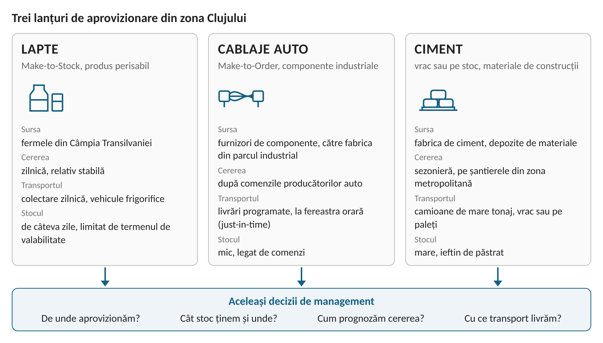
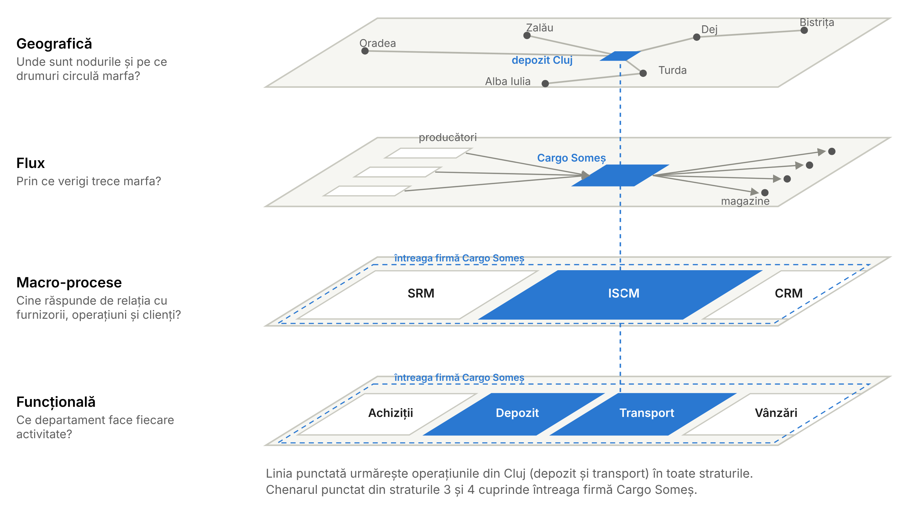
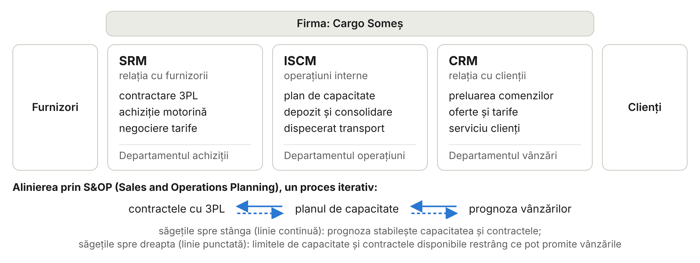

::: {.callout-note appearance="minimal"}
Această pagină însoțește Capitolul 1 al cărții: rezumă întrebările, termenii și aplicațiile, dar nu înlocuiește textul. Textul integral, soluțiile și bibliografia se găsesc în [carte](../carte.qmd).
:::

## Întrebarea capitolului

Laptele de la fermele din Câmpia Transilvaniei, cablajele auto dintr-un parc industrial de lângă Cluj și cimentul pentru un șantier din zona metropolitană sunt produse fără nimic în comun. Fiecare ajunge însă la client printr-un lanț de firme, de la materia primă până la clientul final, iar managerii acestor firme se confruntă cu aceleași tipuri de decizii. **Care sunt aceste decizii?**

Capitolul pornește de la această întrebare și ajunge la alte trei: ce este un lanț de aprovizionare, cum îl putem descrie și de ce este dificil de gestionat. Nu conține calcule; în [Capitolul 2](cap02.qmd) aceleași decizii primesc cifre.

### Pe scurt: ce este un lanț de aprovizionare?

Un **lanț de aprovizionare** (*supply chain*) este ansamblul de firme, locații și activități prin care un produs sau un serviciu ajunge de la furnizorul de materie primă până la clientul final: aprovizionare, producție, stocare, transport, distribuție și retururi. Între fiecare două verigi circulă trei fluxuri:

- **fizic**: marfa „coboară” spre client (în aval);
- **informațional**: comenzile „urcă” spre furnizor (în amonte), iar prognozele și starea livrărilor circulă în ambele sensuri;
- **financiar**: banii „urcă” spre furnizor.

Acesta este fluxul direct. În fluxul invers (retururi, ambalaje reutilizabile, rambursări), sensurile se inversează.

**Managementul lanțului de aprovizionare** (SCM, *Supply Chain Management*) coordonează aceste fluxuri între parteneri, cu un singur scop: deservirea clientului final. Logistica, adică transportul, depozitarea și manipularea mărfii, este o parte a lui.

{fig-alt="Trei lanțuri de aprovizionare din zona Clujului, pentru lapte, cablaje auto și ciment, și deciziile de management comune lor"}

Înainte de a parcurge capitolul, încercați să răspundeți la trei întrebări:

1. Cine plătește, de fapt, pentru tot lanțul? Plățile dintre firme aduc bani noi în lanț sau doar îi împart?

    

Indiciu

    Urmăriți banii până la capătul din aval al lanțului: singurul venit care intră din afară vine de la clientul final. Comparați apoi cât valorează produsul pentru acest client, adică prețul maxim pe care ar fi dispus să-l plătească, cu costul total al lanțului. Capitolul numește această diferență *surplusul lanțului* și arată cum se împarte el între client și firmele din lanț.
    

2. Vânzările unei mărci de apă minerală într-un supermarket sunt aproape aceleași de la o săptămână la alta. De ce ar putea comenzile primite de îmbuteliator să varieze de câteva ori mai mult?

    

Indiciu

    Gândiți-vă la ce vede fiecare verigă: magazinul vede clienții, dar distribuitorul vede doar comenzile magazinului, grupate în paleți și camioane întregi. Căutați în capitol *efectul de bici*.
    

3. Ce se întâmplă cu o decizie atunci când managerul primește dreptul de a controla și ceea ce era până atunci o constrângere?

    

Indiciu

    Gândiți-vă în ce categorie a modelului de decizie trece ceea ce până atunci era o limită fixă. Ce câștigă managerul din această libertate și ce cost apare odată cu ea (secțiunea 2.4 din carte)?
    

## Obiective și termeni-cheie

La finalul capitolului veți putea descrie un lanț de aprovizionare real prin fluxurile, verigile și procesele sale și veți recunoaște deciziile logistice din fiecare verigă. Concret, veți putea:

- să definiți lanțul de aprovizionare și cele trei fluxuri ale sale: fizic, informațional și financiar;
- să deosebiți logistica de managementul lanțului de aprovizionare;
- să comparați perspectivele de analiză a lanțului: geografică, diagramă de flux, cicluri de proces, macro-proces, SCOR, funcțională și sistemică;
- să încadrați activitățile unei firme în procesele SCOR DS și în macro-procesele SRM, ISCM și CRM;
- să explicați de ce lanțul trebuie să absoarbă șocurile externe de cost, cum sunt prețul motorinei, taxa de drum și cursul valutar;
- să explicați efectul de bici și diferența dintre robustețe, flexibilitate și reziliență;
- să formulați, pentru o decizie logistică, obiectivul, variabilele de decizie și constrângerile și să explicați cum se schimbă acestea când se lărgește aria de control.

| Termen | În engleză |
| --- | --- |
| lanț de aprovizionare | *supply chain* |
| SCM, managementul lanțului de aprovizionare | *Supply Chain Management* |
| niveluri de furnizori | *tiers* |
| amonte / aval | *upstream / downstream* |
| surplusul lanțului | *supply chain surplus* |
| efectul de bici | *bullwhip effect* |
| punct de decuplare | *decoupling point*, *push–pull boundary* |
| SCOR DS, modelul de referință al operațiunilor din lanțul de aprovizionare | *SCOR Digital Standard* (*Supply Chain Operations Reference*) |
| SRM, relația cu furnizorii | *Supplier Relationship Management* |
| ISCM, operațiunile interne | *Internal Supply Chain Management* |
| CRM, relația cu clienții | *Customer Relationship Management* |
| S&OP, planificarea vânzărilor și a operațiunilor | *Sales and Operations Planning* |
| 3PL, logistică terță (operator logistic terț) | *third-party logistics (provider)* |
| OTIF, livrat la timp și complet | *On-Time In-Full* |
| compromis | *trade-off* |
| robustețe, flexibilitate, reziliență | *robustness, flexibility, resilience* |

## Studiul de caz: Cargo Someș

Capitolul introduce firma care însoțește toată cartea: **Cargo Someș**, un operator logistic fictiv din Cluj. Păstrează în depozitul din zona Cluj-Napoca mărfurile mai multor producători și le livrează pe europaleți magazinelor din Transilvania, cu o flotă proprie de 5 camioane de 40 t (Euro VI, 33 de europaleți fiecare).

Două convenții sunt importante pentru tot restul cărții:

- **Producătorii sunt clienții firmei.** Marfa rămâne proprietatea lor, iar ei plătesc tariful pe palet. Pe fluxul fizic, producătorii sunt în amonte și magazinele în aval; în relațiile comerciale, producătorii țin de CRM, iar furnizorii de motorină și de paleți, alături de transportatorii subcontractați, țin de SRM.
- **Ce înseamnă „3PL” în carte.** Cargo Someș este el însuși un operator logistic terț pentru producători. În carte, prin 3PL se înțelege transportatorul terț căruia Cargo Someș îi subcontractează curse.

{fig-alt="Rețeaua Cargo Someș în patru perspective suprapuse: geografică, de flux, macro-procese și funcțională"}

Observați în figură că producătorii apar în stânga, pe fluxul fizic, deși în relațiile comerciale sunt clienții firmei. De ce nu se contrazic cele două poziții?

{fig-alt="Macro-procesele la Cargo Someș: SRM (relația cu furnizorii), ISCM (operațiunile interne) și CRM (relația cu clienții), aliniate prin S&OP"}

Studiul de caz urmează patru pași: cele trei fluxuri, verigile lanțului, procesele SCOR DS și macro-procesele și decizia „flotă proprie sau transportator terț”. Ultimul pas lasă deschisă întrebarea la care răspunde Capitolul 2: **de la ce distanță devine utilizarea flotei proprii mai avantajoasă decât apelarea la un transportator terț (3PL)?**

## Lanțul ca „amortizor”

Lanțul de aprovizionare preia șocurile externe astfel încât firma să funcționeze în continuare. Capitolul folosește trei repere de cost din toamna anului 2026, valabile în toată cartea: prețul motorinei, taxa de drum pe kilometru TollRo și cursul leu–euro. Ce ar trebui să schimbe un transportator din Cluj dacă motorina s-ar scumpi cu un leu pe litru? Dar dacă depozitul din Cluj ar deveni brusc indisponibil? Răspunsurile fac diferența dintre un lanț robust, unul flexibil și unul rezilient.

## Verificați-vă

În ce macro-proces încadrați fiecare activitate a firmei Cargo Someș? (răspunsurile se deschid la clic)

| Activitate | Macro-proces |
| --- | --- |
| Cumpărarea anvelopelor de iarnă pentru flotă | SRM: furnizorul vinde direct firmei |
| Planificarea turelor de încărcare în depozit | ISCM: operațiune internă |
| Oferta de tarif pe palet pentru un producător nou | CRM: producătorul este client |
| Reclamația unui producător privind un palet deteriorat | CRM: relația cu clientul |
| Recepția la rampă a paleților sosiți de la un producător | ISCM: operațiune internă de depozit, deși producătorul este client (CRM) |

Exercițiul de încadrare din carte (Pasul 3 al studiului de caz, Tabelul 1.9) are soluția în Anexa B.

## Registrul Excel

Capitolul 1 nu are registru Excel, pentru că este descriptiv. Primul registru, **MLTM_C02_functii_Excel.xlsx**, însoțește [Capitolul 2](cap02.qmd).

## Prezentare

*În pregătire.*

## Temă de seminar: lanțul firmei în care lucrați

Alegeți firma în care lucrați sau o firmă pe care o cunoașteți bine. Pe cel mult două pagini, plus o schiță:

1. Alegeți un produs sau un serviciu al firmei.
2. Desenați lanțul ca rețea: verigile (actorii), de la furnizorii de nivel 2 până la clientul final, cu nodurile lor (locațiile) și arcele de transport dintre ele; marcați sensul amonte–aval.
3. Pentru o singură legătură dintre două verigi, descrieți cele trei fluxuri: ce informație, ce material și ce plată circulă, și cât durează fiecare.
4. Încadrați cinci activități ale firmei în procesele SCOR DS și în macro-procesele SRM, ISCM și CRM.
5. Alegeți o decizie logistică reală și formulați obiectivul, variabilele de decizie și constrângerile. Ce constrângere ar deveni variabilă dacă s-ar lărgi aria de control?

Schița se poate face gratuit în [draw.io (diagrams.net)](https://app.diagrams.net/). Nu folosiți date sensibile ale firmei: puteți schimba numele partenerilor și rotunji cifrele. Criteriile de evaluare sunt în Anexa B a cărții.

## Exerciții suplimentare

Capitolul se încheie cu opt întrebări grilă și o întrebare deschisă despre taxa de drum TollRo; răspunsurile sunt în carte, în secțiunea 4.4 și în Anexa B.

*Exercițiile suplimentare pentru Partea I vor fi publicate în curând.*

## Lecturi suplimentare

1. C. Caplice and E. Ponce, *MITx MicroMasters Program in SCM Key Concepts*, Version 20 Sep. 2026. Cambridge, MA, USA: MIT Center for Transportation & Logistics, 2026.
2. S. Chopra, P. Meindl, and D. V. Kalra, *Supply Chain Management: Strategy, Planning, and Operation*, 6th ed. Noida, India: Pearson India Education Services, 2016.
3. S. Chopra, *Supply Chain Management: Strategy, Planning, and Operation*, 7th ed. (Global ed.). Harlow, U.K.: Pearson, 2019. Ediție mai nouă decât cea folosită în carte; disponibilă la Biblioteca Centrală Universitară „Lucian Blaga” din Cluj-Napoca (BCU Cluj), inclusiv online, cu permis de bibliotecă.
4. ASCM, "SCOR Digital Standard," Association for Supply Chain Management. [Online]. Available: <https://www.ascm.org/>. [Accessed: Nov. 26, 2026].

Lista completă a surselor capitolului se găsește în Bibliografia cărții.
