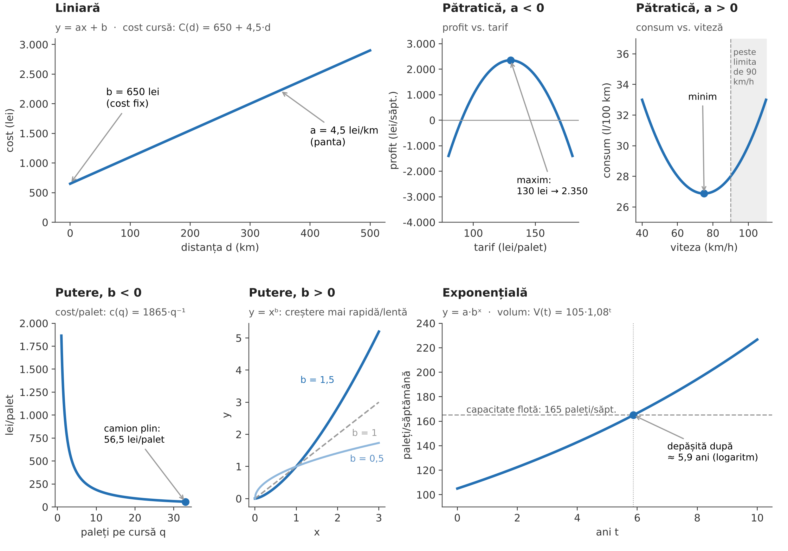
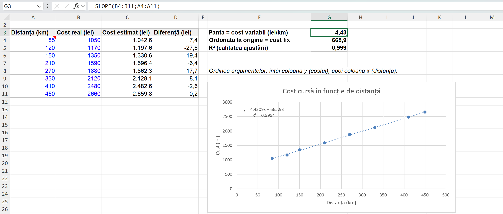

::: {.callout-note appearance="minimal"}
Această pagină însoțește Capitolul 2 al cărții: rezumă întrebările, termenii și aplicațiile, dar nu înlocuiește textul. Textul integral, soluțiile și bibliografia se găsesc în [carte](../carte.qmd).
:::

## Întrebarea capitolului

Dispecerul firmei Cargo Someș știe din Capitolul 1 *ce* are de decis: ce curse face cu camioanele proprii și ce curse dă unui transportator terț. **Cum transformăm această decizie într-un model pe care îl putem calcula?**

Capitolul răspunde în două trepte: întâi clasifică modelele analitice, apoi construiește în Excel funcțiile de cost și de profit cu care se iau deciziile din studiul de caz.

Înainte de a parcurge capitolul, încercați să răspundeți la trei întrebări:

1. O cursă proprie costă o sumă fixă plus o sumă pe kilometru; transportatorul terț cere doar o sumă pe kilometru, dar mai mare. Există o distanță de la care una dintre variante devine mereu mai ieftină?

    

Indiciu

    Scrieți cele două costuri ca drepte în funcție de distanță și căutați punctul în care se intersectează: *pragul de indiferență*.
    

2. Dacă tariful pe palet crește, crește și profitul? Până unde?

    

Indiciu

    Un tarif mai mare aduce mai mulți bani pe palet, dar mai puțini paleți. Profitul devine o funcție pătratică de tarif, cu un maxim.
    

3. O simulare a rețelei de livrări ne spune care este cea mai bună rută?

    

Indiciu

    Comparați modelele care *evaluează* o soluție dată cu cele care *generează* (recomandă) una (secțiunea 2.3 din carte).
    

### Pe scurt: ce este un model analitic?

Un **model analitic** este o reprezentare simplificată a unei decizii, care păstrează doar ce contează pentru ea: datele de intrare, relațiile dintre ele și rezultatul urmărit. Capitolul le clasifică în trei feluri:

- după **gradul de abstractizare**, de la machete și prototipuri la modele matematice;
- după **rol**: modelul *evaluează* o strategie dată sau *generează* una, în condiții de certitudine sau de incertitudine;
- după **întrebarea la care răspunde**: *descriptiv* (ce s-a întâmplat?), *predictiv* (ce se va întâmpla?) sau *prescriptiv* (ce ar trebui să facem?).

Cartea adoptă atitudinea „șofer, nu mecanic”: un profesionist în logistică trebuie să știe ce date cere un model, ce rezultat dă și unde se oprește, fără să-i demonstreze teoremele.

{fig-alt="Șase forme de funcții, liniară, de putere, pătratică, exponențială, logaritmică și multivariată, fiecare cu un exemplu din transportul de marfă"}

## Obiective și termeni-cheie

La finalul capitolului veți alege tipul de model potrivit unei decizii logistice și veți transforma decizia într-o funcție calculată în Excel. Concret, veți putea:

- să clasificați modelele după gradul de abstractizare și după rolul lor;
- să distingeți modelele descriptive, predictive și prescriptive și tehnicile din fiecare categorie;
- să recunoașteți formele de funcții din logistică: liniară, pătratică, de putere, exponențială, logaritmică și multivariată;
- să construiți în Excel funcții de cost și de profit pentru o firmă de transport;
- să calculați un prag de indiferență, un tarif care maximizează profitul și timpul până la atingerea unui prag de capacitate;
- să verificați calitatea unui set de date înainte de a estima un model.

| Termen | În engleză |
| --- | --- |
| model descriptiv / predictiv / prescriptiv | *descriptive / predictive / prescriptive model* |
| prag de indiferență | *break-even point* |
| funcție de putere | *power function* |
| funcție convexă / concavă | *convex / concave function* |
| cost fix / cost variabil | *fixed cost / variable cost* |
| 3PL, operator logistic terț | *third-party logistics* |
| „dacă intră date greșite, ies rezultate greșite” | *garbage in, garbage out* |

## Studiul de caz: distribuție din Cluj

Studiul de caz pune cifre pe deciziile firmei Cargo Someș din Capitolul 1. Fiecare pas folosește altă formă de funcție:

| Pas | Întrebarea managerului | Funcția |
| --- | --- | --- |
| 2 | Flotă proprie sau transportator terț? | liniară |
| 3 | Cât costă un palet, în funcție de cât de plin e camionul? | de putere |
| 4 | Ce tarif pe palet maximizează profitul pe grupajul Cluj–Brașov? | pătratică |
| 5 | Când nu mai ajung cele 5 camioane proprii? | exponențială și logaritm |
| 6 | Cât costă aprovizionarea depozitului cu marfa unui client? | cu mai multe variabile |
| 7 | Cum scriem decizia cu obiectiv, variabile și constrângeri? | problemă de decizie |

Prețurile de piață sunt cele reale din septembrie 2026, iar firma și volumele sunt fictive. Rezultatele: flota proprie se justifică pe curse mai lungi de 250 km, camioanele trebuie umplute, iar pe grupajul Cluj–Brașov tariful optim este de circa 130 lei/palet.

{fig-alt="Foaia 2_Estimare din date: costul a opt curse în funcție de distanță, cu dreapta estimată și funcțiile SLOPE, INTERCEPT și RSQ"}

Pasul 7 scrie decizia ca problemă de optimizare: costul total minim, cu numărul de curse proprii și 3PL ca variabile și cu capacitatea camioanelor ca restricție. Aceeași problemă se rezolvă cu Solver în [Capitolul 10](cap10.qmd).

## Verificați-vă

O cursă proprie costă 650 lei + 4,5 lei/km, una cu 3PL costă 7,1 lei/km. Care variantă e mai ieftină la 300 km și cu cât? (răspunsul se deschide la clic)

Flota proprie: 650 + 4,5 · 300 = 2.000 lei. Transportatorul terț: 7,1 · 300 = 2.130 lei. Flota proprie e mai ieftină cu 130 lei. Pragul de indiferență este la 650 / (7,1 – 4,5) = 250 km: sub el câștigă 3PL, peste el flota proprie.

## Registrul Excel

**MLTM_C02_functii_Excel.xlsx**. Registrul folosește setări românești: argumentele se separă cu „;”, zecimalele cu „,”, iar datele de intrare stau în celule galbene, cu text albastru.

| Foaia | Ce conține |
| --- | --- |
| 1_Cost cursa | Costul unei curse: parametrii și formula cu referințe absolute |
| 2_Estimare din date | Estimarea costului din opt curse cu SLOPE, INTERCEPT și RSQ |
| 2b_Date de verificat | Evidența de verificat din Exercițiul 4 |
| 4_Profit | Tariful care maximizează profitul pe grupajul Cluj–Brașov |
| 5_Capacitate | Momentul în care volumul depășește capacitatea flotei, cu Căutare rezultat (*Goal Seek*) |

*Linkul DOI spre Pachetul Excel (Zenodo) va fi adăugat aici.*

## Prezentare

*În pregătire.*

## Temă de laborator: pragul vostru de indiferență

Alegeți o rută reală pe care o cunoașteți (de exemplu, de la firma în care lucrați sau dintre orașele din Transilvania) și refaceți Pasul 2 cu cifre proprii:

1. Estimați costul fix și costul pe kilometru al unei curse proprii; notați sursa fiecărei cifre.
2. Cereți sau estimați tariful pe kilometru al unui transportator terț.
3. Construiți în Excel cele două funcții și graficul lor; calculați pragul de indiferență.
4. Cum se mută pragul dacă motorina se scumpește cu 10%? Și dacă taxa de drum pe kilometru se dublează?
5. Scrieți în cinci rânduri recomandarea pentru dispecer.

Păstrați datele de intrare în celule separate, nu în formule, ca să puteți schimba ipotezele ușor.

## Exerciții suplimentare

Capitolul se încheie cu șase întrebări grilă, o întrebare deschisă și cinci exerciții în Excel (între ele, rutier sau intermodal pe ruta Constanța–Cluj); răspunsurile sunt în carte, în secțiunea 5.4 și în Anexa B. Alte opt exerciții, care combină Capitolele 2 și 3, sunt în [Problemele recapitulative I](pr1.qmd).

## Lecturi suplimentare

1. C. Caplice and E. Ponce, *MITx MicroMasters Program in SCM Key Concepts*, Version 20 Sep. 2026. Cambridge, MA, USA: MIT Center for Transportation & Logistics, 2026.
2. S. Chopra, P. Meindl, and D. V. Kalra, *Supply Chain Management: Strategy, Planning, and Operation*, 6th ed. Noida, India: Pearson India Education Services, 2016.

Lista completă a surselor capitolului se găsește în Bibliografia cărții.
