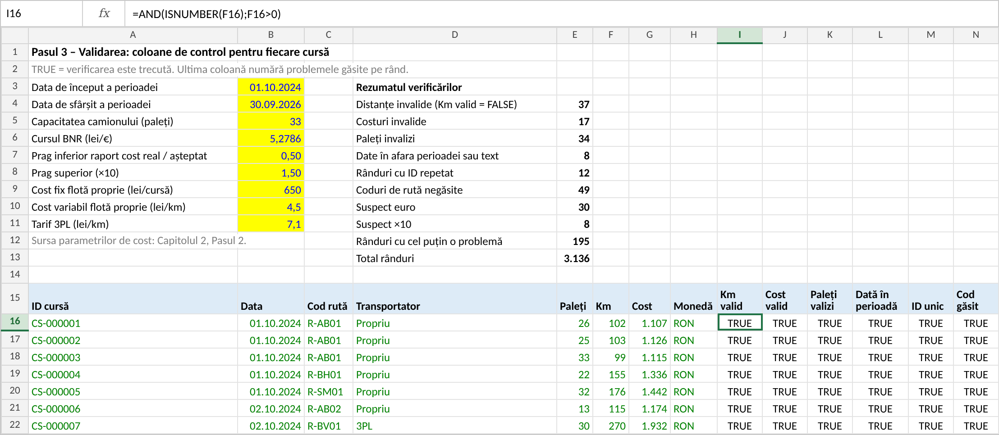
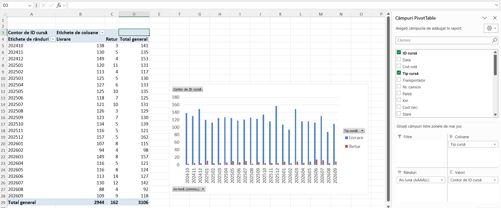

::: {.callout-note appearance="minimal"}
Această pagină însoțește Capitolul 3 al cărții: rezumă întrebările, termenii și aplicațiile, dar nu înlocuiește textul. Textul integral, soluțiile și bibliografia se găsesc în [carte](../carte.qmd).
:::

## Întrebarea capitolului

În Capitolul 2, costul unei curse proprii a fost estimat din opt curse istorice. Managerul firmei Cargo Someș are acum evidența a circa 3.000 de curse pe doi ani, exportată din dispecerat. **Ne putem baza pe aceste date înainte să luăm decizii cu ele?**

Înainte de a parcurge capitolul, încercați să răspundeți la trei întrebări:

1. Media distanțelor dintr-o evidență de curse iese 312 km, dar mediana este 180 km. Ce v-ar face să bănuiți?

    

Indiciu

    O medie mult peste mediană arată câteva valori foarte mari. Sunt curse reale, lungi, sau erori de introducere? Statisticile descriptive funcționează ca un *sistem de alarmă*.
    

2. Ați găsit o cursă cu distanța negativă. O ștergeți?

    

Indiciu

    Ștergerea pierde informație. Capitolul propune trei decizii posibile pentru fiecare tip de eroare și cere ca fiecare decizie să fie scrisă într-un jurnal.
    

3. Când nu mai ajunge Excel?

    

Indiciu

    Gândiți-vă la numărul de rânduri, la câți oameni modifică datele în același timp și la cât de des se repetă aceeași analiză (secțiunea 2.7 din carte).
    

### Pe scurt: ce înseamnă gestiunea datelor?

**Gestiunea datelor** (*data management*) cuprinde tot ce facem ca datele să fie corecte, complete și ușor de interogat. Dacă datele sunt greșite, și rezultatul este greșit, oricât de bun ar fi modelul. Capitolul urmează un traseu în patru etape:

- **verificăm**: statisticile descriptive (mediana, cuartilele, abaterea standard, coeficientul de variație) arată unde e ceva în neregulă;
- **validăm**: coloane de control marchează fiecare valoare invalidă, dublură sau cod negăsit;
- **curățăm**: pentru fiecare problemă decidem dacă excludem înregistrarea, o corectăm sau o marcăm și o păstrăm, iar decizia intră într-un jurnal; datele originale rămân neatinse;
- **interogăm**: tabelele pivot și corelația răspund la întrebările managerului.

## Obiective și termeni-cheie

La finalul capitolului veți verifica un set de date de transport înainte să-l folosiți, îl veți curăța fără să pierdeți informație și veți răspunde cu el la întrebările unui manager. Concret, veți putea:

- să explicați cei 4V ai datelor (volum, viteză, varietate, veracitate) cu exemple din transportul rutier din România;
- să distingeți datele de referință de cele tranzacționale și să le legați printr-o cheie;
- să interpretați statisticile descriptive ca semnale de alarmă;
- să construiți în Excel coloane de control și un jurnal al problemelor;
- să adăugați coloane calculate (ziua săptămânii, săptămâna ISO, luna);
- să răspundeți la întrebări de management cu tabele pivot și să calculați o corelație;
- să recunoașteți limitele foii de calcul.

| Termen | În engleză |
| --- | --- |
| gestiunea datelor | *data management* |
| curățarea datelor | *data cleaning* |
| date de referință / date tranzacționale | *master data / transactional data* |
| coeficient de variație (CV) | *coefficient of variation* |
| cuartile | *quartiles* |
| tabel pivot | *PivotTable* |
| cei 4V: volum, viteză, varietate, veracitate | *volume, velocity, variety, veracity* |

## Studiul de caz: evidența curselor Cargo Someș

Registrul conține fișa celor 24 de rute ale firmei și evidența brută a curselor din ultimii doi ani, cu erori reale: distanțe negative, costuri trecute în euro, dubluri și coduri de rută greșite. Studiul de caz are opt pași, de la prima verificare până la cinci întrebări ale managerului, la care răspund tabelele pivot.

{fig-alt="Foaia 3_Validare din registrul capitolului: celulele galbene cu parametrii verificărilor, rezumatul erorilor și coloanele de control TRUE/FALSE pentru fiecare cursă"}

Ultimul pas se întoarce la Capitolul 2: panta de 4,43 lei/km, estimată din opt curse, rezistă pe cele 2.401 curse proprii curate? Răspunsul îl găsiți în Pasul 8.

{fig-alt="Tabel pivot cu numărul de curse pe lună, pe tipuri de cursă, și diagrama pivot asociată"}

## Verificați-vă

Ce decizie ați lua pentru fiecare problemă: excludem, corectăm sau marcăm și păstrăm? (răspunsurile se deschid la clic)

| Problema | Decizia posibilă |
| --- | --- |
| Aceeași cursă apare de două ori, cu același cod și aceeași dată | Excludem dublura și păstrăm o singură înregistrare |
| Un cost trecut în euro, într-o coloană în lei | Corectăm: convertim cu cursul zilei și notăm corecția |
| O cursă de 640 km, rară, dar posibilă pe ruta respectivă | Marcăm și păstrăm: e o valoare extremă, nu o eroare |
| Un cod de rută care nu există în fișa rutelor | Verificăm cu furnizorul datelor; până atunci, marcăm |

Decizia corectă depinde de context, așa că în carte fiecare rând din jurnal spune și *cine* a confirmat-o.

## Registrul Excel

**MLTM_C03_gestiunea_datelor.xlsx**. Registrul folosește setări românești: argumentele se separă cu „;”, zecimalele cu „,”.

| Foaia | Ce conține |
| --- | --- |
| 0_Citiți-mă | Cum se folosește registrul |
| 1_Rute, 1_Curse_brute | Fișa rutelor (date de referință) și evidența brută a curselor |
| 2_Prima_verificare | Statisticile descriptive pe datele brute |
| 3_Validare | Coloanele de control pentru fiecare cursă |
| 4_Jurnal | Jurnalul problemelor și al deciziilor |
| 5_Curse_curate, 5_Inainte_dupa | Setul curat, cu coloane calculate, și comparația înainte–după |
| 7_Pivot | Rezultatele de control pentru tabelele pivot |
| 8_Corelatie | Corelația și modelul de cost pe datele curate |
| Ex_Facturi_3PL | Facturile transportatorului terț, pentru exerciții |

Păstrați registrul: setul curat se folosește din nou în [Capitolul 4](cap04.qmd).

*Linkul DOI spre Pachetul Excel (Zenodo) va fi adăugat aici.*

## Prezentare

*În pregătire.*

## Temă de laborator: auditul unui set de date

Alegeți un set de date real cu cel puțin 200 de rânduri (evidența unei firme, cu datele sensibile anonimizate, sau un set public) și aplicați traseul din capitol:

1. Descrieți coloanele: care sunt date de referință și care tranzacționale? Care este cheia care le leagă?
2. Calculați statisticile descriptive pentru fiecare coloană numerică. Ce semnale de alarmă vedeți?
3. Construiți cel puțin patru coloane de control și numărați problemele cu formule, nu manual.
4. Țineți un jurnal: problema, câte înregistrări, decizia și motivul ei.
5. Pe setul curat, răspundeți la două întrebări de management cu un tabel pivot.

Lucrați întotdeauna pe o copie; datele originale nu se modifică.

## Exerciții suplimentare

Capitolul se încheie cu opt întrebări grilă, o întrebare deschisă și șase exerciții, pe facturile transportatorului terț; răspunsurile sunt în carte, în secțiunea 5.4 și în Anexa B. Exercițiile B5 și B8 din [Problemele recapitulative I](pr1.qmd) reiau verificarea datelor.

## Lecturi suplimentare

1. C. Caplice and E. Ponce, *MITx MicroMasters Program in SCM Key Concepts*, Version 20 Sep. 2026. Cambridge, MA, USA: MIT Center for Transportation & Logistics, 2026.

Lista completă a surselor capitolului se găsește în Bibliografia cărții.
