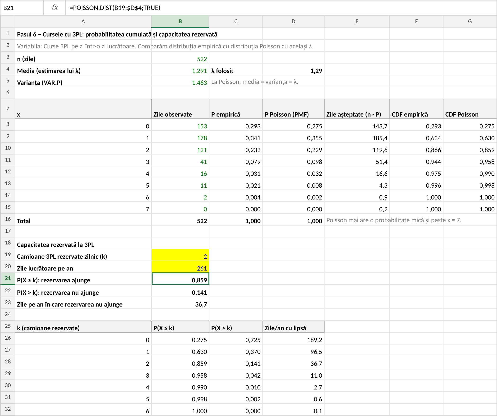
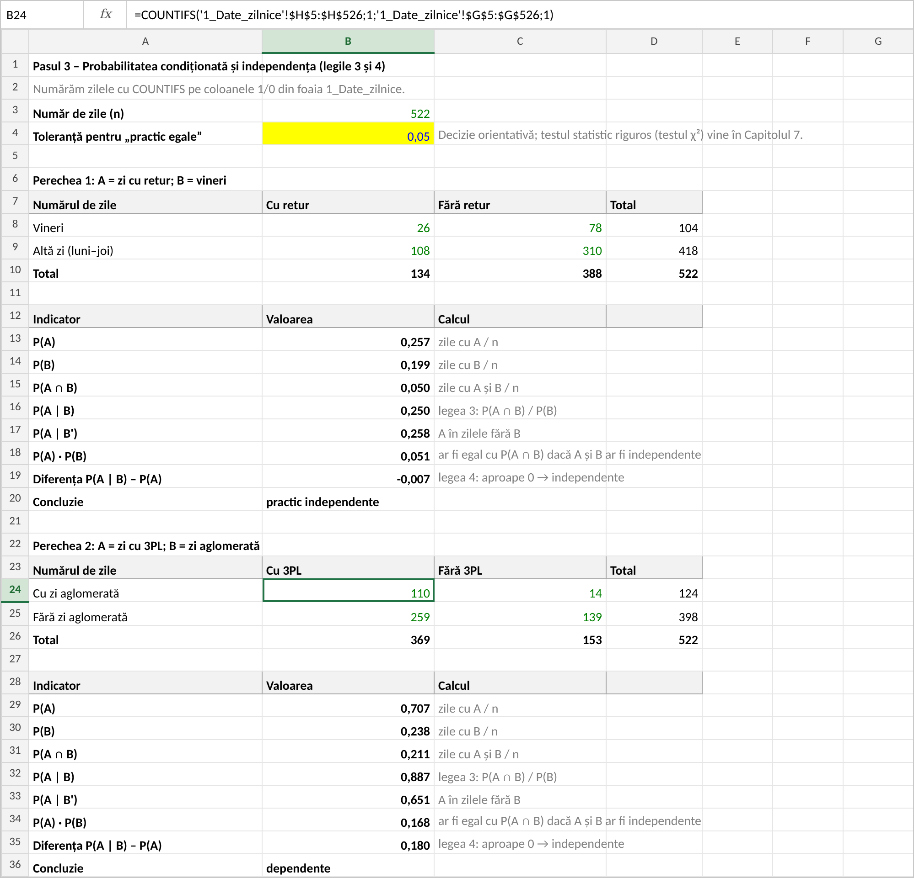

::: {.callout-note appearance="minimal"}
Această pagină însoțește Capitolul 4 al cărții: rezumă întrebările, termenii și aplicațiile, dar nu înlocuiește textul. Textul integral, soluțiile și bibliografia se găsesc în [carte](../carte.qmd).
:::

## Întrebarea capitolului

În Capitolul 3 am lucrat cu evenimente care s-au produs deja. Dispecerul firmei Cargo Someș trebuie însă să decidă azi pentru mâine: câte curse vor fi, câte retururi vor veni, câte camioane să rezerve la transportatorul terț. **Cum descriem ceea ce nu știm dinainte, ca să putem lua totuși o decizie?**

Înainte de a parcurge capitolul, încercați să răspundeți la trei întrebări:

1. Managerul spune: „vinerea vin mai multe retururi”. Cum ați verifica afirmația cu datele din ultimii doi ani?

    

Indiciu

    Comparați probabilitatea unei zile cu retur în general cu probabilitatea unei zile cu retur *știind că* este vineri. Dacă sunt egale, cele două evenimente sunt independente.
    

2. Media curselor 3PL este de 1,29 pe zi, iar fiecare cursă ocupă un camion. Dacă rezervați zilnic un singur camion, cât de des veți rămâne fără?

    

Indiciu

    Media nu ajunge: vă trebuie probabilitatea fiecărui număr de curse și, din ea, probabilitatea cumulată pentru fiecare număr de camioane rezervate. Ce model teoretic se potrivește numărării unor evenimente rare și independente, cu o rată medie cunoscută?
    

3. Un magazin nou nu are istoric; știți doar că o comandă va avea „între 10 și 20 de paleți”. Ce probabilitate dați unei comenzi de 18 paleți sau mai mult?

    

Indiciu

    Fără istoric, nu aveți niciun motiv să preferați o valoare din interval. Câte valori întregi sunt între 10 și 20 și câte dintre ele îndeplinesc condiția?
    

### Pe scurt: ce este o distribuție de probabilitate?

O **variabilă aleatoare** (*random variable*) este un număr care depinde de întâmplare, de exemplu numărul de curse de mâine. **Distribuția** ei spune ce valori poate lua și cât de probabilă este fiecare. Distribuția poate fi:

- **empirică**, construită din date: în câte zile din ultimii doi ani s-au făcut 3 curse, în câte 4 și așa mai departe;
- **teoretică**, dată de o formulă cu câțiva parametri, cum sunt distribuția uniformă discretă sau distribuția Poisson.

Din distribuție se calculează media (valoarea așteptată), varianța și probabilitatea oricărui eveniment, cum ar fi o „zi aglomerată”.

## Obiective și termeni-cheie

La finalul capitolului veți descrie incertitudinea din activitatea unui depozit cu probabilități și distribuții discrete și veți folosi aceste descrieri pentru decizii de capacitate. Concret, veți putea:

- să definiți experimentul, evenimentul și variabila aleatoare, cu exemple din transport;
- să aplicați cele patru legi ale probabilității și să recunoașteți evenimentele mutual exclusive și cele independente;
- să distingeți funcția de masă a probabilității (PMF) de funcția de repartiție (CDF) și distribuția empirică de cea teoretică;
- să construiți în Excel o distribuție empirică pornind de la un calendar de zile;
- să calculați probabilități condiționate și să verificați independența cu COUNTIFS;
- să calculați valoarea așteptată, varianța și coeficientul de variație din distribuție și din date, știind când lucrați cu o populație și când cu un eșantion;
- să folosiți distribuția Poisson (funcția POISSON.DIST din Excel) pentru a dimensiona o capacitate rezervată;
- să calculați media, varianța și probabilitățile unei distribuții uniforme discrete și să generați valori aleatoare cu RANDBETWEEN.

| Termen | În engleză |
| --- | --- |
| variabilă aleatoare | *random variable* |
| evenimente mutual exclusive / independente | *mutually exclusive / independent events* |
| probabilitate condiționată | *conditional probability* |
| funcția de masă a probabilității (PMF) | *probability mass function* |
| funcția de repartiție (CDF) | *cumulative distribution function* |
| valoare așteptată | *expected value* |
| varianță, coeficient de variație (CV) | *variance, coefficient of variation* |
| populație / eșantion | *population / sample* |
| distribuție empirică / teoretică | *empirical / theoretical distribution* |
| distribuția uniformă discretă | *discrete uniform distribution* |
| distribuția Poisson | *Poisson distribution* |

## Studiul de caz: incertitudinea zilnică la Cargo Someș

Setul curat din Capitolul 3 se rezumă pe zile: 522 de zile lucrătoare, între octombrie 2024 și septembrie 2026. Studiul de caz are șapte pași, de la distribuția curselor pe zi la comenzile unui magazin nou din Sibiu. Două bănuieli ale managerului sunt puse la încercare cu legile probabilității, iar cursele 3PL primesc un model Poisson.

{fig-alt="Foaia 7_Poisson_3PL: comparația dintre distribuția empirică și distribuția Poisson a curselor 3PL pe zi și probabilitatea cumulată pentru fiecare număr de camioane rezervate"}

Foaia 4_Conditionare pune la încercare cele două bănuieli ale managerului: comparați probabilitatea unui eveniment în general cu probabilitatea lui știind că s-a produs celălalt.

{fig-alt="Foaia 4_Conditionare din registru: tabele cu numărul de zile pentru două perechi de evenimente și testul de independență"}

Decizia din Pasul 6 este una de nivel de serviciu: câte camioane rezervăm zilnic și în ce procent din zile acoperă rezervarea cererea? Răspunsul îl dă chiar funcția de repartiție. Cum numărul de camioane este întreg, procentul crește în trepte: în modelul Poisson, 2 camioane acoperă circa 86% dintre zile, iar 3 camioane circa 96%.

## Verificați-vă

Cursele de retur urmează aproximativ o distribuție Poisson cu λ = 0,29 pe zi. Ce probabilitate are o zi fără niciun retur? (răspunsul se deschide la clic)

P(X = 0) = e–0,29 ≈ 0,75. Cam trei zile din patru nu au niciun retur. În date, 134 din 522 de zile au avut cel puțin un retur, adică 388 de zile fără retur (74%): modelul și datele se potrivesc bine. În Excel: `=POISSON.DIST(0;0,29;FALSE)`.

## Registrul Excel

**MLTM_C04_probabilitati_distributii.xlsx**. Registrul folosește setări românești: argumentele se separă cu „;”, zecimalele cu „,”.

| Foaia | Ce conține |
| --- | --- |
| 0_Citiți-mă | Cum se folosește registrul |
| 1_Date_zilnice | Calendarul zilelor lucrătoare, cu cursele, retururile și cursele 3PL |
| 2_PMF_CDF | Distribuția empirică a curselor pe zi |
| 3_Evenimente | Zile aglomerate, lejere și tipice |
| 4_Conditionare | Probabilitățile condiționate și testul de independență |
| 5_Medie_varianta | Media și varianța din distribuție și din date |
| 6_Poisson_retur, 7_Poisson_3PL | Distribuția Poisson pentru retururi și pentru cursele 3PL |
| 8_Uniforma | Distribuția uniformă discretă pentru magazinul nou |
| Ex_Comenzi_urgente | Date pentru exerciții |

*Registrul va putea fi descărcat din Pachetul Excel al cărții, publicat pe Zenodo.*

## Prezentare

*În pregătire.*

## Temă de laborator: o distribuție din datele voastre

Alegeți o mărime care se numără, dintr-o activitate pe care o cunoașteți: comenzi pe zi, camioane la rampă pe oră, reclamații pe săptămână. Strângeți cel puțin 60 de observații.

1. Construiți distribuția empirică pornind de la un calendar complet, inclusiv perioadele cu zero.
2. Calculați media, varianța și coeficientul de variație.
3. Comparați distribuția empirică cu o distribuție Poisson cu aceeași medie. Unde diferă?
4. Formulați o decizie de capacitate: câte resurse rezervați pentru un nivel de serviciu de 90%?
5. Explicați în cinci rânduri dacă ipotezele modelului Poisson (evenimente independente, rată constantă) sunt credibile pentru datele voastre.

## Exerciții suplimentare

Capitolul se încheie cu zece întrebări grilă, o întrebare deschisă și patru exerciții în Excel; răspunsurile sunt în carte, în secțiunea 5.4 și în Anexa B. Alte exerciții pentru Partea II sunt în [Problemele recapitulative II](pr2.qmd).

## Lecturi suplimentare

1. C. Caplice and E. Ponce, *MITx MicroMasters Program in SCM Key Concepts*, Version 20 Sep. 2026. Cambridge, MA, USA: MIT Center for Transportation & Logistics, 2026.

Lista completă a surselor capitolului se găsește în Bibliografia cărții.
