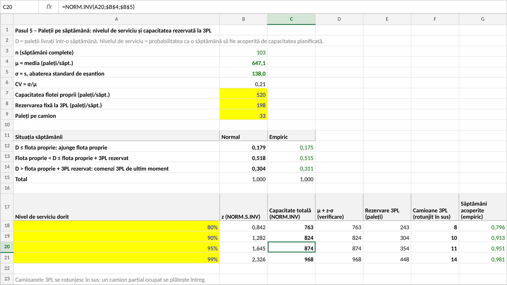

::: {.callout-note appearance="minimal"}
Această pagină însoțește Capitolul 5 al cărții: rezumă întrebările, termenii și aplicațiile, dar nu înlocuiește textul. Textul integral, soluțiile și bibliografia se găsesc în [carte](../carte.qmd).
:::

## Întrebarea capitolului

Câte curse vor fi mâine se numără. Cât durează drumul Cluj–Brașov, cât se abate costul unei curse de la model se măsoară. Paleții livrați într-o săptămână se numără, dar sunt sute (între circa 360 și 1.130), așa că îi tratăm tot ca pe o mărime continuă. **Cum descriem incertitudinea unor mărimi care pot lua orice valoare dintr-un interval?**

Înainte de a parcurge capitolul, încercați să răspundeți la trei întrebări:

1. Care este probabilitatea ca descărcarea unui camion la rampă să dureze *exact* 37 de minute?

    

Indiciu

    Câte valori posibile sunt între 36,9 și 37,1 minute? Dar între 36,99 și 37,01? Ce se întâmplă cu probabilitatea când intervalul se strânge spre un singur punct?
    

2. Ați grupat abaterile costului în intervale de 10 lei și apoi de 100 de lei. Histogramele arată foarte diferit. Care este „adevărată”?

    

Indiciu

    O bară largă adună, firesc, mai multe curse. Ce ați obține dacă ați împărți proporția de curse din fiecare bară la lățimea ei?
    

3. Pentru o rută nouă spre Galați nu aveți date, ci doar estimarea specialiștilor din dispecerat: „cel puțin 9 ore, de obicei 10, cel mult 14”. Ce distribuție folosiți?

    

Indiciu

    Aveți trei numere: un minim, o valoare cea mai probabilă și un maxim. Ce formă ar avea cea mai simplă densitate construită doar din ele? Este simetrică? (secțiunea 2.6 din carte)
    

### Pe scurt: ce este o distribuție continuă?

O **variabilă continuă** poate lua orice valoare dintr-un interval: o durată, o distanță, un cost. Ea se descrie prin **densitatea de probabilitate** (pdf): probabilitatea ca valoarea să cadă între a și b este aria de sub curbă dintre a și b. **Funcția de repartiție** (CDF) dă direct probabilitatea ca valoarea să fie cel mult x. Capitolul folosește trei distribuții, alese după informația disponibilă:

- **uniformă continuă**, când știm doar limitele (o fereastră de sosire „între 7:00 și 8:30”);
- **normală**, când avem multe date cu o formă de clopot (abaterile costului, timpul de condus);
- **triunghiulară**, când avem doar estimări ale specialiștilor (o rută nouă).

## Obiective și termeni-cheie

La finalul capitolului veți descrie cu distribuții continue mărimile măsurabile din transport și veți folosi aceste descrieri pentru planificarea timpului și a capacității. Concret, veți putea:

- să explicați de ce la o variabilă continuă lucrăm cu intervale;
- să distingeți densitatea de probabilitate (pdf) de funcția de repartiție (CDF);
- să descrieți distribuțiile uniformă continuă, normală și triunghiulară și să alegeți una dintre ele după informația disponibilă;
- să calculați probabilități și cuantile pentru distribuția uniformă continuă;
- să explicați scorul z și regula 68–95–99,7;
- să construiți histograme cu intervale de lățimi diferite și să le comparați prin densitate;
- să folosiți NORM.DIST, NORM.INV, NORM.S.DIST și NORM.S.INV pentru probabilități, praguri și niveluri de serviciu;
- să calculați probabilități și cuantile pentru distribuția triunghiulară cu IF și SQRT;
- să găsiți cu Căutare rezultat (*Goal Seek*) valoarea unui parametru care produce un rezultat dorit.

| Termen | În engleză |
| --- | --- |
| densitate de probabilitate (pdf) | *probability density function* |
| distribuția uniformă continuă | *continuous uniform distribution* |
| distribuția normală / normală standard | *normal / standard normal distribution* |
| scorul z | *z-score* |
| distribuția triunghiulară | *triangular distribution* |
| cuantilă | *quantile* |
| nivel de serviciu | *service level* |
| Căutare rezultat | *Goal Seek* |

## Studiul de caz: durate, costuri și volume la Cargo Someș

Studiul de caz folosește cele 2.401 curse proprii din setul curat și paleții livrați în 103 săptămâni complete. Cei șase pași răspund la întrebări de planificare:

1. Cum arată aceleași abateri ale costului grupate în intervale de lățimi diferite?
2. Cât timp așteaptă echipa de la rampă, dacă transportatorul terț (*third-party logistics*, 3PL) anunță doar o fereastră de sosire?
3. Cât de des se abate costul unei curse de la model?
4. Când are nevoie șoferul de pauză pe drumul spre Brașov?
5. Câtă capacitate trebuie rezervată pe săptămână pentru un nivel de serviciu dat?
6. Cât durează o cursă spre Constanța, pe o rută fără istoric?

La pasul 3, registrul compară probabilitățile empirice ale abaterilor cu cele ale distribuției normale ajustate.

{fig-alt="Foaia 4_Normala_abateri: comparația dintre probabilitățile empirice și cele ale distribuției normale pentru abaterile costului, regula 68–95–99,7 și limitele de control"}

{fig-alt="Foaia 6_Capacitate: situația săptămânilor cu rezervarea actuală la 3PL și capacitatea necesară pentru mai multe niveluri de serviciu"}

Pasul 5 arată ideea centrală a capitolului: un **nivel de serviciu** de 95% înseamnă să alegeți capacitatea egală cu cuantila de 95% a cererii, nu cu media ei.

## Verificați-vă

Descărcarea unui camion la rampă durează aproximativ N(40; 6) minute. Câte minute trebuie să rezervați pe rampă pentru ca 90% dintre descărcări să se încheie în timp? (răspunsul se deschide la clic)

Căutăm cuantila de 90%. Pentru normala standard, P(Z ≤ z) = 0,9 dă z ≈ 1,2816. Atunci x = 40 + 1,2816 · 6 ≈ 47,7 minute, deci rezervați circa 48 de minute. În Excel: `=NORM.INV(0,9;40;6)`. Câte descărcări depășesc 50 de minute? `=1-NORM.DIST(50;40;6;TRUE)` ≈ 0,048, cam una din douăzeci.

Capitolul 6 continuă de aici: parametrii acestor distribuții se estimează dintr-un eșantion, iar intervalele de încredere arată cât de sigure sunt estimările.

## Registrul Excel

**MLTM_C05_distributii_continue.xlsx**. Registrul folosește setări românești: argumentele se separă cu „;”, zecimalele cu „,”.

| Foaia | Ce conține |
| --- | --- |
| 0_Citiți-mă | Cum se folosește registrul |
| 1_Curse_proprii, 1b_Saptamani | Cursele cu flota proprie și paleții livrați pe săptămâni |
| 2_Histograme | Aceleași abateri, grupate în intervale de lățimi diferite |
| 3_Uniforma | Fereastra de sosire a camionului 3PL |
| 4_Normala_abateri | Abaterile costului și distribuția normală ajustată |
| 5_Timp_condus | Timpul de condus Cluj–Brașov |
| 6_Capacitate | Capacitatea săptămânală și nivelul de serviciu |
| 7_Triunghiulara | Ruta nouă spre Constanța |

*Registrul va putea fi descărcat din Pachetul Excel al cărții, publicat pe Zenodo.*

## Prezentare

*În pregătire.*

## Temă de laborator: nivelul de serviciu pentru o resursă reală

Alegeți o mărime continuă care determină o resursă: timpul de așteptare la rampă, durata unei livrări, consumul zilnic de motorină al unei autoutilitare.

1. Strângeți cel puțin 50 de observații și construiți histograma, cu densitate pe axa verticală. Cu mai puține date, cozile distribuției, exact zona care contează pentru nivelurile de serviciu ridicate, sunt slab acoperite.
2. Ajustați o distribuție normală (media și abaterea standard din date) și comparați-o cu histograma. Unde diferă cel mai mult?
3. Calculați resursa necesară (timp rezervat, capacitate) pentru niveluri de serviciu de 80%, 90% și 95%.
4. Cât costă fiecare punct procentual de nivel de serviciu în plus, în resursă rezervată?
5. Dacă nu ați avea date, ce trei numere ați cere specialiștilor pentru o distribuție triunghiulară?

## Exerciții suplimentare

Capitolul se încheie cu zece întrebări grilă, o întrebare deschisă și patru exerciții în Excel; răspunsurile sunt în carte, în secțiunea 5.4 și în Anexa B. Alte exerciții pentru Partea II sunt în [Problemele recapitulative II](pr2.qmd).

## Lecturi suplimentare

1. C. Caplice and E. Ponce, *MITx MicroMasters Program in SCM Key Concepts*, Version 20 Sep. 2026. Cambridge, MA, USA: MIT Center for Transportation & Logistics, 2026.

Lista completă a surselor capitolului se găsește în Bibliografia cărții.
