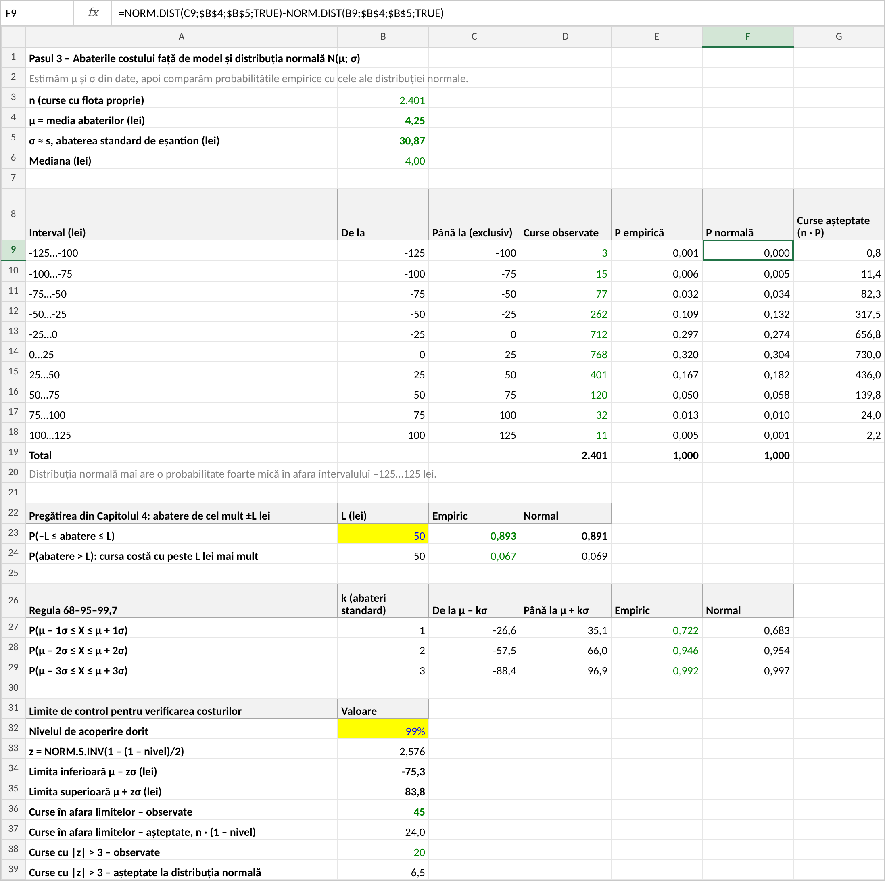

::: {.callout-note appearance="minimal"}
Această pagină însoțește Capitolul 5 al cărții: rezumă întrebările, termenii și aplicațiile, dar nu înlocuiește textul. Textul integral, soluțiile și bibliografia se găsesc în [carte](../carte.qmd).
:::

## Întrebarea capitolului

Câte curse vor fi mâine se numără. Cât durează drumul Cluj–Brașov, cât se abate costul unei curse de la model sau câți paleți pleacă într-o săptămână se măsoară. **Cum descriem incertitudinea unor mărimi care pot lua orice valoare dintr-un interval?**

Înainte de a parcurge capitolul, încercați să răspundeți la trei întrebări:

1. Care este probabilitatea ca o cursă să dureze *exact* 250 de minute?

    

Indiciu

    Între 249 și 251 de minute sunt infinit de multe valori. La o variabilă continuă, probabilitatea unei valori exacte este 0; lucrăm cu intervale.
    

2. Ați grupat abaterile costului în intervale de 10 lei și apoi de 100 de lei. Histogramele arată foarte diferit. Care este „adevărată”?

    

Indiciu

    Comparați nu numărul de curse din fiecare bară, ci numărul împărțit la lățimea barei: *densitatea*.
    

3. Pentru o rută nouă spre Iași nu aveți date, ci doar estimarea a trei oameni experimentați: „cel puțin 9 ore, de obicei 10, cel mult 14”. Ce distribuție folosiți?

    

Indiciu

    Trei numere, minim, cel mai probabil și maxim, sunt exact parametrii distribuției triunghiulare (secțiunea 2.6 din carte).
    

### Pe scurt: ce este o distribuție continuă?

O **variabilă continuă** poate lua orice valoare dintr-un interval: o durată, o distanță, un cost. Ea se descrie prin **densitatea de probabilitate** (pdf): probabilitatea ca valoarea să cadă între a și b este aria de sub curbă dintre a și b. **Funcția de repartiție** (CDF) dă direct probabilitatea ca valoarea să fie cel mult x. Capitolul folosește trei distribuții, alese după informația disponibilă:

- **uniformă continuă**, când știm doar limitele (o fereastră de sosire „între 7:00 și 8:30”);
- **normală**, când avem multe date cu o formă de clopot (abaterile costului, timpul de condus);
- **triunghiulară**, când avem doar estimări ale specialiștilor (o rută nouă).

{fig-alt="Foaia 4_Normala_abateri: comparația dintre probabilitățile empirice și cele ale distribuției normale pentru abaterile costului, regula 68–95–99,7 și limitele de control"}

## Obiective și termeni-cheie

La finalul capitolului veți descrie cu distribuții continue mărimile măsurabile din transport și veți folosi aceste descrieri pentru planificarea timpului și a capacității. Concret, veți putea:

- să explicați de ce la o variabilă continuă lucrăm cu intervale;
- să distingeți densitatea de probabilitate (pdf) de funcția de repartiție (CDF);
- să descrieți distribuțiile uniformă continuă, normală și triunghiulară;
- să explicați scorul z și regula 68–95–99,7;
- să construiți histograme cu intervale de lățimi diferite și să le comparați prin densitate;
- să folosiți NORM.DIST, NORM.INV, NORM.S.DIST și NORM.S.INV pentru probabilități, praguri și niveluri de serviciu;
- să calculați probabilități și cuantile pentru distribuția triunghiulară cu IF și SQRT.

| Termen | În engleză |
| --- | --- |
| densitate de probabilitate (pdf) | *probability density function* |
| distribuția uniformă continuă | *continuous uniform distribution* |
| distribuția normală / normală standard | *normal / standard normal distribution* |
| scorul z | *z-score* |
| distribuția triunghiulară | *triangular distribution* |
| cuantilă | *quantile* |
| nivel de serviciu | *service level* |
| Căutare rezultat | *Goal Seek* |

## Studiul de caz: durate, costuri și volume la Cargo Someș

Studiul de caz folosește cele 2.401 curse proprii din setul curat și paleții livrați în 103 săptămâni. Cei șase pași răspund la întrebări de planificare: cât așteaptă rampa camionul 3PL, cât de des se abate costul unei curse de la model, când are nevoie șoferul de pauză pe drumul spre Brașov, câtă capacitate trebuie rezervată pentru un nivel de serviciu dat și cât durează o cursă spre Constanța, pe o rută fără istoric.

{fig-alt="Foaia 6_Capacitate: situația săptămânilor cu rezervarea actuală la 3PL și capacitatea necesară pentru mai multe niveluri de serviciu"}

Pasul 5 arată ideea centrală a capitolului: un **nivel de serviciu** de 95% înseamnă să alegeți capacitatea egală cu cuantila de 95% a cererii, nu cu media ei.

## Verificați-vă

Timpul de condus Cluj–Brașov este aproximativ N(250; 20) minute. Ce probabilitate are o cursă care durează peste 270 de minute? (răspunsul se deschide la clic)

z = (270 – 250) / 20 = 1. P(T > 270) = 1 – Φ(1) ≈ 1 – 0,841 = 0,159: cam o cursă din șase. În Excel: `=1-NORM.DIST(270;250;20;TRUE)`.

## Registrul Excel

**MLTM_C05_distributii_continue.xlsx**. Registrul folosește setări românești: argumentele se separă cu „;”, zecimalele cu „,”.

| Foaia | Ce conține |
| --- | --- |
| 0_Citiți-mă | Cum se folosește registrul |
| 1_Curse_proprii, 1b_Saptamani | Cursele cu flota proprie și paleții livrați pe săptămâni |
| 2_Histograme | Aceleași abateri, grupate în intervale de lățimi diferite |
| 3_Uniforma | Fereastra de sosire a camionului 3PL |
| 4_Normala_abateri | Abaterile costului și distribuția normală ajustată |
| 5_Timp_condus | Timpul de condus Cluj–Brașov |
| 6_Capacitate | Capacitatea săptămânală și nivelul de serviciu |
| 7_Triunghiulara | Ruta nouă spre Constanța |

*Registrul va putea fi descărcat din Pachetul Excel al cărții, publicat pe Zenodo.*

## Prezentare

*În pregătire.*

## Temă de laborator: nivelul de serviciu pentru o resursă reală

Alegeți o resursă dimensionată după o cerere care variază: locuri de parcare la rampă, operatori pe tură, camioane rezervate pe săptămână.

1. Strângeți cel puțin 30 de observații ale cererii și construiți histograma, cu densitate pe axa verticală.
2. Ajustați o distribuție normală (media și abaterea standard din date) și comparați-o cu histograma. Unde diferă cel mai mult?
3. Calculați capacitatea necesară pentru niveluri de serviciu de 80%, 90% și 95%.
4. Cât costă fiecare punct procentual de nivel de serviciu în plus, în capacitate?
5. Dacă nu ați avea date, ce trei numere ați cere specialiștilor pentru o distribuție triunghiulară?

## Exerciții suplimentare

Capitolul se încheie cu zece întrebări grilă, o întrebare deschisă și patru exerciții în Excel; răspunsurile sunt în carte, în secțiunea 5.4 și în Anexa B. Alte exerciții pentru Partea II sunt în [Problemele recapitulative II](pr2.qmd).

## Lecturi suplimentare

1. C. Caplice and E. Ponce, *MITx MicroMasters Program in SCM Key Concepts*, Version 20 Sep. 2026. Cambridge, MA, USA: MIT Center for Transportation & Logistics, 2026.

Lista completă a surselor capitolului se găsește în Bibliografia cărții.
