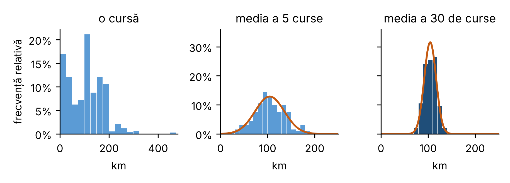
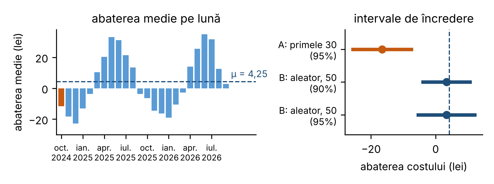

::: {.callout-note appearance="minimal"}
Această pagină însoțește Capitolul 6 al cărții: rezumă întrebările, termenii și aplicațiile, dar nu înlocuiește textul. Textul integral, soluțiile și bibliografia se găsesc în [carte](../carte.qmd).
:::

## Întrebarea capitolului

În Capitolul 5, media și abaterea standard au fost tratate ca valori sigure. Ele vin însă din date, iar datele sunt aproape întotdeauna doar o parte din realitate. Pe ruta Cluj–Brașov, flota proprie are doar 16 curse în doi ani. **Cât de mult ne putem baza pe o medie calculată din atât de puține date și câte date ne-ar trebui pentru o estimare bună?**

Înainte de a parcurge capitolul, încercați să răspundeți la trei întrebări:

1. Ați calculat abaterea medie a costului din primele 30 de curse din evidență și iese mult negativă. Concluzionați că flota proprie este mai ieftină decât prevede modelul?

    

Indiciu

    Uitați-vă la datele primelor 30 de curse. Acoperă ele cei doi ani sau doar câteva zile dintr-o singură lună? Ar rezolva problema 300 de curse luate în același fel? (secțiunea 2.2 și Pasul 3)
    

2. Distanțele curselor nu au deloc forma unui clopot. Media a 30 de curse ar avea?

    

Indiciu

    Urmăriți în Fig. 6.1 cum se schimbă forma distribuției când treceți de la o singură cursă la media a 5 și apoi a 30 de curse. Ce se întâmplă cu asimetria? (secțiunea 2.3)
    

3. „Costul mediu pe ruta Cluj–Brașov este între 1.839 și 1.908 lei, cu 95% încredere.” Înseamnă că 95% dintre curse costă între aceste valori?

    

Indiciu

    Despre ce mărime vorbește afirmația: despre media tuturor curselor de pe rută sau despre o singură cursă viitoare? Care dintre cele două variază mai mult? (secțiunea 2.7)
    

### Pe scurt: ce este un interval de încredere?

Datele de care dispunem sunt un **eșantion** dintr-o **populație** mai mare. Media eșantionului, x̄, estimează media populației, μ, dar alt eșantion ar da altă valoare. Dacă observațiile sunt independente și identic distribuite (iid), **teorema limită centrală** (TLC) spune că media lor are o distribuție apropiată de cea normală, oricare ar fi forma distribuției unei singure observații (Fig. 6.1). **Eroarea standard** măsoară cât de mult variază x̄ de la un eșantion la altul și scade cu rădăcina pătrată a numărului de observații. Un **interval de încredere** adaugă estimării precizia ei: un interval în jurul lui x̄, construit astfel încât, la un nivel de încredere ales (de obicei 95%, uneori 90% sau 99%), aceeași proporție dintre eșantioane să dea un interval care conține media adevărată. Pentru eșantioane mici se folosește distribuția *t* în locul distribuției normale.

{fig-alt="Distribuția distanței unei curse, asimetrică, și distribuțiile mediei a 5 și a 30 de curse, tot mai apropiate de o distribuție normală"}

## Obiective și termeni-cheie

La finalul capitolului veți estima din date incomplete mărimile din transport, veți spune cât de precisă este estimarea și veți stabili câte date trebuie colectate pentru o precizie dorită. Concret, veți putea:

- să distingeți populația de eșantion și parametrul (μ, σ) de statistică (x̄, s);
- să explicați de ce un eșantion de comoditate poate da o estimare greșită;
- să enunțați teorema limită centrală pentru sume și pentru medii și să calculați cu NORM.DIST probabilități pentru sume de variabile aleatoare;
- să construiți intervale de încredere cu z (CONFIDENCE.NORM) și cu t (T.INV.2T, CONFIDENCE.T);
- să explicați când se folosește distribuția t în locul distribuției normale;
- să deosebiți un interval de încredere de un interval de predicție și să calculați un interval de predicție pentru valoarea următoare;
- să extrageți un eșantion aleator cu RANDBETWEEN și INDEX;
- să calculați mărimea eșantionului pentru o marjă de eroare dată.

| Termen | În engleză |
| --- | --- |
| inferență statistică | *statistical inference* |
| populație / eșantion | *population / sample* |
| parametru / statistică | *parameter / statistic* |
| teorema limită centrală (TLC) | *central limit theorem* |
| eroare standard | *standard error* |
| interval de încredere / de predicție | *confidence / prediction interval* |
| distribuția t | *Student’s t-distribution* |
| grade de libertate | *degrees of freedom* |
| marjă de eroare | *margin of error* |
| eșantion de comoditate | *convenience sample* |
| independente și identic distribuite (iid) | *independent and identically distributed* |

## Studiul de caz: cât de sigure sunt estimările la Cargo Someș?

Cele 2.401 curse proprii sunt tratate ca o populație cunoscută, din care se extrag eșantioane. Astfel se poate verifica direct ce promit formulele. Cei șase pași trec de la teorema limită centrală la încărcarea camioanelor la rampă, de la eșantionul de comoditate la 100 de intervale de încredere, apoi la ruta Brașov cu doar 16 curse și la numărul de curse care trebuie monitorizate prin sistemul de poziționare globală (*Global Positioning System*, GPS).

{fig-alt="Abaterea medie a costului pe luni, cu luna din care provin primele 30 de curse evidențiată, și intervalele de încredere ale eșantionului de comoditate și ale celui aleator"}

Pasul 6 arată costul preciziei: cum crește numărul de curse necesar când marja de eroare se strânge?

## Verificați-vă

Pe un eșantion aleator de 100 de curse, abaterea costului față de model are abaterea standard de 30,87 lei. Cât este marja de eroare a mediei, la 95% încredere? (răspunsul se deschide la clic)

Eroarea standard: 30,87/√100 = 3,087 lei. Marja de eroare: 1,96 · 3,087 ≈ 6,05 lei. Intervalul este x̄ ± 6,05 lei. În Excel: `=CONFIDENCE.NORM(0,05;30,87;100)`. Cu n = 100, intervalul cu t ar fi aproape la fel: `=CONFIDENCE.T(0,05;30,87;100)` ≈ 6,13 lei.

Capitolul 7 pornește de aici: un interval spune unde se află, probabil, o medie, dar multe decizii cer un răspuns da/nu, de exemplu „greșește modelul de cost sistematic?”. Acolo trecem de la intervale la testarea ipotezelor.

## Registrul Excel

**MLTM_C06_esantionare_intervale.xlsx**. Registrul folosește setări românești: argumentele se separă cu „;”, zecimalele cu „,”.

| Foaia | Ce conține |
| --- | --- |
| 0_Citiți-mă | Cum se folosește registrul |
| 1_Curse_proprii | Cele 2.401 curse cu flota proprie, numerotate |
| 2_TLC, 2b_TLC_esantioane | Teorema limită centrală pe distanțele curselor |
| 3_Rampa | Timpul de încărcare a unui camion: TLC pentru sume |
| 4_Esantioane | Eșantionul de comoditate și eșantionul aleator |
| 5_100_intervale, 5b_100_esantioane | 100 de eșantioane și intervalele lor de încredere |
| 6_Brasov_t | Ruta Cluj–Brașov: distribuția t și intervalul de predicție |
| 7_Marime_esantion | Câte curse trebuie monitorizate |
| Ex_Exercitii | Date pentru exerciții |

*Registrul va putea fi descărcat din Pachetul Excel al cărții, publicat pe Zenodo.*

## Prezentare

*În pregătire.*

## Temă de laborator: cât de precisă este media voastră?

Alegeți o mărime măsurată pe care o cunoașteți: durata unei operații, costul unei livrări, timpul de așteptare la o rampă.

1. Descrieți populația și explicați cum ați extrage din ea un eșantion aleator, nu unul de comoditate.
2. Pe 15–25 de observații (un eșantion mic), calculați media, abaterea standard și eroarea standard.
3. Construiți intervalul de încredere de 95% cu t și comparați-l cu cel calculat cu z. Care este mai îngust și de ce nu este potrivit aici? De la ce număr de observații diferența ar deveni neglijabilă?
4. Calculați intervalul de predicție pentru observația următoare. De ce este mai larg?
5. Câte observații v-ar trebui pentru o marjă de eroare de trei ori mai mică?

## Exerciții suplimentare

Capitolul se încheie cu zece întrebări grilă, o întrebare deschisă și patru exerciții în Excel; răspunsurile sunt în carte, în secțiunea 5.4 și în Anexa B. Alte exerciții pentru Partea II sunt în [Problemele recapitulative II](pr2.qmd).

## Lecturi suplimentare

1. C. Caplice and E. Ponce, *MITx MicroMasters Program in SCM Key Concepts*, Version 20 Sep. 2026. Cambridge, MA, USA: MIT Center for Transportation & Logistics, 2026.

Lista completă a surselor capitolului se găsește în Bibliografia cărții.
