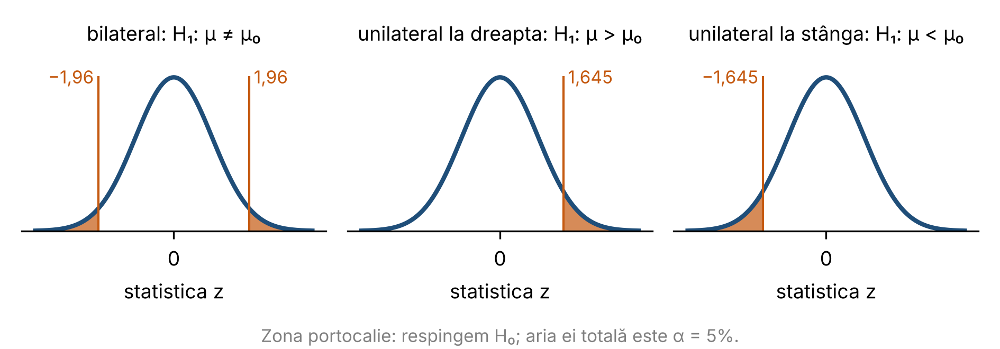
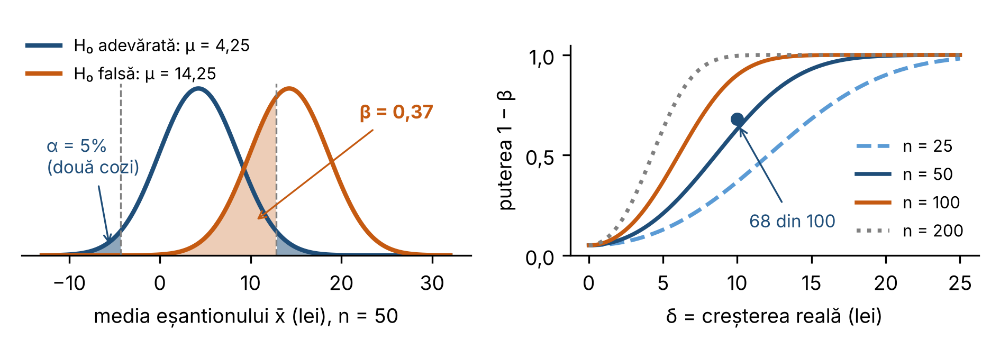

::: {.callout-note appearance="minimal"}
Această pagină însoțește Capitolul 7 al cărții: rezumă întrebările, termenii și aplicațiile, dar nu înlocuiește textul. Textul integral, soluțiile și bibliografia se găsesc în [carte](../carte.qmd).
:::

## Întrebarea capitolului

În Capitolul 6 am spus cât de precisă este o estimare. Managerul firmei Cargo Someș cere însă adesea un răspuns de tip da/nu: greșește modelul de cost? A crescut costul după taxa TollRo? Încarcă stivuitorul nou mai repede? **Cum transformăm întrebarea „s-a schimbat ceva?” într-o decizie, cu un risc de eroare ales dinainte?**

Înainte de a parcurge capitolul, încercați să răspundeți la trei întrebări:

1. Pe 2.401 curse, abaterea medie a costului față de model este de 4,25 lei, iar testul dă p practic zero. Trebuie schimbate tarifele?

    

Indiciu

    Cu atât de multe date, testul „vede” orice diferență, oricât de mică. 4,25 lei înseamnă 0,38% din costul unei curse. Semnificația statistică nu ține locul *relevanței practice*.
    

2. Vreți să aflați dacă taxa TollRo a crescut costul în octombrie 2026. Cu ce comparați: cu media tuturor lunilor sau cu octombrie din anii trecuți?

    

Indiciu

    Abaterea costului are sezonalitate: octombrie a fost, în ambii ani, sub media generală. Cu referința greșită, același test dă concluzia opusă.
    

3. Un test pe 15 camioane dă p = 0,21 pentru stivuitorul nou. Înseamnă că stivuitorul nu este mai rapid?

    

Indiciu

    „Nu respingem H₀” nu înseamnă „H₀ este adevărată”. Pe un eșantion mic, testul are *putere* redusă și poate rata o îmbunătățire reală: eroarea de tip II.
    

### Pe scurt: cum funcționează un test statistic?

Un test alege între două afirmații despre populație care se exclud reciproc. **Ipoteza nulă** (H₀) spune că nu s-a schimbat nimic; **ipoteza alternativă** (H₁) spune ce vrem să dovedim. Calculăm cât de departe este media eșantionului de valoarea din H₀, în număr de erori standard: statistica **z** sau **t**. **Valoarea p** este probabilitatea de a obține un rezultat cel puțin la fel de extrem dacă H₀ ar fi adevărată; dacă este sub nivelul de semnificație α ales dinainte, respingem H₀. Testul poate greși în două feluri: respinge o H₀ adevărată (**eroarea de tip I**, cu probabilitatea α) sau nu respinge o H₀ falsă (**eroarea de tip II**). Testul **χ²** compară o distribuție întreagă cu un model, iar **covarianța** și **corelația** arată cum variază două mărimi împreună.

{fig-alt="Trei curbe normale cu zona de respingere colorată: pe ambele cozi pentru testul bilateral, pe coada dreaptă și pe coada stângă pentru testele unilaterale"}

## Obiective și termeni-cheie

La finalul capitolului veți transforma o întrebare de management într-un test statistic, veți lua decizia cu un risc de eroare ales dinainte și veți ține cont de legăturile dintre variabile atunci când le adunați. Concret, veți putea:

- să formulați ipoteza nulă și ipoteza alternativă și să alegeți între un test bilateral și unul unilateral;
- să explicați valoarea p și ce înseamnă „respingem” și „nu respingem” H₀;
- să deosebiți eroarea de tip I de eroarea de tip II și să legați α, β, mărimea eșantionului și puterea testului;
- să deosebiți semnificația statistică de relevanța practică;
- să faceți în Excel un test z sau t pentru medie (NORM.S.DIST, T.DIST, T.DIST.RT, T.INV);
- să faceți un test χ² de concordanță (CHISQ.DIST.RT, CHISQ.INV.RT, CHISQ.TEST) cu numărul corect de grade de libertate;
- să calculați covarianța și corelația (COVARIANCE.S, CORREL) și abaterea standard a unei sume de variabile aleatoare.

| Termen | În engleză |
| --- | --- |
| ipoteza nulă / alternativă | *null / alternative hypothesis* |
| test bilateral / unilateral | *two-tailed / one-tailed test* |
| nivel de semnificație | *significance level* |
| valoarea p | *p-value* |
| eroarea de tip I / de tip II | *type I / type II error* |
| puterea testului | *power of a test* |
| testul χ² de concordanță | *chi-square goodness-of-fit test* |
| covarianță / corelație | *covariance / correlation* |

## Studiul de caz: s-a schimbat ceva la Cargo Someș?

În noiembrie 2026, pe biroul managerului s-au strâns mai multe întrebări de tip „s-a schimbat ceva?”. Cei șapte pași le iau pe rând: este modelul de cost deplasat, a crescut costul după taxa TollRo, încarcă stivuitorul nou mai repede, cât de des greșește un test (pe 100 de eșantioane), sunt livrările uniforme pe zilele săptămânii, urmează paleții pe săptămână o distribuție normală și cât contează corelațiile dintre cele trei lanțuri de magazine pentru capacitatea depozitului.

{fig-alt="Rezultatele testului pe 100 de eșantioane, cu erorile de tip I și II marcate, și curbele puterii testului în funcție de mărimea efectului, pentru mai multe mărimi ale eșantionului"}

Pasul 7 arată de ce contează variabilele multiple: dacă presupunem că lanțurile de magazine sunt independente, subestimăm variabilitatea volumului total cu 5%, iar capacitatea rezervată iese prea mică.

## Verificați-vă

Dispecerul planifică același număr de șoferi în fiecare zi. Din 2.813 livrări luni–vineri, lunea au fost 634, iar vinerea 495. Testul χ² dă 18,44. Sunt livrările uniforme? (răspunsul se deschide la clic)

Sunt 5 categorii și niciun parametru estimat, deci 5 – 1 = 4 grade de libertate. Valoarea critică la α = 5% este 9,49. Cum 18,44 > 9,49, respingem distribuția uniformă: lunea are mai multe livrări, vinerea mai puține. În Excel: valoarea critică `=CHISQ.INV.RT(0,05;4)`, valoarea p `=CHISQ.DIST.RT(18,44;4)` ≈ 0,001.

## Registrul Excel

**MLTM_C07_teste_variabile_multiple.xlsx**. Registrul folosește setări românești: argumentele se separă cu „;”, zecimalele cu „,”.

| Foaia | Ce conține |
| --- | --- |
| 0_Citiți-mă | Cum se folosește registrul |
| 1_Curse_proprii, 1b_Curse_oct2026 | Cele 2.401 curse cu flota proprie și cele 104 curse din octombrie 2026 |
| 1c_Rute, 1d_Livrari | Fișa rutelor și toate livrările, cu lanțul de magazine destinatar |
| 2_Model_cost | Este modelul de cost deplasat? Testul z |
| 3_TollRo | Taxa TollRo față de două referințe diferite |
| 4_Stivuitor | Testul t pentru stivuitorul nou |
| 5_Erori, 5b_Esantioane | Erorile de tip I și II pe 100 de eșantioane și puterea testului |
| 6_Chi_zile | Livrările pe zilele săptămânii: testul χ² |
| 7_Chi_normala | Paleții pe săptămână față de distribuția normală |
| 8_Lanturi, 8b_Saptamani | Covarianța și corelația pentru cele trei lanțuri de magazine |
| Ex_Exercitii | Date pentru exerciții |

*Registrul va putea fi descărcat din Pachetul Excel al cărții, publicat pe Zenodo.*

## Prezentare

*În pregătire.*

## Temă de laborator: s-a schimbat ceva în activitatea voastră?

Alegeți o schimbare reală dintr-o activitate pe care o cunoașteți: un traseu nou, un echipament nou, o regulă nouă de programare la rampă.

1. Formulați H₀ și H₁ și alegeți testul (bilateral sau unilateral). Justificați alegerea.
2. Fixați dinainte α și pragul de relevanță practică: de la ce diferență ați schimba decizia?
3. Strângeți cel puțin 15 observații după schimbare și alegeți referința corectă pentru comparație. Ce ar putea s-o deplaseze (sezon, zi, client)?
4. Calculați statistica t și valoarea p și scrieți decizia în două fraze: una statistică, una pentru manager.
5. Câte observații v-ar trebui ca testul să detecteze efectul ales la punctul 2 cu o putere de 80%?

## Exerciții suplimentare

Capitolul se încheie cu zece întrebări grilă, o întrebare deschisă și cinci exerciții în Excel; răspunsurile sunt în carte, în secțiunea 5.4 și în Anexa B. Alte exerciții pentru Partea II sunt în [Problemele recapitulative II](pr2.qmd).

## Lecturi suplimentare

1. C. Caplice and E. Ponce, *MITx MicroMasters Program in SCM Key Concepts*, Version 20 Sep. 2026. Cambridge, MA, USA: MIT Center for Transportation & Logistics, 2026.

Lista completă a surselor capitolului se găsește în Bibliografia cărții.
