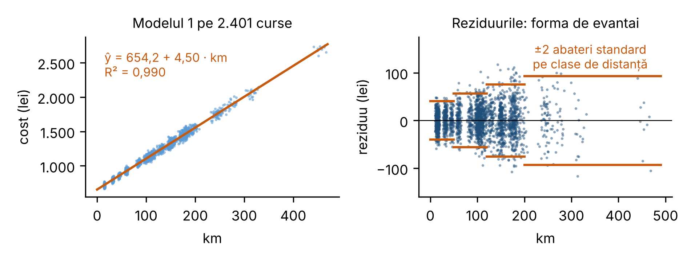

::: {.callout-note appearance="minimal"}
Această pagină însoțește Capitolul 8 al cărții: rezumă întrebările, termenii și aplicațiile, dar nu înlocuiește textul. Textul integral, soluțiile și bibliografia se găsesc în [carte](../carte.qmd).
:::

## Întrebarea capitolului

Modelul de cost al firmei Cargo Someș, 650 lei + 4,5 lei/km, a fost stabilit în Capitolul 2 din câteva cifre de buget. În Capitolul 7 am aflat că taxa de drum pe kilometru TollRo, aplicată din 1 octombrie 2026, l-a făcut depășit. Managerul vrea acum un model pentru ofertele din 2027. **Cum construim modelul direct din istoricul curselor (cele 2.401 curse proprii din ultimii doi ani și cele 104 din octombrie 2026) și cum știm dacă îi putem crede prognozele?**

Înainte de a parcurge capitolul, încercați să răspundeți la trei întrebări:

1. Regresia costului după distanță are R² = 0,99. Înseamnă că modelul este bun și nu mai trebuie verificat?

    

Indiciu

    Ce măsoară, de fapt, R²? Ce ipoteze trebuie să fie îndeplinite pentru ca prognozele și testele modelului să fie de încredere și cum le-ați putea verifica pe un grafic? (secțiunea 2.7)
    

2. Dispecerul crede că un camion plin costă mai mult. Cum verificați dacă numărul de paleți trebuie adăugat în model?

    

Indiciu

    Ce s-ar întâmpla cu R² dacă ați adăuga în model o variabilă complet întâmplătoare? Ce indicatori arată dacă o variabilă nouă aduce cu adevărat informație? (secțiunile 2.3–2.5)
    

3. Un model cu zece variabile se potrivește perfect pe datele din ultimii doi ani. Va prevedea la fel de bine anul viitor?

    

Indiciu

    Ce „învață” un model cu mulți parametri din datele trecute, pe lângă relația reală? Pe ce date l-ați verifica, dacă observațiile au o ordine în timp? (secțiunea 2.8)
    

### Pe scurt: ce este regresia liniară?

**Regresia liniară** descrie cum depinde o **variabilă dependentă** (costul unei curse) de una sau mai multe **variabile independente** (distanța, anotimpul, kilometrii de autostradă). **Metoda celor mai mici pătrate** alege coeficienții care fac cât mai mică suma pătratelor **reziduurilor**, adică a diferențelor dintre valorile reale și cele prognozate. **R²** arată ce parte din variație explică modelul, **eroarea standard a regresiei** cât greșește de obicei o prognoză, iar **testul t** al fiecărui coeficient dacă variabila contează. „Liniar” înseamnă liniar în coeficienți: modelul poate folosi și **variabile dummy** (0/1, de exemplu „vară”) sau variabile transformate, cum este 1/km.

## Obiective și termeni-cheie

La finalul capitolului veți construi din date un model de cost sau de durată pentru transport, îl veți evalua și îl veți folosi pentru prognoză, știind când rezultatele lui sunt de încredere. Concret, veți putea:

- să deosebiți variabila dependentă de variabilele independente și tipurile de variabile;
- să explicați metoda celor mai mici pătrate și semnificația coeficienților unui model liniar;
- să interpretați R², R² ajustat, eroarea standard a regresiei, testul F și testele t ale coeficienților;
- să recunoașteți în reziduuri heteroscedasticitatea, autocorelarea și abaterile de la normalitate;
- să explicați supraajustarea și de ce un model se validează pe date pe care nu a fost estimat;
- să faceți o regresie simplă și una multiplă în Excel, cu Data Analysis → Regression și cu LINEST;
- să construiți variabile dummy și variabile transformate (1/x, x²) și să le interpretați coeficienții;
- să decideți, cu testul t și cu R² ajustat, dacă o variabilă rămâne în model;
- să faceți o prognoză cu TREND și să o însoțiți de un interval aproximativ de predicție;
- să împărțiți datele în antrenare și testare și să comparați modelele cu MAPE.

| Termen | În engleză |
| --- | --- |
| variabilă dependentă / independentă | *dependent / independent variable* |
| metoda celor mai mici pătrate | *ordinary least squares, OLS* |
| coeficient de determinare (R²), R² ajustat | *coefficient of determination, adjusted R²* |
| reziduu | *residual* |
| eroarea standard a regresiei | *standard error of the regression* |
| heteroscedasticitate | *heteroscedasticity* |
| autocorelare | *autocorrelation* |
| multicoliniaritate | *multicollinearity* |
| variabilă dummy | *dummy variable* |
| supraajustare | *overfitting* |
| antrenare / testare | *training / test set* |
| eroarea procentuală absolută medie (MAPE) | *mean absolute percentage error* |
| rădăcina erorii pătratice medii (RMSE) | *root mean square error* |

## Studiul de caz: modelul de cost al Cargo Someș, reconstruit din date

Cei șapte pași reconstruiesc modelul de cost pornind de la cele 2.401 curse proprii și cele 104 curse din octombrie 2026. Modelul 1 confirmă din date costul fix și costul pe km. Reziduurile lui arată două probleme: o împrăștiere care crește cu distanța și un tipar sezonier. Paleții nu intră în model, dar anotimpul intră, cu variabile dummy. Transformarea 1/km dă costul pe km pentru oferte, iar o variabilă de interacțiune estimează, pe toate cele 2.505 curse, cât costă taxa TollRo pe fiecare km de autostradă.

{fig-alt="Stânga: costul curselor în funcție de distanță, cu dreapta de regresie. Dreapta: reziduurile față de distanță, tot mai împrăștiate pe măsură ce distanța crește"}

Pasul 7 verifică modelele pe cursele din aprilie–septembrie 2026, pe care nu le-au „văzut”: modelul cu anotimp reduce eroarea procentuală absolută medie (MAPE) de la 2,3% la 1,8%.

## Verificați-vă

Pe 120 de descărcări la un client, regresia duratei (minute) dă: durata = 12,4 + 1,85 · paleți + 4,2 · fără_nivelator, unde fără_nivelator este 1 dacă rampa nu are platformă de nivelare și 0 dacă are. Eroarea standard a coeficientului 4,2 este 1,6. Rămâne variabila în model la α = 5%? Cât durează, în medie, descărcarea a 20 de paleți la o rampă fără nivelator? (răspunsul se deschide la clic)

t = 4,2/1,6 ≈ 2,63, cu 120 – 2 – 1 = 117 grade de libertate. Valoarea critică este `=T.INV.2T(0,05;117)` ≈ 1,98, iar valoarea p `=T.DIST.2T(2,63;117)` ≈ 0,01. Cum 2,63 > 1,98, variabila rămâne: la același număr de paleți, o rampă fără nivelator adaugă în medie circa 4 minute. Prognoza: 12,4 + 1,85 · 20 + 4,2 = 53,6 minute. În Excel, prognoza se poate face și cu TREND, care acceptă mai multe variabile independente în coloane alăturate: `=TREND(y_cunoscute;x_cunoscute;x_noi)`, unde argumentele sunt domenii de celule.

Cu regresia se încheie partea de statistică a cărții (Capitolele 4–8); urmează [Problemele recapitulative II](pr2.qmd). Capitolul 9 trece de la a descrie și a prevedea la a decide: optimizarea. Costul pe km, costul fix pe cursă și efectul taxei estimate aici devin acolo date de intrare.

## Registrul Excel

**MLTM_C08_regresie.xlsx**. Registrul folosește setări românești: argumentele se separă cu „;”, zecimalele cu „,”. Pentru ieșirea completă a regresiei activați programul de completare Analysis ToolPak (în Excelul românesc, „Pachet instrumente analiză”); comanda Data Analysis („Analiză date”) apare apoi în fila Date (*Data*). Ferestrele lui rămân în engleză și în Excel cu interfață românească, de aceea le numim cu denumirile englezești, ca în carte.

{fig-alt="Foaia 2_Model_km din registru, cu tabelul calculat cu LINEST, și fereastra Regression din Data Analysis completată cu domeniile pentru cost și distanță"}

| Foaia | Ce conține |
| --- | --- |
| 0_Citiți-mă | Cum se folosește registrul |
| 1_Curse, 1b_Rute | Cursele, cu variabilele pregătite pentru regresie, și fișa rutelor |
| 2_Model_km | Modelul 1: costul fix și costul pe km |
| 3_Reziduuri | Analiza reziduurilor Modelului 1 |
| 4_Paleti | Modelul 2: contează numărul de paleți? |
| 5_Sezon | Modelele 3 și 3b: anotimpul și tendința în timp |
| 6_Cost_pe_km | Modelul 4: costul pe km și transformarea 1/km |
| 7_TollRo | Modelul 5: taxa TollRo pe km de autostradă |
| 8_Validare | Antrenare și testare: MAPE și RMSE (rădăcina erorii pătratice medii) |
| Ex_Exercitii | Date pentru exerciții |

*Registrul va putea fi descărcat din Pachetul Excel al cărții, publicat pe Zenodo.*

## Prezentare

*În pregătire.*

## Temă de laborator: un model de cost sau de durată din datele voastre

Alegeți o mărime din transport care depinde de câțiva factori: durata descărcării unui camion, costul unei livrări, timpul unei curse urbane. Strângeți cel puțin 50 de observații.

1. Numiți variabila dependentă și două–trei variabile independente; spuneți ce tip de variabilă este fiecare.
2. Estimați un model simplu și unul multiplu cu LINEST sau cu Data Analysis → Regression.
3. Interpretați fiecare coeficient în unități concrete (lei, minute) și decideți, cu testul t și R² ajustat, ce variabile rămân.
4. Faceți graficul reziduurilor. Ce tipar vedeți și ce variabilă ar putea lipsi?
5. Păstrați deoparte 20–25% dintre observații (ultimele, dacă datele sunt ordonate în timp; altfel, alese aleator), estimați modelul pe restul și calculați MAPE pe datele păstrate.

## Exerciții suplimentare

Capitolul se încheie cu zece întrebări grilă, o întrebare deschisă și patru exerciții în Excel; răspunsurile sunt în carte, în secțiunea 5.4 și în Anexa B. Alte exerciții pentru Partea II sunt în [Problemele recapitulative II](pr2.qmd).

## Lecturi suplimentare

1. C. Caplice and E. Ponce, *MITx MicroMasters Program in SCM Key Concepts*, Version 20 Sep. 2026. Cambridge, MA, USA: MIT Center for Transportation & Logistics, 2026.

Lista completă a surselor capitolului se găsește în Bibliografia cărții.
