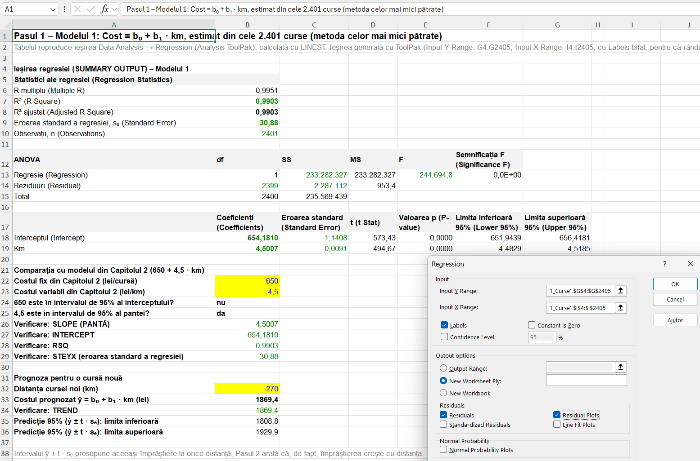

::: {.callout-note appearance="minimal"}
Această pagină însoțește Capitolul 8 al cărții: rezumă întrebările, termenii și aplicațiile, dar nu înlocuiește textul. Textul integral, soluțiile și bibliografia se găsesc în [carte](../carte.qmd).
:::

## Întrebarea capitolului

Modelul de cost al firmei Cargo Someș, 650 lei + 4,5 lei/km, a fost stabilit în Capitolul 2 din câteva cifre de buget. În Capitolul 7 am aflat că taxa TollRo l-a făcut depășit. Managerul vrea acum un model pentru ofertele din 2027. **Cum construim modelul direct din cele 2.401 curse și cum știm dacă îi putem crede prognozele?**

Înainte de a parcurge capitolul, încercați să răspundeți la trei întrebări:

1. Regresia costului după distanță are R² = 0,99. Înseamnă că modelul este bun și nu mai trebuie verificat?

    

Indiciu

    R² spune cât din variație explică modelul, nu dacă modelul este corect specificat. Priviți *reziduurile*: au aceeași împrăștiere la curse scurte și lungi? Au un tipar pe luni?
    

2. Dispecerul crede că un camion plin costă mai mult. Cum verificați dacă numărul de paleți trebuie adăugat în model?

    

Indiciu

    Adăugați variabila și uitați-vă la trei lucruri: semnul coeficientului, valoarea p a testului t și R² ajustat. O variabilă care nu le trece pe toate trei nu rămâne în model.
    

3. Un model cu zece variabile se potrivește perfect pe datele din ultimii doi ani. Va prevedea la fel de bine anul viitor?

    

Indiciu

    Nu neapărat: este *supraajustarea*. Un model se verifică pe date pe care nu a fost estimat; la o serie de timp, antrenăm pe trecut și testăm pe viitor.
    

### Pe scurt: ce este regresia liniară?

**Regresia liniară** descrie cum depinde o **variabilă dependentă** (costul unei curse) de una sau mai multe **variabile independente** (distanța, anotimpul, kilometrii de autostradă). **Metoda celor mai mici pătrate** alege coeficienții care fac cât mai mică suma pătratelor **reziduurilor**, adică a diferențelor dintre valorile reale și cele prognozate. **R²** arată ce parte din variație explică modelul, **eroarea standard a regresiei** cât greșește de obicei o prognoză, iar **testul t** al fiecărui coeficient dacă variabila contează. „Liniar” înseamnă liniar în coeficienți: modelul poate folosi și **variabile dummy** (0/1, de exemplu „vară”) sau variabile transformate, cum este 1/km.

{fig-alt="Foaia 2_Model_km din registru, cu tabelul calculat cu LINEST, și fereastra Regression din Data Analysis completată cu domeniile pentru cost și distanță"}

## Obiective și termeni-cheie

La finalul capitolului veți construi din date un model de cost sau de durată pentru transport, îl veți evalua și îl veți folosi pentru prognoză, știind când rezultatele lui sunt de încredere. Concret, veți putea:

- să deosebiți variabila dependentă de variabilele independente și tipurile de variabile;
- să interpretați R², R² ajustat, eroarea standard a regresiei, testul F și testele t ale coeficienților;
- să recunoașteți în reziduuri heteroscedasticitatea, autocorelarea și abaterile de la normalitate;
- să faceți o regresie simplă și una multiplă în Excel, cu Data Analysis → Regression și cu LINEST;
- să construiți variabile dummy și variabile transformate (1/x, x²) și să le interpretați coeficienții;
- să faceți o prognoză cu TREND și să o însoțiți de un interval aproximativ de predicție;
- să împărțiți datele în antrenare și testare și să comparați modelele cu MAPE.

| Termen | În engleză |
| --- | --- |
| variabilă dependentă / independentă | *dependent / independent variable* |
| metoda celor mai mici pătrate | *ordinary least squares, OLS* |
| coeficient de determinare (R²), R² ajustat | *coefficient of determination, adjusted R²* |
| reziduu | *residual* |
| heteroscedasticitate | *heteroscedasticity* |
| variabilă dummy | *dummy variable* |
| supraajustare | *overfitting* |
| eroarea procentuală absolută medie (MAPE) | *mean absolute percentage error* |

## Studiul de caz: modelul de cost al Cargo Someș, reconstruit din date

Cei șapte pași reconstruiesc modelul de cost pornind de la cele 2.401 curse proprii și cele 104 curse din octombrie 2026. Modelul 1 confirmă din date costul fix și costul pe km. Reziduurile lui arată două probleme: o împrăștiere care crește cu distanța și un tipar sezonier. Paleții nu intră în model, dar anotimpul intră, cu variabile dummy. Transformarea 1/km dă costul pe km pentru oferte, iar o variabilă de interacțiune estimează cât costă taxa TollRo pe fiecare km de autostradă.

{fig-alt="Stânga: costul curselor în funcție de distanță, cu dreapta de regresie. Dreapta: reziduurile față de distanță, tot mai împrăștiate pe măsură ce distanța crește"}

Pasul 7 verifică modelele pe cursele din aprilie–septembrie 2026, pe care nu le-au „văzut”: modelul cu anotimp reduce eroarea procentuală medie de la 2,3% la 1,8%.

## Verificați-vă

Modelul 3 dă costul = 639,91 + 4,5129 · km, la care se adaugă +33,47 lei vara (toamna este referința). Cât costă o cursă de 150 km vara și ce înseamnă coeficientul 33,47? (răspunsul se deschide la clic)

639,91 + 4,5129 · 150 + 33,47 ≈ 1.350 lei. Coeficientul 33,47 înseamnă că, la aceeași distanță, o cursă de vară costă în medie cu circa 33 de lei mai mult decât una de toamnă. Coeficientul unei variabile dummy se citește mereu față de categoria de referință. În Excel, coeficienții se obțin cu `=LINEST(Cost;Km_și_dummy;TRUE;TRUE)`, iar prognoza pentru o singură variabilă cu `=TREND(Cost;Km;150)`.

## Registrul Excel

**MLTM_C08_regresie.xlsx**. Registrul folosește setări românești: argumentele se separă cu „;”, zecimalele cu „,”. Pentru ieșirea completă a regresiei activați programul de completare Analysis ToolPak (Data Analysis).

| Foaia | Ce conține |
| --- | --- |
| 0_Citiți-mă | Cum se folosește registrul |
| 1_Curse, 1b_Rute | Cursele, cu variabilele pregătite pentru regresie, și fișa rutelor |
| 2_Model_km | Modelul 1: costul fix și costul pe km |
| 3_Reziduuri | Analiza reziduurilor Modelului 1 |
| 4_Paleti | Modelul 2: contează numărul de paleți? |
| 5_Sezon | Modelele 3 și 3b: anotimpul și tendința în timp |
| 6_Cost_pe_km | Modelul 4: costul pe km și transformarea 1/km |
| 7_TollRo | Modelul 5: taxa TollRo pe km de autostradă |
| 8_Validare | Antrenare și testare: MAPE și RMSE |
| Ex_Exercitii | Date pentru exerciții |

*Linkul DOI spre Pachetul Excel (Zenodo) va fi adăugat aici.*

## Prezentare

*În pregătire.*

## Temă de laborator: un model de cost sau de durată din datele voastre

Alegeți o mărime din transport care depinde de câțiva factori: durata descărcării unui camion, costul unei livrări, timpul unei curse urbane. Strângeți cel puțin 50 de observații.

1. Numiți variabila dependentă și două–trei variabile independente; spuneți ce tip de variabilă este fiecare.
2. Estimați un model simplu și unul multiplu cu LINEST sau cu Data Analysis → Regression.
3. Interpretați fiecare coeficient în unități concrete (lei, minute) și decideți, cu testul t și R² ajustat, ce variabile rămân.
4. Faceți graficul reziduurilor. Ce tipar vedeți și ce variabilă ar putea lipsi?
5. Păstrați deoparte ultimele 20% dintre observații, estimați modelul pe restul și calculați MAPE pe datele păstrate.

## Exerciții suplimentare

Capitolul se încheie cu zece întrebări grilă, o întrebare deschisă și patru exerciții în Excel; răspunsurile sunt în carte, în secțiunea 5.4 și în Anexa B. Alte exerciții pentru Partea II sunt în [Problemele recapitulative II](pr2.qmd).

## Lecturi suplimentare

1. C. Caplice and E. Ponce, *MITx MicroMasters Program in SCM Key Concepts*, Version 20 Sep. 2026. Cambridge, MA, USA: MIT Center for Transportation & Logistics, 2026.

Lista completă a surselor capitolului se găsește în Bibliografia cărții.
