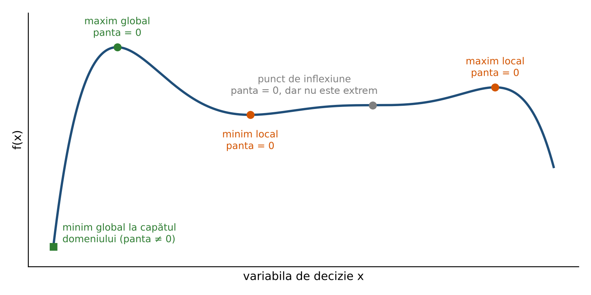
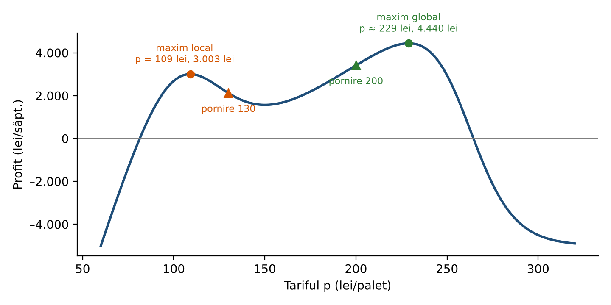

::: {.callout-note appearance="minimal"}
Această pagină însoțește Capitolul 9 al cărții: rezumă întrebările, termenii și aplicațiile, dar nu înlocuiește textul. Textul integral, soluțiile și bibliografia se găsesc în [carte](../carte.qmd).
:::

## Întrebarea capitolului

Până acum am folosit modele care descriu (ce s-a întâmplat?) și modele care prevăd (ce se va întâmpla?). De aici trecem la modele care recomandă o decizie: ce tarif să cerem, cât să comandăm odată, cu ce viteză să conducem. **Cum găsim valoarea cea mai bună a unei singure decizii și cum știm că este, cu adevărat, cea mai bună?**

Înainte de a parcurge capitolul, încercați să răspundeți la trei întrebări:

1. O comandă mare înseamnă mai puține curse pe an, dar mai mult stoc în depozit. Există o mărime a comenzii care face costul total minim?

    

Indiciu

    Două costuri variază în sens opus: costul comenzilor scade cu mărimea lotului, costul deținerii crește. Optimul este *compromisul* dintre ele: lotul economic de comandă.
    

2. Formula lotului economic recomandă comenzi de 165 de paleți. În camion încap 33. Ce faceți?

    

Indiciu

    Formula nu știe nimic despre camion. Verificați dacă optimul matematic se află în *domeniul admisibil* și recalculați costul cu numărul real de curse.
    

3. Solver afișează „Solver has converged to the current solution”. Ați găsit cel mai bun tarif?

    

Indiciu

    Mesajul spune doar că profitul nu mai crește de la un pas la altul. Dacă funcția are două vârfuri, Solver poate rămâne pe cel mai mic: un *optim local*. Încercați mai multe puncte de pornire.
    

### Pe scurt: ce este o problemă de optimizare?

Un **model prescriptiv** răspunde la întrebarea „ce ar trebui să facem?”. El are trei elemente: **variabila de decizie** (tariful, mărimea comenzii, viteza), **funcția obiectiv** pe care o maximizăm sau o minimizăm (profitul, costul) și **domeniul admisibil**, adică valorile pe care decizia le poate lua în realitate. Într-un optim interior, panta funcției este zero; dacă funcția este **concavă** (pentru un maxim) sau **convexă** (pentru un minim), optimul găsit este **global**. Altfel, pot exista mai multe **optime locale**, iar un instrument ca Solver poate să se oprească pe unul dintre ele.

{fig-alt="O curbă cu un maxim global, un maxim local, un minim local, un minim global și un punct de inflexiune, fiecare marcat și denumit"}

## Obiective și termeni-cheie

La finalul capitolului veți formula o decizie logistică simplă ca problemă de optimizare, veți găsi soluția optimă în Excel și veți judeca dacă este cea mai bună și dacă poate fi aplicată. Concret, veți putea:

- să numiți elementele unei probleme de optimizare: variabila de decizie, funcția obiectiv, domeniul admisibil;
- să recunoașteți maximul și minimul, local și global, și punctul de inflexiune;
- să explicați de ce panta este zero într-un optim interior și ce garantează forma concavă sau convexă a funcției;
- să găsiți optimul cu un tabel, un grafic și panta calculată din diferențe finite;
- să calculați lotul economic de comandă și costul total anual în Excel;
- să verificați dacă optimul matematic este admisibil și să găsiți optimul practic la limită;
- să rezolvați o problemă cu o variabilă în Solver (GRG Nonlinear) și să încercați mai multe puncte de pornire.

| Termen | În engleză |
| --- | --- |
| model prescriptiv | *prescriptive model* |
| variabilă de decizie / funcție obiectiv | *decision variable / objective function* |
| domeniu admisibil | *feasible region* |
| optim local / global | *local / global optimum* |
| diferență finită | *finite difference* |
| compromis | *trade-off* |
| lotul economic de comandă (EOQ) | *economic order quantity* |
| program de completare | *add-in* |

## Studiul de caz: deciziile cu o singură variabilă la Cargo Someș

Cei cinci pași reiau două întrebări din Capitolul 2 și adaugă trei noi. Pasul 1 regăsește tariful optim al grupajului Cluj–Brașov, 130 lei/palet, fără formula parabolei, doar din pantă. Pașii 2 și 3 calculează lotul economic de aprovizionare a depozitului și arată că optimul matematic nu încape în camion: optimul practic este un camion plin, la limita domeniului admisibil. Pasul 4 caută viteza economică pe autostradă, iar Pasul 5 arată capcana unui profit cu două vârfuri.

{fig-alt="Curba profitului în funcție de tarif, cu două vârfuri de înălțimi diferite, și cele două puncte de pornire ale Solver-ului, fiecare ducând la alt vârf"}

Lecția Pasului 5: mesajul de reușită al Solver-ului nu garantează optimul global. Pentru o funcție care nu este concavă, încercați mai multe puncte de pornire sau opțiunea Multistart.

## Verificați-vă

Depozitul primește D = 1.320 de paleți pe an, o comandă costă A = 1.865 lei, iar deținerea unui palet costă 20% din valoarea lui de 900 lei pe an. Care este lotul economic? (răspunsul se deschide la clic)

Costul anual de deținere pe palet este 0,2 · 900 = 180 lei. Q* = √(2 · 1.320 · 1.865 / 180) ≈ 165,4 paleți. La acest lot, costul comenzilor și costul deținerii sunt egale, câte circa 14.885 lei pe an. În Excel: `=SQRT(2*1320*1865/(0,2*900))`. Dar un camion are 33 de paleți: Pasul 3 din carte arată de ce optimul practic este, aici, un camion plin.

## Registrul Excel

**MLTM_C09_optimizare_fara_constrangeri.xlsx**. Registrul folosește setări românești: argumentele se separă cu „;”, zecimalele cu „,”. Pentru Pașii 2–5 activați programul de completare Solver.

| Foaia | Ce conține |
| --- | --- |
| 0_Citiți-mă | Cum se folosește registrul |
| 1_Tarif | Tariful optim la grupajul Cluj–Brașov, din pantă |
| 2_Lot_economic | Lotul economic de aprovizionare (EOQ) |
| 3_Lot_camion | Costul cu numărul real de curse și optimul la limită |
| 4_Viteza | Viteza economică pe autostradă |
| 5_Doua_segmente | Profitul cu două vârfuri și punctele de pornire ale Solver-ului |
| Ex_Exercitii | Date pentru exerciții, cu soluțiile sub fiecare exercițiu |

*Registrul va putea fi descărcat din Pachetul Excel al cărții, publicat pe Zenodo.*

## Prezentare

*În pregătire.*

## Temă de laborator: un compromis din activitatea voastră

Alegeți o decizie cu o singură variabilă în care două costuri trag în sensuri opuse: mărimea lotului comandat, frecvența livrărilor la un client, numărul de operatori pe tură.

1. Numiți variabila de decizie, funcția obiectiv și domeniul admisibil. Ce limite reale are decizia?
2. Scrieți cele două costuri ca funcții de variabilă și notați sursa fiecărui parametru.
3. Găsiți optimul cu un tabel și un grafic, apoi cu Solver.
4. Este optimul matematic admisibil? Dacă nu, care este optimul practic?
5. Cât de plată este curba în jurul optimului? Cât pierdeți dacă rotunjiți decizia la o valoare convenabilă?

## Exerciții suplimentare

Capitolul se încheie cu șase întrebări grilă, o întrebare deschisă și patru exerciții în Excel; răspunsurile sunt în carte, în secțiunea 5.4 și în Anexa B. Alte exerciții pentru Partea III sunt în [Problemele recapitulative III](pr3.qmd).

## Lecturi suplimentare

1. C. Caplice and E. Ponce, *MITx MicroMasters Program in SCM Key Concepts*, Version 20 Sep. 2026. Cambridge, MA, USA: MIT Center for Transportation & Logistics, 2026.
2. S. Chopra, P. Meindl, and D. V. Kalra, *Supply Chain Management: Strategy, Planning, and Operation*, 6th ed. Noida, India: Pearson India Education Services, 2016.

Lista completă a surselor capitolului se găsește în Bibliografia cărții.
