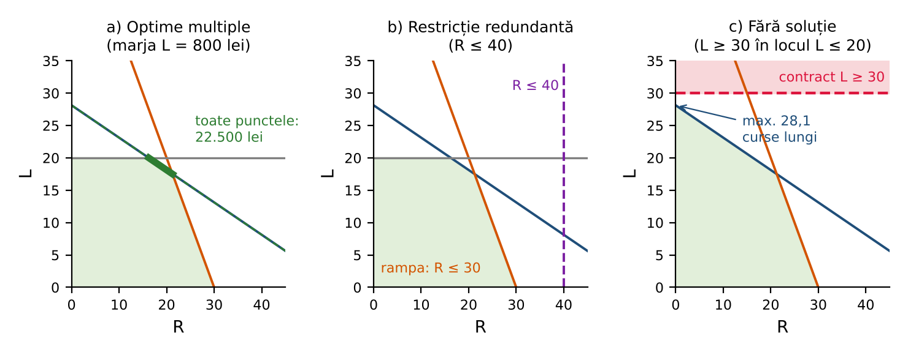

::: {.callout-note appearance="minimal"}
Această pagină însoțește Capitolul 10 al cărții: rezumă întrebările, termenii și aplicațiile, dar nu înlocuiește textul. Textul integral, soluțiile și bibliografia se găsesc în [carte](../carte.qmd).
:::

## Întrebarea capitolului

În Capitolul 9 am optimizat o singură decizie. Dispecerul firmei Cargo Someș ia însă mai multe decizii deodată, iar ele concurează pentru aceleași resurse: orele de condus ale șoferilor, orele de lucru la rampă, cererea clienților. **Câte curse de fiecare tip să planificăm într-o săptămână, ca marja totală să fie cât mai mare, și cât valorează o oră în plus dintr-o resursă?**

Înainte de a parcurge capitolul, încercați să răspundeți la trei întrebări:

1. O cursă lungă aduce 700 de lei marjă, una regională 400 de lei. Planificăm doar curse lungi?

    

Indiciu

    Nu comparați doar marja pe cursă. Câtă marjă aduce fiecare tip de cursă pe o oră de condus? Dar pe o oră la rampă? Rămâne același tip de cursă pe primul loc la ambele resurse?
    

2. Domeniul admisibil este un poligon. De ce nu trebuie căutat optimul și în interiorul lui?

    

Indiciu

    Luați un punct aflat strict în interiorul poligonului și faceți un pas mic în direcția în care marja crește. Vă oprește ceva înainte de a ajunge la margine? Dar după ce ați ajuns pe o latură?
    

3. Managerul se întreabă dacă merită să angajeze un șofer cu jumătate de normă. Trebuie rezolvat modelul din nou?

    

Indiciu

    Câte ore de condus adaugă o jumătate de normă? Dacă știți cât aduce o oră în plus, puteți înmulți simplu? Ce altă resursă ar putea bloca extinderea înainte ca toate acele ore să fie folosite?
    

### Pe scurt: ce este un program liniar?

Un **program liniar** (*linear programming, LP*) este o problemă de optimizare cu mai multe **variabile de decizie**, în care funcția obiectiv și toate constrângerile, numite în programarea liniară **restricții** (*constraints*), sunt liniare: fiecare variabilă apare doar înmulțită cu o constantă, iar termenii se adună. Restricțiile descriu resursele limitate, cerințele minime (de exemplu, un contract) sau condițiile de echilibru (cererea fiecărei regiuni). Dacă problema are o soluție optimă, cel puțin una dintre soluțiile optime se află într-un **vârf** al domeniului admisibil. Metoda **Simplex LP** din Solver trece din vârf în vârf până găsește optimul; spre deosebire de metoda gradientului redus generalizat (GRG Nonlinear) din Capitolul 9, optimul găsit este global. **Analiza de sensibilitate** spune, fără o nouă rezolvare, ce se întâmplă dacă o dată se schimbă puțin: **prețul umbră** al unei resurse, **restul** (*slack*) și **costul redus** al unei variabile.

{fig-alt="Trei grafice cu domeniul admisibil al planului săptămânal: în primul, dreapta de izoprofit se suprapune pe o latură; în al doilea, o restricție nu atinge domeniul; în al treilea, restricțiile nu au niciun punct comun"}

## Obiective și termeni-cheie

La finalul capitolului veți formula o problemă de planificare a transportului ca program liniar, o veți rezolva în Excel cu Solver și veți folosi raportul de sensibilitate pentru întrebări de tipul „merită să mai angajăm un șofer?”. Concret, veți putea:

- să numiți elementele unui program liniar și ipotezele lui: proporționalitate, aditivitate, divizibilitate, certitudine;
- să rezolvați grafic un program liniar cu două variabile și să găsiți vârful optim;
- să recunoașteți optimele multiple, restricțiile redundante, problemele fără soluție și cele nemărginite;
- să organizați modelul în foaia de calcul cu SUMPRODUCT și să-l rezolvați cu Solver (Simplex LP);
- să citiți raportul de sensibilitate: restricții active, rest, preț umbră, cost redus și intervalele lor;
- să formulați și să rezolvați o problemă de transport cu mai multe surse și destinații.

| Termen | În engleză |
| --- | --- |
| programare liniară | *linear programming, LP* |
| restricție / restricție activă | *constraint / binding constraint* |
| poligon convex, vârf | *convex polygon, corner point* |
| dreaptă de izoprofit | *iso-profit line* |
| analiză de sensibilitate | *sensitivity analysis* |
| rest | *slack* |
| preț umbră | *shadow price* |
| cost redus | *reduced cost* |
| creștere / scădere admisă | *allowable increase / decrease* |
| problemă fără soluție admisibilă / nemărginită | *infeasible / unbounded problem* |
| problema de transport | *transportation problem* |

## Studiul de caz: planul săptămânal al flotei Cargo Someș

Cele 5 camioane proprii pot face curse regionale, spre Dej și Bistrița, sau curse lungi, spre Brașov. Cei șapte pași formulează problema, o rezolvă întâi grafic și apoi cu Solver, citesc raportul de sensibilitate și încearcă trei situații speciale. Pasul 6 rezolvă o problemă de transport pentru un client industrial cu două depozite, la Bistrița și la Sebeș, al cărui transport Cargo Someș îl organizează cu un transportator 3PL, iar Pasul 7 scrie modelul general cu Σ, pentru patru tipuri de curse.

{fig-alt="Schema celor două depozite, Bistrița și Sebeș, și a celor trei regiuni aprovizionate, cu numărul de paleți pe fiecare rută folosită și costul pe palet"}

Planul optim, 21,25 curse regionale și 17,5 curse lungi pe săptămână, este fracționar. Cum îl transformăm într-un plan cu curse întregi și cum tratăm deciziile de tip „da sau nu”, cu un cost fix (angajarea unui șofer, deschiderea unei rute), aflăm în [Capitolul 11](cap11.qmd).

## Verificați-vă

Un depozit pregătește comenzi mici (*M*, marjă 60 de lei) și mari (*G*, marjă 100 de lei). O comandă mică cere 1 oră de culegere și 1 oră de ambalare; una mare, 2 ore de culegere și 1 oră de ambalare. Pe săptămână sunt disponibile 40 de ore de culegere și 30 de ore de ambalare. a) Este admisibil planul *M* = 20, *G* = 10? Ce marjă aduce și ce rest rămâne la fiecare resursă? b) Raportul de sensibilitate dă pentru culegere prețul umbră 40 lei/h și creșterea admisă 20 de ore. Managerul vrea 30 de ore de culegere în plus. Cu cât crește marja? (răspunsul se deschide la clic)

a) Culegere: 1 · 20 + 2 · 10 = 40 de ore; ambalare: 20 + 10 = 30 de ore. Planul este admisibil, iar restul este 0 la ambele resurse. Marja: 60 · 20 + 100 · 10 = 2.200 de lei. În Excel: `=SUMPRODUCT(marje;plan)`, unde argumentele sunt cele două domenii de celule.

b) Calculul 30 · 40 = 1.200 de lei este greșit, pentru că 30 de ore depășesc creșterea admisă de 20. Primele 20 de ore aduc 20 · 40 = 800 de lei: planul devine *M* = 0, *G* = 30, iar ambalarea este folosită complet. După aceea, încă o comandă mare ar cere ambalare pe care depozitul nu o mai are, deci ultimele 10 ore de culegere nu aduc nimic. Marja crește cu 800 de lei, la 3.000, iar modelul trebuie rezolvat din nou ca să vedeți asta.

## Registrul Excel

**MLTM_C10_programare_liniara.xlsx**. Registrul folosește setări românești: argumentele se separă cu „;”, zecimalele cu „,”. Activați programul de completare Solver și alegeți metoda Simplex LP.

| Foaia | Ce conține |
| --- | --- |
| 0_Citiți-mă | Cum se folosește registrul |
| 1_Plan_flota | Modelul planului săptămânal, pregătit pentru Solver |
| 2_Grafic | Vârfurile domeniului admisibil și marja în fiecare |
| 3_Sensibilitate | Raportul de sensibilitate (restricții și variabile) și experimentul „încă o oră” |
| 4a_Optime_multiple, 4b_Redundanta, 4c_Infezabil | Cele trei situații speciale |
| 5_Transport | Problema de transport: două depozite, trei regiuni |
| 6_Formulare_generala | Modelul general cu patru tipuri de curse |
| Ex_Atelier, Ex_Paleti | Datele și soluțiile Exercițiilor 1 și 2, în rândul gri de la final; Exercițiile 3 și 4 se rezolvă pe copii ale foilor 1_Plan_flota și 5_Transport |

*Registrul va putea fi descărcat din Pachetul Excel al cărții, publicat pe Zenodo.*

## Prezentare

*În pregătire.*

## Temă de laborator: un plan cu resurse limitate

Alegeți o activitate în care două–trei tipuri de lucrări concurează pentru aceleași resurse: tipuri de curse, de comenzi pregătite în depozit, de produse pe o linie.

1. Definiți variabilele de decizie și scrieți obiectivul și restricțiile, întâi în cuvinte, apoi cu formule.
2. Verificați cele patru ipoteze ale programării liniare. Care este cea mai puțin credibilă pentru datele alese?
3. Organizați modelul cu SUMPRODUCT și rezolvați-l cu Solver (Simplex LP).
4. Din raportul de sensibilitate, numiți resursa cu cel mai mare preț umbră și intervalul în care el rămâne valabil.
5. Scrieți recomandarea pentru manager: ce resursă merită mărită și cu cât?

## Exerciții suplimentare

Capitolul se încheie cu șase întrebări grilă, o întrebare deschisă și patru exerciții în Excel; răspunsurile sunt în carte, în secțiunea 5.4 și în Anexa B. Alte exerciții pentru Partea III sunt în [Problemele recapitulative III](pr3.qmd).

## Lecturi suplimentare

1. C. Caplice and E. Ponce, *MITx MicroMasters Program in SCM Key Concepts*, Version 20 Sep. 2026. Cambridge, MA, USA: MIT Center for Transportation & Logistics, 2026.
2. S. Chopra, P. Meindl, and D. V. Kalra, *Supply Chain Management: Strategy, Planning, and Operation*, 6th ed. Noida, India: Pearson India Education Services, 2016.

Lista completă a surselor capitolului se găsește în Bibliografia cărții.
