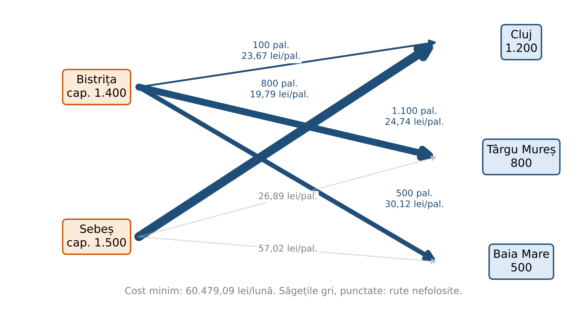

::: {.callout-note appearance="minimal"}
Această pagină însoțește Capitolul 10 al cărții: rezumă întrebările, termenii și aplicațiile, dar nu înlocuiește textul. Textul integral, soluțiile și bibliografia se găsesc în [carte](../carte.qmd).
:::

## Întrebarea capitolului

În Capitolul 9 am optimizat o singură decizie. Dispecerul firmei Cargo Someș ia însă mai multe decizii deodată, iar ele concurează pentru aceleași resurse: orele de condus ale șoferilor, orele de lucru la rampă, cererea clienților. **Câte curse de fiecare tip să planificăm într-o săptămână, ca marja totală să fie cât mai mare, și cât valorează o oră în plus dintr-o resursă?**

Înainte de a parcurge capitolul, încercați să răspundeți la trei întrebări:

1. O cursă lungă aduce 700 de lei marjă, una regională 400 de lei. Planificăm doar curse lungi?

    

Indiciu

    Cursa lungă consumă de două ori mai multe ore de condus, cursa regională de două ori mai mult timp la rampă. Răspunsul depinde de resursa care se epuizează prima: de aceea avem nevoie de un model.
    

2. Domeniul admisibil este un poligon. De ce nu trebuie căutat optimul și în interiorul lui?

    

Indiciu

    Când obiectivul și restricțiile sunt liniare, dreapta de izoprofit se poate împinge mereu mai departe, până atinge ultimul punct al poligonului: un *vârf*.
    

3. Managerul se întreabă dacă merită să angajeze un șofer cu jumătate de normă. Trebuie rezolvat modelul din nou?

    

Indiciu

    Nu neapărat. Raportul de sensibilitate dă *prețul umbră* al orelor de condus: cât crește marja pentru fiecare oră în plus, într-un interval dat.
    

### Pe scurt: ce este un program liniar?

Un **program liniar** (*linear programming, LP*) este o problemă de optimizare cu mai multe **variabile de decizie**, în care funcția obiectiv și toate **restricțiile** sunt liniare: fiecare variabilă apare doar înmulțită cu o constantă, iar termenii se adună. Restricțiile descriu resursele limitate. Optimul se află întotdeauna într-un **vârf** al domeniului admisibil, iar metoda **Simplex LP** din Solver trece din vârf în vârf până îl găsește; spre deosebire de GRG Nonlinear, optimul găsit este global. **Analiza de sensibilitate** spune, fără o nouă rezolvare, ce se întâmplă dacă o dată se schimbă puțin: **prețul umbră** al unei resurse, **restul** (*slack*) și **costul redus** al unei variabile.

{fig-alt="Trei grafice cu domeniul admisibil al planului săptămânal: în primul, dreapta de izoprofit se suprapune pe o latură; în al doilea, o restricție nu atinge domeniul; în al treilea, restricțiile nu au niciun punct comun"}

## Obiective și termeni-cheie

La finalul capitolului veți formula o problemă de planificare a transportului ca program liniar, o veți rezolva în Excel cu Solver și veți folosi raportul de sensibilitate pentru întrebări de tipul „merită să mai angajăm un șofer?”. Concret, veți putea:

- să numiți elementele unui program liniar și ipotezele lui: proporționalitate, aditivitate, divizibilitate, certitudine;
- să rezolvați grafic un program liniar cu două variabile și să găsiți vârful optim;
- să recunoașteți optimele multiple, restricțiile redundante, problemele fără soluție și cele nemărginite;
- să organizați modelul în foaia de calcul cu SUMPRODUCT și să-l rezolvați cu Solver (Simplex LP);
- să citiți raportul de sensibilitate: restricții active, rest, preț umbră, cost redus și intervalele lor;
- să formulați și să rezolvați o problemă de transport cu mai multe surse și destinații.

| Termen | În engleză |
| --- | --- |
| programare liniară | *linear programming, LP* |
| restricție / restricție activă | *constraint / binding constraint* |
| poligon convex, vârf | *convex polygon, corner point* |
| dreaptă de izoprofit | *isoprofit line* |
| analiză de sensibilitate | *sensitivity analysis* |
| rest, preț umbră, cost redus | *slack, shadow price, reduced cost* |
| problemă fără soluție admisibilă / nemărginită | *infeasible / unbounded problem* |
| problema de transport | *transportation problem* |

## Studiul de caz: planul săptămânal al flotei Cargo Someș

Cele 5 camioane proprii pot face curse regionale, spre Dej și Bistrița, sau curse lungi, spre Brașov. Cei șapte pași formulează problema, o rezolvă întâi grafic și apoi cu Solver, citesc raportul de sensibilitate și încearcă trei situații speciale. Pasul 6 rezolvă o problemă de transport pentru un client cu două depozite, la Bistrița și la Sebeș, iar Pasul 7 scrie modelul general cu Σ, pentru patru tipuri de curse.

{fig-alt="Schema celor două depozite, Bistrița și Sebeș, și a celor trei regiuni aprovizionate, cu numărul de paleți pe fiecare rută folosită și costul pe palet"}

Planul optim, 21,25 curse regionale și 17,5 curse lungi pe săptămână, este fracționar. Cum îl transformăm într-un plan cu curse întregi aflăm în [Capitolul 11](cap11.qmd).

## Verificați-vă

O cursă regională folosește 4 ore de condus și 2 ore de rampă; una lungă, 8 ore de condus și 1 oră de rampă. Sunt disponibile 225 de ore de condus și 60 de ore de rampă. Verificați că planul R = 21,25, L = 17,5 folosește complet ambele resurse și calculați marja. (răspunsul se deschide la clic)

Condus: 4 · 21,25 + 8 · 17,5 = 85 + 140 = 225 de ore. Rampă: 2 · 21,25 + 17,5 = 60 de ore. Ambele restricții sunt active. Marja: 400 · 21,25 + 700 · 17,5 = 20.750 lei pe săptămână. În Excel: `=SUMPRODUCT(B5:C5;B7:C7)`. Prețul umbră al orelor de condus este 83,33 lei: încă 10 ore ar aduce circa 833 de lei, pentru că 10 ore se află în intervalul admis de +15 ore.

## Registrul Excel

**MLTM_C10_programare_liniara.xlsx**. Registrul folosește setări românești: argumentele se separă cu „;”, zecimalele cu „,”. Activați programul de completare Solver și alegeți metoda Simplex LP.

| Foaia | Ce conține |
| --- | --- |
| 0_Citiți-mă | Cum se folosește registrul |
| 1_Plan_flota | Modelul planului săptămânal, pregătit pentru Solver |
| 2_Grafic | Vârfurile domeniului admisibil și marja în fiecare |
| 3_Sensibilitate | Raportul de sensibilitate: restricții și variabile |
| 4a_Optime_multiple, 4b_Redundanta, 4c_Infezabil | Cele trei situații speciale |
| 5_Transport | Problema de transport: două depozite, trei regiuni |
| 6_Formulare_generala | Modelul general cu patru tipuri de curse |
| Ex_Atelier, Ex_Paleti | Date pentru exerciții, cu soluțiile în rândul gri de la final |

*Linkul DOI spre Pachetul Excel (Zenodo) va fi adăugat aici.*

## Prezentare

*În pregătire.*

## Temă de laborator: un plan cu resurse limitate

Alegeți o activitate în care două–trei tipuri de lucrări concurează pentru aceleași resurse: tipuri de curse, de comenzi pregătite în depozit, de produse pe o linie.

1. Definiți variabilele de decizie și scrieți obiectivul și restricțiile, întâi în cuvinte, apoi cu formule.
2. Verificați cele patru ipoteze ale programării liniare. Care este cea mai puțin credibilă pentru datele voastre?
3. Organizați modelul cu SUMPRODUCT și rezolvați-l cu Solver (Simplex LP).
4. Din raportul de sensibilitate, numiți resursa cu cel mai mare preț umbră și intervalul în care el rămâne valabil.
5. Scrieți recomandarea pentru manager: ce resursă merită mărită și cu cât?

## Exerciții suplimentare

Capitolul se încheie cu șase întrebări grilă, o întrebare deschisă și patru exerciții în Excel; răspunsurile sunt în carte, în secțiunea 5.4 și în Anexa B. Alte exerciții pentru Partea III sunt în [Problemele recapitulative III](pr3.qmd).

## Lecturi suplimentare

1. C. Caplice and E. Ponce, *MITx MicroMasters Program in SCM Key Concepts*, Version 20 Sep. 2026. Cambridge, MA, USA: MIT Center for Transportation & Logistics, 2026.
2. S. Chopra, P. Meindl, and D. V. Kalra, *Supply Chain Management: Strategy, Planning, and Operation*, 6th ed. Noida, India: Pearson India Education Services, 2016.

Lista completă a surselor capitolului se găsește în Bibliografia cărții.
