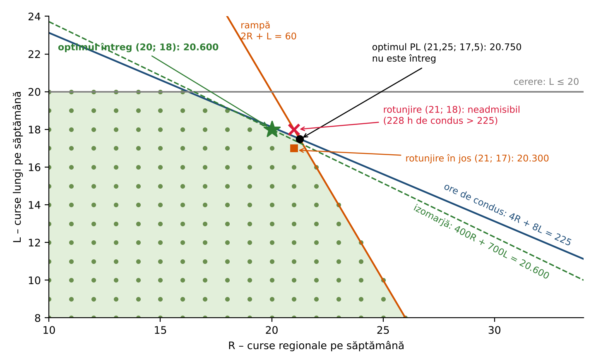

::: {.callout-note appearance="minimal"}
Această pagină însoțește Capitolul 11 al cărții: rezumă întrebările, termenii și aplicațiile, dar nu înlocuiește textul. Textul integral, soluțiile și bibliografia se găsesc în [carte](../carte.qmd).
:::

## Întrebarea capitolului

Planul optim din Capitolul 10 cerea 21,25 curse regionale pe săptămână. Un dispecer nu poate trimite un sfert de camion, iar multe decizii din transport nu sunt cantități, ci alegeri: semnăm sau nu un contract, angajăm sau nu un șofer, deschidem sau nu o rută. **Cum scriem astfel de decizii într-un model și cât ne costă fiecare regulă de afaceri?**

Înainte de a parcurge capitolul, încercați să răspundeți la trei întrebări:

1. Programul liniar recomandă 21,25 curse regionale și 17,5 curse lungi. Rotunjiți la 21 și 18. Ce poate merge prost?

    

Indiciu

    Soluția programului liniar folosește complet orele de condus și rampa. Ce se întâmplă cu o resursă aflată deja la limită când rotunjiți o variabilă în sus? Dar dacă le rotunjiți pe amândouă în jos: este acela cel mai bun plan întreg? (Capitolul 10, Pasul 1, dă orele pe cursă.)
    

2. Un transportator cere un abonament lunar fix, plătit doar dacă primește cel puțin o cursă. Cum scrieți „dacă primește curse, plătim abonamentul” cu o restricție liniară?

    

Indiciu

    Separați decizia în două: una de tip „da sau nu” (semnăm contractul?) și numărul de curse. Ce relație ar forța numărul de curse să fie zero când decizia este „nu”, fără să-l limiteze când decizia este „da”?
    

3. Departamentul de achiziții vrea cel mult două contracte cu transportatori terți. Cât costă această regulă?

    

Indiciu

    Ce face o regulă în plus cu mulțimea planurilor permise: adaugă variante noi sau elimină din cele vechi? Cum ați măsura efectul ei în lei, cu același model?
    

### Pe scurt: ce este programarea în numere întregi?

Un model de **programare liniară mixtă cu numere întregi** (*mixed-integer linear programming, MILP*) combină variabile **continue** cu variabile **întregi** (camioane, curse, șoferi) și/sau **binare** (0 sau 1: da sau nu). Ca în Capitolul 10, constrângerile se numesc aici **restricții**. Dacă ștergem condiția de număr întreg obținem **relaxarea liniară**, a cărei valoare optimă este o limită pentru optimul întreg. Variabilele binare traduc regulile de afaceri în restricții, după trei tipare: **Dacă–atunci** (un cost fix plătit doar când o activitate are loc), **Fie–fie** (un volum minim sau nimic) și **Selecție** (cel mult N variante dintr-o listă). Constanta **M mare** (*big M*) leagă variabila binară de cantitate; aleasă prea mică, interzice planuri bune, aleasă prea mare, încetinește rezolvarea.

{fig-alt="Domeniul admisibil al planului flotei, cu punctele întregi admisibile, soluția fracționară a relaxării, optimul programului liniar (21,25; 17,5), rotunjirea la cel mai apropiat întreg (21; 18), în afara domeniului, rotunjirea în jos (21; 17), admisibilă, și optimul întreg (20; 18), fiecare cu marja ei"}

## Obiective și termeni-cheie

La finalul capitolului veți recunoaște deciziile de transport care cer valori întregi sau binare, veți traduce reguli de afaceri în restricții liniare și veți rezolva și depana în Excel un model MILP. Concret, veți putea:

- să deosebiți variabilele continue, întregi și binare și să spuneți când programul liniar obișnuit este suficient;
- să explicați relaxarea liniară și de ce ea dă o limită pentru optimul întreg;
- să explicați de ce rotunjirea soluției unui program liniar nu este sigură;
- să scrieți condițiile logice Dacă–atunci, Fie–fie și Selecție și să alegeți constanta M;
- să găsiți optimul întreg al unui model mic prin enumerare completă și să-l comparați cu rotunjirea;
- să rezolvați cu Solver un model cu costuri fixe și volume minime (restricțiile int, număr întreg, și bin, binar);
- să calculați cât costă o regulă de afaceri și să depanați un model Solver cu o listă de verificare.

| Termen | În engleză |
| --- | --- |
| programare liniară mixtă cu numere întregi (MILP) | *mixed-integer linear programming* |
| variabilă continuă / întreagă / binară | *continuous / integer / binary variable* |
| relaxarea liniară | *LP (linear programming) relaxation* |
| enumerare completă | *complete enumeration* |
| limită | *bound* |
| decalaj de optimalitate | *optimality gap* |
| cost fix | *fixed cost* |
| restricție de legătură | *linking constraint* |
| constanta M mare | *big M* |
| volum minim | *minimum volume* |

## Studiul de caz: curse întregi și alegerea transportatorilor 3PL la Cargo Someș

Pasul 1 reia planul flotei Cargo Someș din Capitolul 10 și compară trei rotunjiri cu optimul întreg. Pașii 2–5 construiesc, pe rând, patru modele pentru alegerea transportatorilor terți (3PL) pe rutele de peste 250 km, grupate în trei zone: Centru-Est, Vest și Sud. Modelul 1 folosește doar tarifele; Modelul 2 adaugă abonamentul lunar (Dacă–atunci); Modelul 3, volumul minim de 15 curse (Fie–fie); Modelul 4, limita de cel mult două contracte (Selecție). Pasul 6 pune cele patru modele unul lângă altul.

Comparația arată prețul fiecărei reguli: volumul minim costă circa 690 de lei pe lună, iar limitarea la două contracte încă circa 140 de lei. Cu aceste cifre, discuția cu departamentul de achiziții nu mai pornește de la impresii.

Toate modelele de aici leagă direct sursele de destinații. În [Capitolul 12](cap12.qmd) rețeaua capătă noduri intermediare: drumul minim, transbordarea printr-un cross-dock, alegerea locației lui cu variabile binare (același tipar Dacă–atunci) și un prim contact cu programarea neliniară.

## Verificați-vă

Un model decide dacă închiriați pe lună un depozit temporar (*y* = 1 da, *y* = 0 nu) și câți paleți *x* trec prin el. Chiria fixă este de 6.000 de lei, depozitul are loc pentru cel mult 900 de paleți, iar proprietarul îl închiriază doar pentru cel puțin 200 de paleți. a) Scrieți restricțiile care leagă *x* de *y*. b) Un coleg a rulat Solver și a obținut *x* = 350, *y* = 0, iar costul nu conține chiria. Ce lipsește din model? (răspunsul se deschide la clic)

a) *x* ≤ 900 · *y* (Dacă–atunci: fără depozit nu trece niciun palet; cu depozit, cel mult capacitatea) și *x* ≥ 200 · *y* (Fie–fie: zero sau cel puțin 200), cu *y* binar și chiria 6.000 · *y* în cost. Capacitatea de 900 este aici cea mai bună alegere pentru M: un M mai mic ar interzice planuri bune, unul mult mai mare ar încetini rezolvarea.

b) *x* = 350 cu *y* = 0 este posibil doar dacă lipsește restricția *x* ≤ 900 · *y* sau dacă ea nu se referă la celula lui *y*. Fără legătură, Solver alege *y* = 0 ca să nu plătească chiria. Verificați și că *y* are restricția bin în Solver: dacă nu o are, Solver poate alege o valoare fracționară, de exemplu *y* = 0,39, și plătește doar o parte din chirie.

## Registrul Excel

**MLTM_C11_MILP.xlsx**. Registrul folosește setări românești: argumentele se separă cu „;”, zecimalele cu „,”. Activați programul de completare Solver; metoda rămâne Simplex LP, cu restricțiile int (număr întreg) și bin (binar). În Opțiuni (*Options*), setați Integer Optimality la 0%: cu valoarea implicită de 1%, Solver se poate opri la un plan care nu este optim.

| Foaia | Ce conține |
| --- | --- |
| 0_Citiți-mă | Cum se folosește registrul |
| 1_Curse_intregi | Relaxarea, rotunjirile și optimul întreg prin enumerare |
| 2_Model1_tarife | Modelul 1: trei transportatori, numai tarife |
| 3_Model2_abonament | Modelul 2: abonamentul lunar (Dacă–atunci) |
| 4_Model3_volum_minim | Modelul 3: volumul minim contractual (Fie–fie) |
| 5_Model4_doi_transportatori | Modelul 4: cel mult două contracte (Selecție) |
| 6_Comparatie | Costul fiecărei reguli în cele patru modele |
| Ex_Investitii, Ex_Incarcare, Ex_Depanare | Datele Exercițiilor 1, 2 și 4, cu soluțiile în rândul gri de la final; Exercițiul 3 se rezolvă pe o copie a foii 4_Model3_volum_minim |

*Registrul va putea fi descărcat din Pachetul Excel al cărții, publicat pe Zenodo.*

## Prezentare

*În pregătire.*

## Temă de laborator: cât costă o regulă de afaceri?

Alegeți o decizie de alocare cu o regulă de afaceri reală: alegerea furnizorilor, a transportatorilor, a depozitelor deschise sau a turelor de lucru.

1. Scrieți modelul fără reguli: variabile, obiectiv, restricții. Ce variabile trebuie să fie întregi?
2. Formulați o regulă Dacă–atunci (cost fix) și una Fie–fie (volum minim) și alegeți constanta M. Justificați valoarea aleasă.
3. Rezolvați modelul cu Solver, întâi fără reguli, apoi adăugând câte o regulă.
4. Calculați costul fiecărei reguli ca diferență față de modelul anterior.
5. Scrieți recomandarea pentru manager: ce regulă merită păstrată și de ce, inclusiv argumente din afara modelului.

## Exerciții suplimentare

Capitolul se încheie cu șase întrebări grilă, o întrebare deschisă și patru exerciții în Excel; răspunsurile sunt în carte, în secțiunea 5.4 și în Anexa B. Alte exerciții pentru Partea III sunt în [Problemele recapitulative III](pr3.qmd).

## Lecturi suplimentare

1. C. Caplice and E. Ponce, *MITx MicroMasters Program in SCM Key Concepts*, Version 20 Sep. 2026. Cambridge, MA, USA: MIT Center for Transportation & Logistics, 2026.

Lista completă a surselor capitolului se găsește în Bibliografia cărții.
