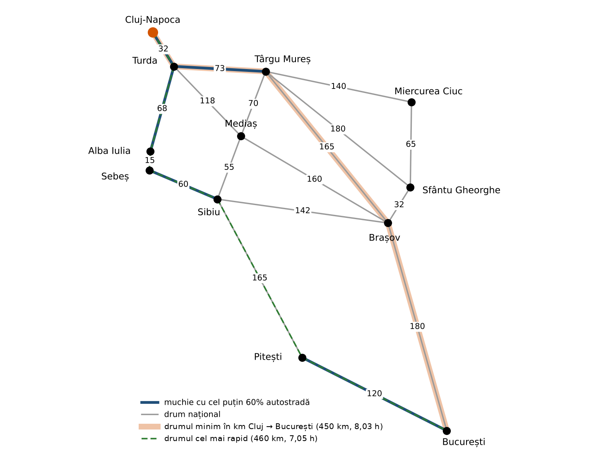

::: {.callout-note appearance="minimal"}
Această pagină însoțește Capitolul 12 al cărții: rezumă întrebările, termenii și aplicațiile, dar nu înlocuiește textul. Textul integral, soluțiile și bibliografia se găsesc în [carte](../carte.qmd).
:::

## Întrebarea capitolului

Transportul de marfă se desfășoară într-o rețea: orașe legate prin drumuri, depozite legate de clienți, platforme în care marfa se descarcă și se reîncarcă. Dispecerul firmei Cargo Someș alege zilnic pe ce drum merge un camion, în ce ordine vizitează magazinele și prin ce platformă trece marfa. **Cum scriem aceste decizii de rețea ca modele de optimizare și cum știm când o problemă devine prea grea pentru Solver?**

Înainte de a parcurge capitolul, încercați să răspundeți la trei întrebări:

1. Spre București, un drum are cu 10 km mai mult, dar trece pe autostradă și câștigă aproape o oră. Care este „drumul minim”?

    

Indiciu

    Ce plătește, de fapt, firma pe fiecare drum: kilometrii (combustibil, taxe), timpul șoferului sau amândouă? Rămâne același drum pe primul loc când șoferul are timp liber și când orele lui de condus sunt la limită?
    

2. Un camion pleacă din Cluj, livrează la Dej, Zalău, Satu Mare și Baia Mare și se întoarce. Mergeți mereu la cel mai apropiat oraș nevizitat. Obțineți circuitul cel mai scurt?

    

Indiciu

    Ce informație folosește regula la fiecare oprire? Privește doar pasul următor sau tot drumul? Ce se poate întâmpla cu ultimul segment, cel de întoarcere spre Cluj?
    

3. Un operator logistic oferă un cross-dock la Brașov, pentru 2.500 de lei pe săptămână. Cum decideți dacă merită și dacă nu este mai bun unul la Sibiu?

    

Indiciu

    Ce trebuie pus în balanță pentru fiecare locație: chiria săptămânală și ce altceva? Cum împiedicați un model să trimită marfă printr-un cross-dock fără să-i plătească chiria? (Capitolul 11)
    

### Pe scurt: ce sunt rețelele și programele neliniare?

O **rețea** este o mulțime de **noduri** (depozite, orașe, clienți) legate prin **arce** (drumuri, fluxuri de marfă). Patru probleme de rețea apar zilnic în transport: **drumul minim** între două noduri, **problema comis-voiajorului** (cel mai scurt circuit prin toate nodurile), **problema de transport** și **problema de transbordare**, cu noduri intermediare, precum un cross-dock, în care fluxul care intră este egal cu cel care iese. Drumul minim, problema de transport și problema de transbordare sunt ușor de rezolvat ca programe liniare; problema comis-voiajorului devine însă repede foarte grea. Un **program neliniar** (*nonlinear program, NLP*) are cel puțin o funcție care nu este liniară, de exemplu costul anual al comenzilor, A·D/Q, din costul aprovizionării. Solver îl rezolvă cu metoda gradientului redus generalizat (GRG Nonlinear), dar optimul găsit este sigur global doar când minimizăm o funcție convexă (sau maximizăm una concavă) cu restricții liniare.

{fig-alt="Harta schematică a celor 12 noduri, din sudul Transilvaniei până la București, și a celor 18 drumuri dintre ele, cu cele două drumuri posibile de la Cluj la București evidențiate: prin Brașov (450 km, circa 8 ore) și prin Sibiu și Pitești (460 km, circa 7 ore)"}

## Obiective și termeni-cheie

La finalul capitolului veți recunoaște problemele de rețea din transportul de marfă, le veți formula ca programe liniare sau mixte și le veți rezolva în Excel; veți ști când un model devine neliniar și ce precauții cere. Concret, veți putea:

- să definiți nodul, arcul și rețeaua și să deosebiți rețeaua fizică de rețeaua operațională;
- să descrieți drumul minim, problema comis-voiajorului, problema de transport și problema de transbordare;
- să explicați conservarea fluxului într-un nod de transbordare și rolul binarelor în alegerea locației;
- să găsiți drumul minim cu Solver, după distanță, timp sau cost;
- să formulați o problemă de transbordare cu un cross-dock și să comparați două locații candidate;
- să construiți un circuit cu euristica celui mai apropiat vecin și să-l comparați cu optimul găsit prin enumerare;
- să rezolvați un program neliniar cu GRG Nonlinear, să spuneți când optimul găsit este sigur global și să interpretați multiplicatorul Lagrange al unei restricții.

| Termen | În engleză |
| --- | --- |
| rețea | *network* |
| nod, arc | *node, arc* |
| drumul minim | *shortest path problem, SPP* |
| problema comis-voiajorului | *traveling salesman problem, TSP* |
| problema de transbordare, cross-dock | *transshipment problem, cross-dock* |
| conservarea fluxului | *flow conservation* |
| localizarea unei facilități | *facility location* |
| euristica celui mai apropiat vecin | *nearest neighbour heuristic* |
| program neliniar (NLP) | *nonlinear program* |
| multiplicator Lagrange | *Lagrange multiplier* |

## Studiul de caz: rețeaua Cargo Someș

Cei șapte pași pornesc de la harta rețelei din sudul Transilvaniei. Pasul 2 caută drumul minim spre Brașov și spre București după trei criterii. Pasul 3 aprovizionează cinci orașe din sudul Transilvaniei și Bucureștiul (șase destinații) din depozitul Cargo Someș din Cluj și din depozitul de la Sebeș al unui producător, client al firmei, Pasul 4 adaugă un cross-dock la Brașov, iar Pasul 5 alege între Brașov și Sibiu. Pasul 6 compară circuitul celui mai apropiat vecin cu circuitul optim prin nord-vest. Pasul 7 se mută în depozitul din Cluj: Cargo Someș planifică loturile pentru trei produse ale unui client distribuitor, cu un spațiu de recepție limitat, într-un model neliniar.

{fig-alt="Schema fluxurilor săptămânale de paleți de la depozitul din Cluj și de la producătorul din Sebeș, prin cross-dock-ul de la Brașov sau direct, către Sibiu, Mediaș, Brașov, Sfântu Gheorghe, Miercurea Ciuc și București"}

Rezultatul Pasului 5: cross-dock-ul de la Brașov economisește circa 155.000 de lei pe an față de livrările directe. Întrebarea deschisă a capitolului cere să judecați ce ar trebui verificat înainte de a semna un contract pe trei ani.

Cu 5 noduri, toate circuitele se pot enumera; cu câteva zeci de clienți, nici enumerarea, nici Solver nu mai fac față. Partea IV începe cu [Capitolul 13](cap13.qmd), unde trecem la algoritmi și euristici de rutare.

## Verificați-vă

a) Între două orașe există două drumuri: A are 300 km și 5,0 ore, B are 320 km și 4,2 ore. Costul pe km este de 2,5 lei. Care drum este mai ieftin dacă o oră de condus valorează 50 de lei? De la ce valoare a orei devine B mai avantajos? b) Un cross-dock primește pe săptămână 90 de paleți din depozitul X și 50 din depozitul Y și livrează 60 la magazinul P și 45 la magazinul Q. Câți paleți pot pleca spre magazinul R? (răspunsul se deschide la clic)

a) Costul generalizat este km · 2,5 + ore · v. Cu v = 50 lei/h: A costă 750 + 250 = 1.000 de lei, B costă 800 + 210 = 1.010 lei, deci A este mai ieftin, deși B este mai rapid. Cele două sunt egale când 750 + 5,0 · v = 800 + 4,2 · v, adică v = 50 / 0,8 = 62,5 lei/h; peste această valoare câștigă B. „Drumul minim” depinde de criteriu.

b) Într-un nod de transbordare fluxul care iese este egal cu cel care intră: 90 + 50 = 140 de paleți intră, 60 + 45 = 105 ies spre P și Q, deci spre R pleacă 35 de paleți. În model, aceasta este o restricție de egalitate pentru nod: intrările – ieșirile = 0.

## Registrul Excel

**MLTM_C12_retele_NLP.xlsx**. Registrul folosește setări românești: argumentele se separă cu „;”, zecimalele cu „,”. Activați programul de completare Solver: Simplex LP (pentru programe liniare) în Pașii 2–5, cu restricția bin pentru binare și Integer Optimality 0% în Pasul 5, și GRG Nonlinear în Pasul 7. Pasul 6 se rezolvă doar cu formule.

| Foaia | Ce conține |
| --- | --- |
| 0_Citiți-mă | Cum se folosește registrul |
| 1_Retea | Nodurile, muchiile și matricea distanțelor minime |
| 2_Drum_minim | Drumul minim după distanță, timp sau cost |
| 3_Transport | Aprovizionarea din Cluj și Sebeș |
| 4_Transbordare | Cross-dock-ul de la Brașov |
| 5_Localizare | Brașov sau Sibiu: alegerea locației cu binare |
| 6_Tur_NV | Circuitul Nord-Vest: cel mai apropiat vecin și enumerarea |
| 7_NLP_loturi | Loturile pentru trei produse cu spațiu limitat |
| Ex_Tur, Ex_Depanare | Exercițiile 2 și 5, cu soluțiile în rândurile gri; Exercițiile 1, 3 și 4 se fac pe copii ale foilor 2_Drum_minim, 5_Localizare și 7_NLP_loturi |

*Registrul va putea fi descărcat din Pachetul Excel al cărții, publicat pe Zenodo.*

## Prezentare

*În pregătire.*

## Temă de laborator: o rețea pe care o cunoașteți

Alegeți o rețea reală mică: livrările unei firme într-un județ, traseele unui curier, aprovizionarea câtorva magazine.

1. Desenați rețeaua cu 6–10 noduri și notați distanța și timpul pe fiecare arc; notați sursa datelor.
2. Găsiți drumul minim între două noduri după distanță și după timp. Diferă drumurile? Ce ați recomanda?
3. Alegeți 4–5 noduri și construiți circuitul celui mai apropiat vecin. Comparați-l cu circuitul optim, prin enumerare.
4. Propuneți o locație pentru un punct de transbordare și estimați economia săptămânală față de livrările directe.
5. Ce ipoteze ale modelului ați verifica înainte de o decizie pe termen lung, cum ar fi o închiriere sau o investiție?

## Exerciții suplimentare

Capitolul se încheie cu șase întrebări grilă, o întrebare deschisă și cinci exerciții în Excel; răspunsurile sunt în carte, în secțiunea 5.4 și în Anexa B. Alte exerciții pentru Partea III sunt în [Problemele recapitulative III](pr3.qmd).

## Lecturi suplimentare

1. C. Caplice and E. Ponce, *MITx MicroMasters Program in SCM Key Concepts*, Version 20 Sep. 2026. Cambridge, MA, USA: MIT Center for Transportation & Logistics, 2026.
2. S. Chopra, P. Meindl, and D. V. Kalra, *Supply Chain Management: Strategy, Planning, and Operation*, 6th ed. Noida, India: Pearson India Education Services, 2016.

Lista completă a surselor capitolului se găsește în Bibliografia cărții.
