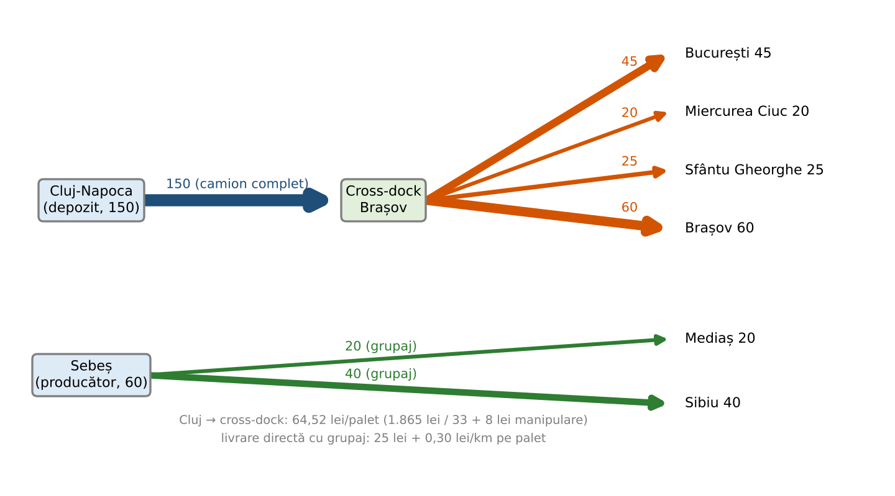

::: {.callout-note appearance="minimal"}
Această pagină însoțește Capitolul 12 al cărții: rezumă întrebările, termenii și aplicațiile, dar nu înlocuiește textul. Textul integral, soluțiile și bibliografia se găsesc în [carte](../carte.qmd).
:::

## Întrebarea capitolului

Transportul de marfă se desfășoară într-o rețea: orașe legate prin drumuri, depozite legate de clienți, platforme în care marfa se descarcă și se reîncarcă. Dispecerul firmei Cargo Someș alege zilnic pe ce drum merge un camion, în ce ordine vizitează magazinele și prin ce platformă trece marfa. **Cum scriem aceste decizii de rețea ca modele de optimizare și cum știm când o problemă devine prea grea pentru Solver?**

Înainte de a parcurge capitolul, încercați să răspundeți la trei întrebări:

1. Spre București, un drum are cu 10 km mai mult, dar trece pe autostradă și câștigă aproape o oră. Care este „drumul minim”?

    

Indiciu

    Depinde de criteriu: kilometri, ore sau lei. Răspunsul „corect” depinde de cât valorează o oră de condus pentru firmă.
    

2. Un camion pleacă din Cluj, livrează la Dej, Zalău, Satu Mare și Baia Mare și se întoarce. Mergeți mereu la cel mai apropiat oraș nevizitat. Obțineți circuitul cel mai scurt?

    

Indiciu

    Nu neapărat. Euristica celui mai apropiat vecin poate lăsa un oraș îndepărtat la capătul circuitului. Cu cinci noduri, toate cele 12 circuite distincte se pot enumera și compara.
    

3. Un operator logistic oferă un cross-dock la Brașov, pentru 2.500 de lei pe săptămână. Cum decideți dacă merită și dacă nu e mai bun unul la Sibiu?

    

Indiciu

    Este tiparul Dacă–atunci din Capitolul 11: o binară pentru fiecare locație, costul fix în obiectiv și o restricție de legătură care permite flux prin cross-dock doar dacă este deschis.
    

### Pe scurt: ce sunt rețelele și programele neliniare?

O **rețea** este o mulțime de **noduri** (depozite, orașe, clienți) legate prin **arce** (drumuri, fluxuri de marfă). Patru probleme de rețea apar zilnic în transport: **drumul minim** între două noduri, **problema comis-voiajorului** (cel mai scurt circuit prin toate nodurile), **problema de transport** și **problema de transbordare**, cu noduri intermediare, precum un cross-dock, în care fluxul care intră este egal cu cel care iese. Primele și ultimele sunt ușor de rezolvat ca programe liniare; problema comis-voiajorului devine repede foarte grea. Un **program neliniar** (*nonlinear program, NLP*) are cel puțin o funcție care nu este liniară, de exemplu costul stocului, A·D/Q; Solver îl rezolvă cu GRG Nonlinear, dar optimul găsit este sigur global doar dacă problema este convexă.

{fig-alt="Harta schematică a celor 12 noduri din sudul Transilvaniei și a celor 18 drumuri dintre ele, cu cele două drumuri posibile de la Cluj la București, prin Brașov și prin Sibiu și Pitești, evidențiate"}

## Obiective și termeni-cheie

La finalul capitolului veți recunoaște problemele de rețea din transportul de marfă, le veți formula ca programe liniare sau mixte și le veți rezolva în Excel; veți ști când un model devine neliniar și ce precauții cere. Concret, veți putea:

- să definiți nodul, arcul și rețeaua și să deosebiți rețeaua fizică de rețeaua operațională;
- să descrieți drumul minim, problema comis-voiajorului, problema de transport și problema de transbordare;
- să explicați conservarea fluxului într-un nod de transbordare și rolul binarelor în alegerea locației;
- să găsiți drumul minim cu Solver, după distanță, timp sau cost;
- să formulați o problemă de transbordare cu un cross-dock și să comparați două locații candidate;
- să construiți un circuit cu euristica celui mai apropiat vecin și să-l comparați cu optimul găsit prin enumerare;
- să rezolvați un program neliniar cu GRG Nonlinear și să interpretați multiplicatorul Lagrange al unei restricții.

| Termen | În engleză |
| --- | --- |
| rețea, nod, arc | *network, node, arc* |
| drumul minim | *shortest path problem, SPP* |
| problema comis-voiajorului | *traveling salesman problem, TSP* |
| problema de transbordare, cross-dock | *transshipment problem, cross-dock* |
| conservarea fluxului | *flow conservation* |
| localizarea unei facilități | *facility location* |
| euristica celui mai apropiat vecin | *nearest neighbor heuristic* |
| program neliniar, multiplicator Lagrange | *nonlinear program, Lagrange multiplier* |

## Studiul de caz: rețeaua Cargo Someș

Cei șapte pași pornesc de la harta rețelei din sudul Transilvaniei. Pasul 2 caută drumul minim spre Brașov și spre București după trei criterii. Pasul 3 aprovizionează șase orașe și Bucureștiul din depozitele de la Cluj și Sebeș, Pasul 4 adaugă un cross-dock la Brașov, iar Pasul 5 alege între Brașov și Sibiu. Pasul 6 compară circuitul celui mai apropiat vecin cu circuitul optim prin nord-vest. Pasul 7 se mută în depozit: trei produse, loturi economice și un spațiu de depozitare limitat, un model neliniar.

{fig-alt="Schema fluxurilor săptămânale de paleți de la depozitele din Cluj și Sebeș, prin cross-dock-ul de la Brașov sau direct, către Sibiu, Mediaș, Brașov, Sfântu Gheorghe, Miercurea Ciuc și București"}

Rezultatul Pasului 5: cross-dock-ul de la Brașov economisește circa 155.000 de lei pe an față de livrările directe. Întrebarea deschisă a capitolului cere să judecați ce ar trebui verificat înainte de a semna un contract pe trei ani.

## Verificați-vă

Câte circuite distincte are problema comis-voiajorului pentru depozitul din Cluj și patru magazine? Dar dacă adăugați Bistrița? (răspunsul se deschide la clic)

Pentru n noduri, cu depozitul inclus, numărul de circuite distincte este (n – 1)! / 2, pentru că un circuit parcurs invers are aceeași lungime. Cu 5 noduri: 4! / 2 = 12 circuite. Cu Bistrița, 6 noduri: 5! / 2 = 60. Cu 11 noduri ar fi deja 1.814.400. În Excel: `=FACT(5)/2`. De aceea, pentru rețelele mai mari, [Capitolul 13](cap13.qmd) folosește euristici.

## Registrul Excel

**MLTM_C12_retele_NLP.xlsx**. Registrul folosește setări românești: argumentele se separă cu „;”, zecimalele cu „,”. Activați programul de completare Solver: Simplex LP pentru Pașii 2–5, GRG Nonlinear pentru Pasul 7.

| Foaia | Ce conține |
| --- | --- |
| 0_Citiți-mă | Cum se folosește registrul |
| 1_Retea | Nodurile, muchiile și matricea distanțelor minime |
| 2_Drum_minim | Drumul minim după distanță, timp sau cost |
| 3_Transport | Aprovizionarea din Cluj și Sebeș |
| 4_Transbordare | Cross-dock-ul de la Brașov |
| 5_Localizare | Brașov sau Sibiu: alegerea locației cu binare |
| 6_Tur_NV | Circuitul Nord-Vest: cel mai apropiat vecin și enumerarea |
| 7_NLP_loturi | Loturile pentru trei produse cu spațiu limitat |
| Ex_Tur, Ex_Depanare | Date pentru exerciții |

*Linkul DOI spre Pachetul Excel (Zenodo) va fi adăugat aici.*

## Prezentare

*În pregătire.*

## Temă de laborator: o rețea pe care o cunoașteți

Alegeți o rețea reală mică: livrările unei firme într-un județ, traseele unui curier, aprovizionarea câtorva magazine.

1. Desenați rețeaua cu 6–10 noduri și notați distanța și timpul pe fiecare arc; notați sursa datelor.
2. Găsiți drumul minim între două noduri după distanță și după timp. Diferă drumurile? Ce ați recomanda?
3. Alegeți 4–5 noduri și construiți circuitul celui mai apropiat vecin. Comparați-l cu circuitul optim, prin enumerare.
4. Propuneți o locație pentru un punct de transbordare și estimați economia săptămânală față de livrările directe.
5. Ce ipoteze ale modelului ați verifica înainte de a semna un contract pe trei ani?

## Exerciții suplimentare

Capitolul se încheie cu șase întrebări grilă, o întrebare deschisă și cinci exerciții în Excel; răspunsurile sunt în carte, în secțiunea 5.4 și în Anexa B. Alte exerciții pentru Partea III sunt în [Problemele recapitulative III](pr3.qmd).

## Lecturi suplimentare

1. C. Caplice and E. Ponce, *MITx MicroMasters Program in SCM Key Concepts*, Version 20 Sep. 2026. Cambridge, MA, USA: MIT Center for Transportation & Logistics, 2026.
2. S. Chopra, P. Meindl, and D. V. Kalra, *Supply Chain Management: Strategy, Planning, and Operation*, 6th ed. Noida, India: Pearson India Education Services, 2016.

Lista completă a surselor capitolului se găsește în Bibliografia cărții.
