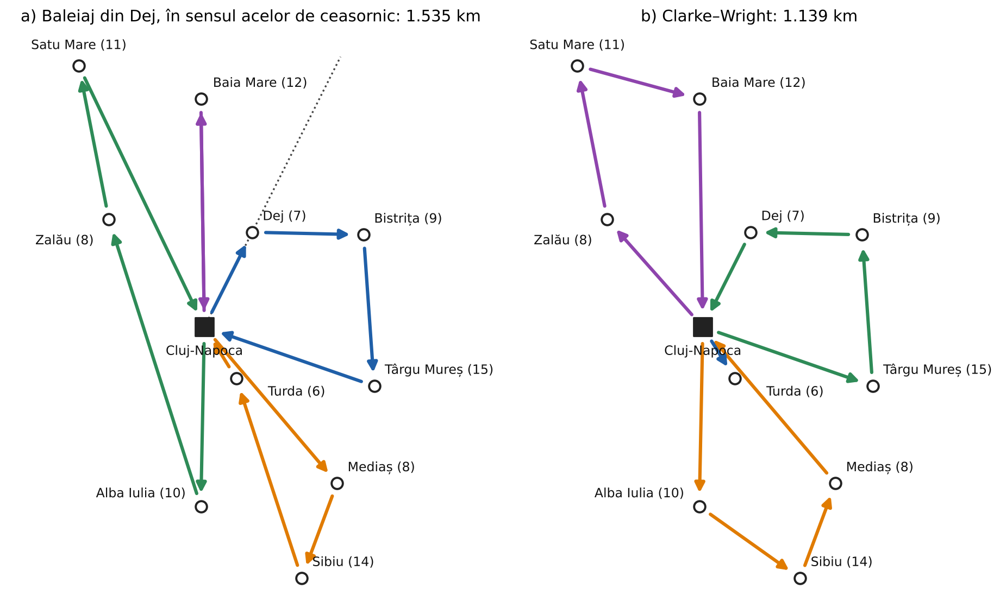

::: {.callout-note appearance="minimal"}
Această pagină însoțește Capitolul 13 al cărții: rezumă întrebările, termenii și aplicațiile, dar nu înlocuiește textul. Textul integral, soluțiile și bibliografia se găsesc în [carte](../carte.qmd).
:::

## Întrebarea capitolului

În Partea III am rezolvat problemele de rețea cu Solver. Metoda este eficientă pentru zeci de variabile, dar un dispecer care planifică zilnic livrările pentru zeci de magazine are nevoie de altceva: reguli rapide, pas cu pas, care dau o soluție bună în câteva secunde. **Cum construim traseele unei zile de livrări fără un program de optimizare și cât de departe suntem de cea mai bună soluție?**

Înainte de a parcurge capitolul, încercați să răspundeți la trei întrebări:

1. Vreți distanțele minime de la Cluj spre toate cele 16 orașe ale rețelei. Rulați Solver de 16 ori?

    

Indiciu

    Un program liniar de drum minim dă un singur drum, între o origine și o destinație. Ce informație ați putea ține minte și actualiza pas cu pas pentru fiecare nod, astfel încât o singură parcurgere din Cluj să rezolve toate destinațiile deodată?
    

2. Zece magazine, 100 de paleți, camioane de 33 de paleți. Grupați magazinele după direcția în care se află față de Cluj. Ce poate merge prost?

    

Indiciu

    Priviți o hartă rutieră cu Clujul în centru. Două localități atinse una după alta de o rază care se rotește sunt legate întotdeauna și printr-un drum scurt?
    

3. Două reguli rapide dau, pentru aceeași zi de livrări, soluții diferite, iar una dintre ele coincide cu optimul. Ce puteți concluziona pentru săptămâna viitoare?

    

Indiciu

    Separați ce garantează *metoda* de ce s-a întâmplat pe *un singur set* de cereri și distanțe. Ce s-ar schimba dacă magazinele sau cererile ar fi altele?
    

### Pe scurt: algoritmi exacți și euristici

Un **algoritm** este o succesiune de pași, descriși precis, care transformă datele de intrare într-un rezultat. Un **algoritm exact** garantează soluția optimă; o **euristică** oferă rapid o soluție bună, fără această garanție. Euristicile pot fi **de construcție** (construiesc o soluție, de exemplu cel mai apropiat vecin) sau **de îmbunătățire** (pornesc de la o soluție existentă și o îmbunătățesc prin modificări locale, de exemplu mutările 2-opt). **Problema rutării vehiculelor** (*vehicle routing problem, VRP*) cere traseele de cost minim pentru mai multe vehicule cu capacitate limitată. Două euristici clasice o abordează: **metoda baleiajului**, care „întâi grupează, apoi ordonează”, și **algoritmul economiilor Clarke–Wright**, care unește, pe rând, traseele care economisesc cei mai mulți kilometri, dacă cele două puncte sunt în trasee diferite, la capetele lor, și cererea totală încape în camion. În literatura despre VRP, „client” înseamnă punctul de livrare; în studiul de caz Cargo Someș, acesta este magazinul destinatar.

{fig-alt="Stânga: depozitul și doi clienți serviți separat, cu două trasee dus-întors, de lungime 2·d0i + 2·d0j. Dreapta: aceiași doi clienți serviți în același traseu, de lungime d0i + dij + dj0"}

## Obiective și termeni-cheie

La finalul capitolului veți aplica pas cu pas algoritmii de bază pentru rețelele de transport, veți înțelege diferența dintre un algoritm exact și o euristică și veți compara soluțiile euristice cu optimul. Concret, veți putea:

- să enumerați proprietățile unui algoritm și să deosebiți algoritmii exacți de euristicile de construcție și de îmbunătățire;
- să explicați logica etichetelor din algoritmul lui Dijkstra și ce este arborele drumurilor minime;
- să rulați algoritmul lui Dijkstra, manual și în Excel, și să citiți drumul minim din predecesori;
- să îmbunătățiți un circuit cu mutări 2-opt și să verificați rezultatul prin enumerare;
- să descrieți VRP și abordarea „întâi grupăm, apoi ordonăm”;
- să explicați formula economiilor Clarke–Wright și regulile prin care se unesc două trasee;
- să construiți traseele unei zile de livrări cu metoda baleiajului și cu algoritmul Clarke–Wright, respectând capacitatea camioanelor;
- să alegeți traseele cu un model de programare liniară în numere întregi (MILP) în Solver și să evaluați cât de bune sunt euristicile.

| Termen | În engleză |
| --- | --- |
| algoritm / euristică | *algorithm / heuristic* |
| euristică de construcție / de îmbunătățire | *construction / improvement heuristic* |
| cel mai apropiat vecin | *nearest neighbour* |
| algoritmul lui Dijkstra, etichetă, predecesor | *Dijkstra’s algorithm, label, predecessor* |
| arborele drumurilor minime | *shortest path tree* |
| mutare 2-opt | *2-opt move* |
| problema rutării vehiculelor (VRP) | *vehicle routing problem* |
| întâi grupăm, apoi ordonăm | *cluster first, route second* |
| metoda baleiajului | *sweep heuristic* |
| algoritmul economiilor | *savings algorithm* |
| programare liniară mixtă în numere întregi (MILP) | *mixed-integer linear programming* |

## Studiul de caz: algoritmi pentru rețeaua Cargo Someș

Rețeaua din Capitolul 12 se extinde la 17 noduri, cu cinci orașe din nord-vest. Pasul 1 calculează cu Dijkstra drumurile minime din Cluj și matricea distanțelor 17 × 17. Pasul 2 construiește circuitul Nord-Vest cu Bistrița cu cel mai apropiat vecin, îl îmbunătățește prin mutări 2-opt și îl verifică prin enumerarea celor 60 de circuite. Pașii 3 și 4 planifică ziua de marți, cu 100 de paleți pentru zece magazine: baleiajul pornit spre Dej, în sensul acelor de ceasornic, dă 1.535 km, iar Clarke–Wright 1.139 km. Pasul 5 alege traseele exact, cu un model MILP din 167 de trasee candidate, și verifică cât de bune au fost euristicile.

Algoritmii de aici cer date detaliate: fiecare drum, fiecare distanță, cererea fiecărui magazin. La începutul unui proiect, aceste date nu există încă. [Capitolul 14](cap14.qmd) prezintă metodele de aproximare: estimări rapide și formule care dau lungimea traseelor doar din aria zonei și numărul de clienți.

{fig-alt="Două hărți schematice cu depozitul din Cluj și cele zece magazine: în stânga, cele patru trasee ale metodei baleiajului, unul trecând de la Alba Iulia la Zalău; cu raza de pornire spre Dej și 1.535 km în total; în dreapta, traseele algoritmului Clarke–Wright, 1.139 km. Pe ambele hărți, paleții fiecărui magazin sunt în paranteză"}

## Verificați-vă

În algoritmul Clarke–Wright s-a format deja traseul depozit – A – B – C – depozit, cu 24 de paleți, într-un camion de 33. Magazinul E, servit încă separat, cere 6 paleți. Distanțele față de depozit sunt: B 120 km, C 100 km, E 110 km; B–E are 40 km, iar C–E 70 km. Care dintre perechile B–E și C–E are economia mai mare și care se poate uni? (răspunsul se deschide la clic)

Economia este sij = d0i + d0j – dij. Pentru B–E: 120 + 110 – 40 = 190 km; pentru C–E: 100 + 110 – 70 = 140 km. Capacitatea nu este o problemă: 24 + 6 = 30 ≤ 33 de paleți. Totuși, B–E nu se poate uni, pentru că B este în interiorul traseului, nu la un capăt: E ar trebui inserat între două opriri, iar algoritmul unește doar capete de traseu. Se unește C–E, cu economia de 140 km, iar traseul devine depozit – A – B – C – E – depozit. În Excel, economiile se calculează din matricea distanțelor, cu fiecare distanță citită cu INDEX și MATCH.

## Registrul Excel

**MLTM_C13_algoritmi_VRP.xlsx**. Registrul folosește setări românești: argumentele se separă cu „;”, zecimalele cu „,”. Pentru Pasul 5 activați programul de completare Solver (Date → Solver; *Data → Solver*).

| Foaia | Ce conține |
| --- | --- |
| 0_Citiți-mă | Cum se folosește registrul |
| 1_Dijkstra | Algoritmul lui Dijkstra din Cluj și matricea distanțelor minime |
| 2_Tur_NV_BN | Circuitul Nord-Vest cu Bistrița: cel mai apropiat vecin și 2-opt |
| 3_VRP_date | Magazinele, cererile, coordonatele și distanțele |
| 4_Baleiaj | Metoda baleiajului pentru ziua de marți |
| 5_Clarke_Wright | Matricea economiilor și unirea traseelor |
| 6_MILP_tururi | Alegerea exactă a traseelor din 167 de trasee candidate (plus opțiunea de grupaj 3PL pentru Turda, din Exercițiul 5) |

*Registrul va putea fi descărcat din Pachetul Excel al cărții, publicat pe Zenodo.*

## Prezentare

*În pregătire.*

## Temă de laborator: traseele unei zile de livrări

Alegeți o zi reală de livrări cu 6–10 puncte, dintr-o activitate pe care o cunoașteți, sau inventați una plauzibilă pe harta județului.

1. Construiți matricea completă a distanțelor, între depozit și puncte și între toate perechile de puncte; notați sursa fiecărei distanțe.
2. Stabiliți cererea fiecărui punct și capacitatea vehiculului și calculați limita inferioară a numărului de vehicule.
3. Notați direcția (unghiul) fiecărui punct față de depozit și construiți traseele cu metoda baleiajului, pornind din două direcții diferite. Cât diferă rezultatele?
4. Construiți traseele cu Clarke–Wright și comparați kilometrii totali. Încercați o mutare 2-opt pe cel mai lung traseu.
5. Ce ar spune un șofer cu experiență despre traseele obținute? Ce constrângeri reale lipsesc din model?

## Exerciții suplimentare

Capitolul se încheie cu șase întrebări grilă, o întrebare deschisă și șase exerciții; răspunsurile sunt în carte, în secțiunea 5.4 și în Anexa B. Alte exerciții pentru Partea IV sunt în [Problemele recapitulative IV](pr4.qmd).

## Lecturi suplimentare

1. C. Caplice and E. Ponce, *MITx MicroMasters Program in SCM Key Concepts*, Version 20 Sep. 2026. Cambridge, MA, USA: MIT Center for Transportation & Logistics, 2026.
2. S. Chopra, P. Meindl, and D. V. Kalra, *Supply Chain Management: Strategy, Planning, and Operation*, 6th ed. Noida, India: Pearson India Education Services, 2016.
3. E. W. Dijkstra, “A note on two problems in connexion with graphs,” *Numerische Mathematik*, vol. 1, no. 1, pp. 269–271, 1959.
4. G. Clarke and J. W. Wright, “Scheduling of vehicles from a central depot to a number of delivery points,” *Operations Research*, vol. 12, no. 4, pp. 568–581, 1964.

Lista completă a surselor capitolului se găsește în Bibliografia cărții.
