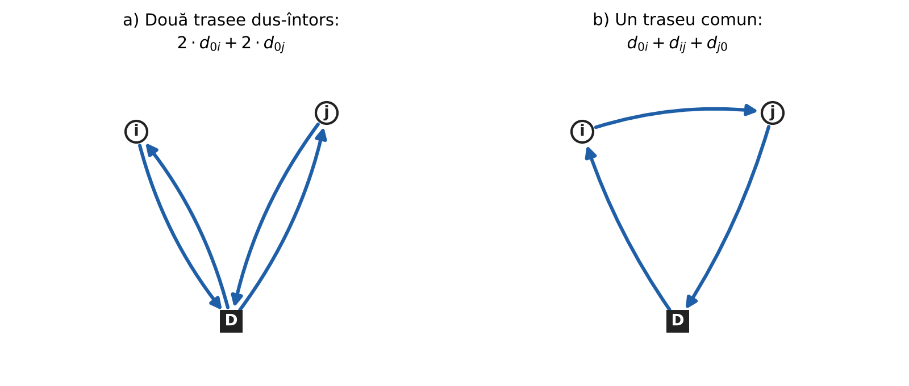

::: {.callout-note appearance="minimal"}
Această pagină însoțește Capitolul 13 al cărții: rezumă întrebările, termenii și aplicațiile, dar nu înlocuiește textul. Textul integral, soluțiile și bibliografia se găsesc în [carte](../carte.qmd).
:::

## Întrebarea capitolului

În Partea III am rezolvat problemele de rețea cu Solver. Metoda merge pentru zeci de variabile, dar un dispecer care planifică zilnic livrările pentru zeci de magazine are nevoie de altceva: reguli rapide, pas cu pas, care dau o soluție bună în câteva secunde. **Cum construim traseele unei zile de livrări fără un program de optimizare și cât de departe suntem de cea mai bună soluție?**

Înainte de a parcurge capitolul, încercați să răspundeți la trei întrebări:

1. Vreți distanțele minime de la Cluj spre toate cele 16 orașe ale rețelei. Rulați Solver de 16 ori?

    

Indiciu

    Algoritmul lui Dijkstra dă, într-o singură rulare, drumurile minime de la o origine spre toate celelalte noduri: *arborele drumurilor minime*.
    

2. Zece magazine, 100 de paleți, camioane de 33 de paleți. Grupați magazinele după direcția în care se află față de Cluj. Ce poate merge prost?

    

Indiciu

    Metoda baleiajului vede unghiuri, nu drumuri. Între două magazine apropiate ca unghi pot sta Munții Apuseni.
    

3. O euristică a dat aceeași soluție ca optimul. Putem renunța de acum la verificare?

    

Indiciu

    O euristică nu garantează optimul. Faptul că a nimerit o dată nu spune nimic despre ziua de mâine, cu alte magazine și alte cereri.
    

### Pe scurt: algoritmi exacți și euristici

Un **algoritm** este o succesiune de pași, descriși precis, care transformă datele de intrare într-un rezultat. Un **algoritm exact** garantează soluția optimă; o **euristică** dă repede o soluție bună, fără această garanție. Euristicile pot fi **de construcție** (construiesc o soluție, de exemplu cel mai apropiat vecin) sau **de îmbunătățire** (pornesc de la o soluție și o fac mai bună, de exemplu mutările 2-opt). **Problema rutării vehiculelor** (*vehicle routing problem, VRP*) cere traseele de cost minim pentru mai multe vehicule cu capacitate limitată. Două euristici clasice o rezolvă: **metoda baleiajului**, care „întâi grupează, apoi ordonează”, și **algoritmul economiilor Clarke–Wright**, care unește, pe rând, traseele care economisesc cei mai mulți kilometri.

{fig-alt="Stânga: depozitul și doi clienți serviți separat, cu două trasee dus-întors. Dreapta: aceiași doi clienți serviți în același traseu, cu economia de distanță marcată"}

## Obiective și termeni-cheie

La finalul capitolului veți aplica pas cu pas algoritmii de bază pentru rețelele de transport, veți înțelege diferența dintre un algoritm exact și o euristică și veți compara soluțiile euristice cu optimul. Concret, veți putea:

- să enumerați proprietățile unui algoritm și să deosebiți algoritmii exacți de euristicile de construcție și de îmbunătățire;
- să rulați algoritmul lui Dijkstra, manual și în Excel, și să citiți drumul minim din predecesori;
- să îmbunătățiți un circuit cu mutări 2-opt și să verificați rezultatul prin enumerare;
- să descrieți VRP și abordarea „întâi grupăm, apoi ordonăm”;
- să construiți traseele unei zile de livrări cu metoda baleiajului și cu algoritmul Clarke–Wright, respectând capacitatea camioanelor;
- să alegeți traseele cu un model MILP în Solver și să evaluați cât de bune sunt euristicile.

| Termen | În engleză |
| --- | --- |
| algoritm / euristică | *algorithm / heuristic* |
| algoritmul lui Dijkstra, etichetă, predecesor | *Dijkstra’s algorithm, label, predecessor* |
| arborele drumurilor minime | *shortest path tree* |
| mutare 2-opt | *2-opt move* |
| problema rutării vehiculelor (VRP) | *vehicle routing problem* |
| întâi grupăm, apoi ordonăm | *cluster first, route second* |
| metoda baleiajului | *sweep heuristic* |
| algoritmul economiilor | *savings algorithm* |

## Studiul de caz: algoritmi pentru rețeaua Cargo Someș

Rețeaua din Capitolul 12 se extinde la 17 noduri, cu cinci orașe din nord-vest. Pasul 1 calculează cu Dijkstra drumurile minime din Cluj și matricea distanțelor 17 × 17. Pasul 2 îmbunătățește circuitul Nord-Vest cu Bistrița prin mutări 2-opt. Pașii 3 și 4 planifică ziua de marți, cu 100 de paleți pentru zece magazine: baleiajul dă 1.535 km, Clarke–Wright 1.139 km. Pasul 5 alege traseele exact, cu un model MILP din 167 de trasee candidate, și verifică cât de bune au fost euristicile.

{fig-alt="Două hărți schematice cu depozitul din Cluj și cele zece magazine: în stânga, cele patru trasee ale metodei baleiajului, unul trecând de la Alba Iulia la Zalău; în dreapta, traseele algoritmului Clarke–Wright, cu paleții fiecărui magazin în paranteză"}

## Verificați-vă

Sibiu este la 175 km de Cluj, Mediaș la 150 km, iar Sibiu–Mediaș are 55 km. Care este economia Clarke–Wright a perechii? (răspunsul se deschide la clic)

s = d(Cluj; Sibiu) + d(Cluj; Mediaș) – d(Sibiu; Mediaș) = 175 + 150 – 55 = 270 km. Serviți separat, cele două magazine cer 2 · 175 + 2 · 150 = 650 km; în același traseu, 175 + 55 + 150 = 380 km. Este cea mai mare economie din ziua de marți, deci perechea se unește prima, dacă cei 14 + 8 = 22 de paleți încap în camion. În Excel, pentru o matrice de distanțe: `=d0i+d0j-dij`, cu fiecare d citit cu INDEX și MATCH.

## Registrul Excel

**MLTM_C13_algoritmi_VRP.xlsx**. Registrul folosește setări românești: argumentele se separă cu „;”, zecimalele cu „,”. Pentru Pasul 5 activați programul de completare Solver.

| Foaia | Ce conține |
| --- | --- |
| 0_Citiți-mă | Cum se folosește registrul |
| 1_Dijkstra | Algoritmul lui Dijkstra din Cluj și matricea distanțelor minime |
| 2_Tur_NV_BN | Circuitul Nord-Vest cu Bistrița: cel mai apropiat vecin și 2-opt |
| 3_VRP_date | Magazinele, cererile, coordonatele și distanțele |
| 4_Baleiaj | Metoda baleiajului pentru ziua de marți |
| 5_Clarke_Wright | Matricea economiilor și unirea traseelor |
| 6_MILP_tururi | Alegerea exactă a traseelor din 167 de candidați |

*Registrul va putea fi descărcat din Pachetul Excel al cărții, publicat pe Zenodo.*

## Prezentare

*În pregătire.*

## Temă de laborator: traseele unei zile de livrări

Alegeți o zi reală de livrări cu 6–10 puncte, dintr-o activitate pe care o cunoașteți, sau inventați una plauzibilă pe harta județului.

1. Construiți matricea distanțelor dintre depozit și puncte; notați sursa fiecărei distanțe.
2. Stabiliți capacitatea vehiculului și limita inferioară a numărului de vehicule.
3. Construiți traseele cu metoda baleiajului, pornind din două direcții diferite. Cât diferă rezultatele?
4. Construiți traseele cu Clarke–Wright și comparați kilometrii totali.
5. Ce ar spune un șofer cu experiență despre traseele obținute? Ce constrângeri reale lipsesc din model?

## Exerciții suplimentare

Capitolul se încheie cu șase întrebări grilă, o întrebare deschisă și șase exerciții; răspunsurile sunt în carte, în secțiunea 5.4 și în Anexa B. Alte exerciții pentru Partea IV sunt în [Problemele recapitulative IV](pr4.qmd).

## Lecturi suplimentare

1. C. Caplice and E. Ponce, *MITx MicroMasters Program in SCM Key Concepts*, Version 20 Sep. 2026. Cambridge, MA, USA: MIT Center for Transportation & Logistics, 2026.
2. S. Chopra, P. Meindl, and D. V. Kalra, *Supply Chain Management: Strategy, Planning, and Operation*, 6th ed. Noida, India: Pearson India Education Services, 2016.

Lista completă a surselor capitolului se găsește în Bibliografia cărții.
