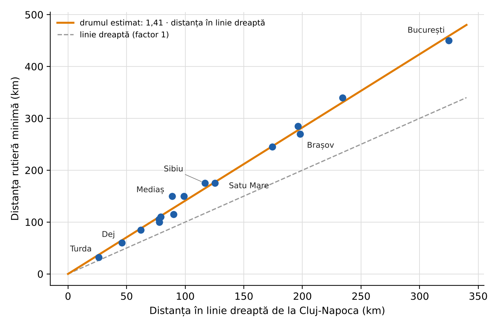
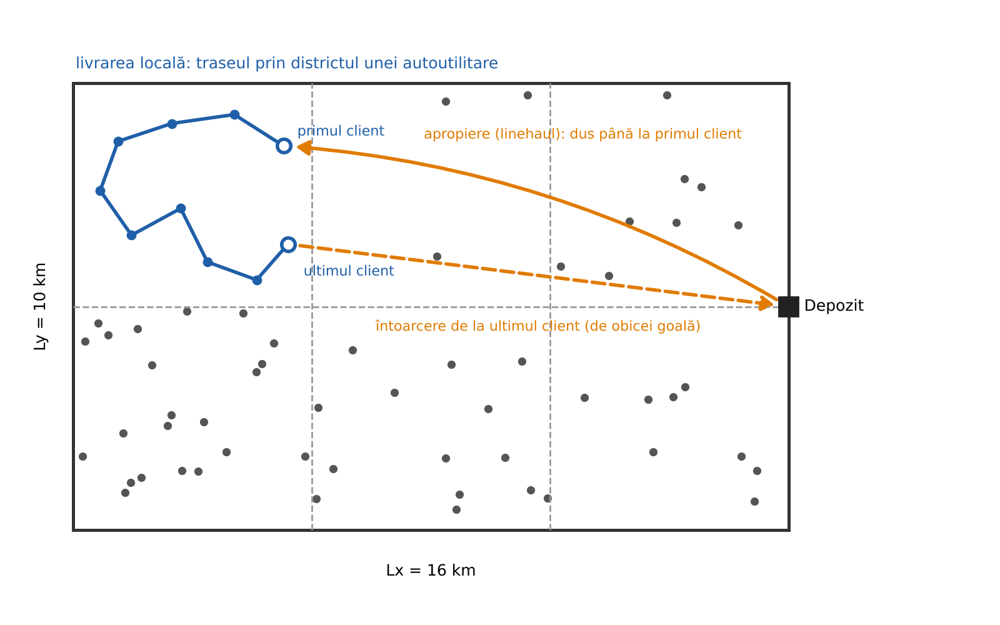

::: {.callout-note appearance="minimal"}
Această pagină însoțește Capitolul 14 al cărții: rezumă întrebările, termenii și aplicațiile, dar nu înlocuiește textul. Textul integral, soluțiile și bibliografia se găsesc în [carte](../carte.qmd).
:::

## Întrebarea capitolului

Algoritmii din Capitolul 13 au nevoie de date complete: fiecare drum, fiecare client, fiecare cerere. La începutul unui proiect, aceste date lipsesc. Un magazin online din Cluj-Napoca îi propune firmei Cargo Someș un contract pe trei ani pentru livrarea comenzilor la domiciliu, la 20 de lei pe comandă. **Putem spune, fără date detaliate, dacă oferta merită analizată mai departe?**

Înainte de a parcurge capitolul, încercați să răspundeți la trei întrebări:

1. Câte comenzi pe zi ar putea avea un magazin online de alimente într-un oraș de 290.000 de locuitori?

    

Indiciu

    În loc să ghiciți direct un număr, porniți de la o mărime cunoscută (populația orașului) și ajungeți la comenzile zilnice ale magazinului printr-un lanț de 3–4 rapoarte plauzibile. Ce se întâmplă cu rezultatul dacă unele ipoteze sunt puțin prea mari, iar altele puțin prea mici?
    

2. Oradea este la 131 km de Cluj în linie dreaptă. Ce lungime are drumul rutier?

    

Indiciu

    Luați 2–3 orașe din jurul Clujului ale căror distanțe rutiere le știți și comparați-le cu distanța în linie dreaptă, pe hartă. Cu cât la sută sunt mai lungi drumurile? Este procentul același pentru toate?
    

3. Numărul punctelor de livrare dintr-o zonă se dublează. Se dublează și kilometrii parcurși pentru livrarea locală?

    

Indiciu

    Imaginați-vă un cartier în care apar de două ori mai multe adrese de livrare. Ce se întâmplă cu distanța medie dintre două opriri vecine? Și cu numărul de opriri?
    

### Pe scurt: de ce aproximăm?

O **aproximare** este o valoare apropiată, dar nu exactă; o **estimare** este un calcul aproximativ al unei mărimi. Aproximările sunt rapide, cer puține date și spun dacă merită să mergem mai departe. Principiul **„nici prea mult, nici prea puțin”** (*Goldilocks*) spune când: dacă estimarea arată un proiect clar favorabil sau clar nefavorabil, decizia se poate lua; dacă rezultatul este la limită, merită să investim timp în date și într-un model mai exact. Capitolul folosește trei instrumente: **estimarea Fermi**, cu scenarii pesimist, probabil și optimist; **factorul de circuitate** *k*CF, care aproximează, în medie pe o rețea, distanța rutieră plecând de la distanța în linie dreaptă (pe o singură pereche de orașe poate greși mult); și **formula lungimii unui circuit**, *k*CF · *k*TSP · √(*n* · *A*), pentru *n* opriri într-o zonă de arie *A*, unde *k*TSP depinde de forma zonei și de metoda de rutare. Formula se aplică unei zone relativ compacte, cu punctele de livrare răspândite relativ uniform și multe opriri pe traseu. În modelul „de la un depozit la mulți clienți”, „client” înseamnă punctul de livrare (o gospodărie); clientul comercial al firmei Cargo Someș este magazinul online.

{fig-alt="Diagramă de dispersie cu distanța în linie dreaptă pe axa orizontală și distanța rutieră minimă pe axa verticală pentru cele 16 orașe, cu dreapta drumului estimat (1,41 · distanța în linie dreaptă) și, întreruptă, linia dreaptă de referință (factor 1)"}

## Obiective și termeni-cheie

La finalul capitolului veți face o estimare rapidă, cu date puține, pentru o problemă de transport și veți decide dacă problema merită o analiză detaliată. Concret, veți putea:

- să explicați când și de ce se folosesc aproximările și principiul Goldilocks;
- să descrieți cei trei pași ai unei estimări Fermi, să explicați de ce erorile componentelor se compensează parțial și să o construiți în Excel, cu trei scenarii;
- să calculați în Excel distanța în linie dreaptă dintre două orașe și să estimați factorul de circuitate al unei rețele;
- să explicați formula de aproximare a lungimii unui circuit, k · √(n · A);
- să descrieți componentele costului unei distribuții „de la un depozit la mulți clienți”: opririle, apropierea și circuitul local;
- să estimați costul zilnic și costul pe comandă al unei distribuții urbane cu autoutilitare;
- să analizați sensibilitatea estimării și să recomandați dacă un proiect merită continuat.

| Termen | În engleză |
| --- | --- |
| aproximare / estimare | *approximation / estimation* |
| estimare rapidă „pe dosul unui plic” | *back-of-the-envelope estimate* |
| estimare Fermi | *Fermi estimation* |
| principiul „nici prea mult, nici prea puțin” | *Goldilocks principle* |
| factor de circuitate | *circuity factor* |
| distanța euclidiană / Manhattan | *Euclidean / Manhattan distance* |
| zonă de servire | *service region* |
| distanța de apropiere | *linehaul distance* |
| economia de densitate | *density economy* |
| analiza de sensibilitate | *sensitivity analysis* |

## Studiul de caz: estimări rapide pentru Cargo Someș

Cei cinci pași răspund la oferta magazinului online. Pasul 1 estimează comenzile zilnice după extindere, în trei scenarii. Pasul 2 calculează factorul de circuitate al rețelei Cargo Someș (cele 16 orașe din Capitolul 13): un drum este, în medie, cu circa 40% mai lung decât linia dreaptă. Pasul 3 verifică o estimare rapidă pe ziua de marți din Capitolul 13. Pasul 4 estimează costul pe comandă al distribuției în Cluj-Napoca, cu o flotă nouă de autoutilitare de 40 de lăzi, distinctă de cele 5 camioane de 40 t ale firmei, iar Pasul 5 arată de ce ipoteze depinde concluzia.

{fig-alt="Zona de livrare de 16 pe 10 km, împărțită în districte, cu depozitul la mijlocul marginii de est, clienții răspândiți în zonă și traseul unei autoutilitare prin districtul ei: apropierea până la primul client, livrarea locală și întoarcerea la depozit"}

Rezultatul Pasului 4: circa 19,20 lei pe comandă, foarte aproape de tariful de 20 de lei. Oferta nu este nici evident profitabilă, nici evident neprofitabilă, deci merită o analiză detaliată, începând cu datele care contează cel mai mult: volumul, timpul la oprire și circuitatea.

Estimările de aici folosesc valori medii. În realitate, numărul comenzilor variază de la o zi la alta, iar o zi aglomerată nu se compensează cu una liniștită. [Capitolul 15](cap15.qmd), ultimul al cărții, folosește simularea Monte Carlo pentru decizii în care contează întreaga distribuție, nu doar media.

## Verificați-vă

O firmă de curierat livrează 80 de colete pe zi într-o zonă de 50 km², cu *k*CF = 1,25 și *k*TSP = 0,8. Își dublează livrările, la 160 de colete pe zi, preluând un cartier vecin de aceeași suprafață, deci zona devine de 100 km². Scade distanța locală pe colet? (răspunsul se deschide la clic)

Înainte: 1,25 · 0,8 · √(80 · 50) = 1,0 · √4.000 ≈ 63,2 km pe zi, adică 0,79 km pe colet. După: 1,0 · √(160 · 100) = √16.000 ≈ 126,5 km, tot 0,79 km pe colet. Distanța pe colet nu scade, pentru că densitatea *n*/*A* a rămas aceeași, 1,6 opriri pe km². Mai mult volum aduce economie doar dacă vine din aceeași zonă. În Excel: `=1,25*0,8*SQRT(160*100)/160`.

## Registrul Excel

**MLTM_C14_aproximari.xlsx**. Registrul folosește setări românești: argumentele se separă cu „;”, zecimalele cu „,”. Registrul nu folosește Solver: toate calculele sunt formule.

| Foaia | Ce conține |
| --- | --- |
| 0_Citiți-mă | Cum se folosește registrul |
| 1_Fermi | Estimarea Fermi a comenzilor zilnice, în trei scenarii |
| 2_Circuitate | Distanța în linie dreaptă, distanța rutieră și factorul de circuitate |
| 3_Verificare_C13 | Estimarea rapidă pentru ziua de marți din Capitolul 13 |
| 4_Cost_Cluj | Costul zilnic și costul pe comandă al distribuției urbane |
| 5_Sensibilitate | Costul pe comandă în mai multe scenarii |

*Registrul va putea fi descărcat din Pachetul Excel al cărții, publicat pe Zenodo.*

## Prezentare

*În pregătire.*

## Temă de laborator: o estimare pe dosul unui plic

Alegeți o întrebare de transport la care nu aveți încă date și care cere atât o estimare de volum, cât și una de distanțe sau cost: costul livrărilor unui serviciu nou, numărul de vehicule pentru o zonă, costul servirii unui client nou.

1. Descompuneți întrebarea în 4–6 componente și dați fiecăreia o valoare pesimistă, una probabilă și una optimistă.
2. Calculați rezultatul în cele trei scenarii. Cât de larg este intervalul?
3. Estimați distanțele cu un factor de circuitate calculat pentru zona aleasă din 5–10 perechi de puncte cunoscute.
4. Faceți analiza de sensibilitate: care ipoteză influențează cel mai mult rezultatul?
5. Aplicați principiul Goldilocks: decizia se poate lua acum sau merită o analiză detaliată? Ce date ați colecta întâi?

## Exerciții suplimentare

Capitolul se încheie cu șase întrebări grilă, o întrebare deschisă și cinci exerciții; răspunsurile sunt în carte, în secțiunea 5.4 și în Anexa B. Alte exerciții pentru Partea IV sunt în [Problemele recapitulative IV](pr4.qmd).

## Lecturi suplimentare

1. C. Caplice and E. Ponce, *MITx MicroMasters Program in SCM Key Concepts*, Version 20 Sep. 2026. Cambridge, MA, USA: MIT Center for Transportation & Logistics, 2026.

Lista completă a surselor capitolului se găsește în Bibliografia cărții.
