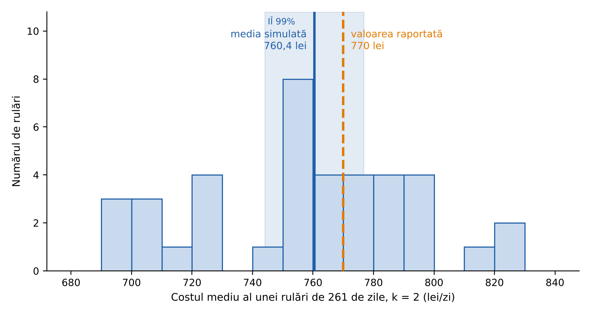

::: {.callout-note appearance="minimal"}
Această pagină însoțește Capitolul 15 al cărții: rezumă întrebările, termenii și aplicațiile, dar nu înlocuiește textul. Textul integral, soluțiile și bibliografia se găsesc în [carte](../carte.qmd).
:::

## Întrebarea capitolului

Optimizarea din Partea III presupune că datele sunt cunoscute, iar aproximările din Capitolul 14 lucrează cu valori medii. Multe decizii din logistică depind însă de întreaga distribuție. În Capitolul 4 am lăsat o întrebare deschisă: câte camioane să rezerve zilnic firma Cargo Someș la transportatorul terț (3PL), când numărul de curse variază de la o zi la alta? **Cum evaluăm o decizie când viitorul este incert, înainte de a o aplica?**

Înainte de a parcurge capitolul, încercați să răspundeți la trei întrebări:

1. Media curselor 3PL este 1,29 pe zi. Managerul propune să rezerve un singur camion. Ce lipsește din raționament?

    

Indiciu

    Media nu este o capacitate. În zilele cu 3–6 curse, cursele peste rezervare se comandă pe piața spot, cu un supliment mare. Costul depinde de toată distribuția, nu doar de medie.
    

2. Ați rulat simularea o dată, pe un an, și politica B iese mai ieftină cu 15 lei pe zi. Este mai bună?

    

Indiciu

    Rezultatul unei rulări este o variabilă aleatoare. Faceți mai multe rulări, construiți intervale de încredere (Capitolul 6) și comparați politicile cu *aceleași numere aleatoare*.
    

3. Cum știți că modelul de simulare reproduce realitatea, înainte de a-l folosi pentru o politică nouă?

    

Indiciu

    *Validarea*: comparați rezultatul simulat al politicii actuale cu ce s-a întâmplat de fapt, cu un test de ipoteză (Capitolul 7).
    

### Pe scurt: ce este simularea?

**Simularea** este un model **descriptiv**: nu recomandă o soluție, ci evaluează soluțiile pe care i le propunem, imitând funcționarea sistemului zi de zi. Orice simulare pornește de la numere aleatoare uniforme între 0 și 1 (RAND în Excel), din care **transformarea inversă** obține orice distribuție: normală (NORM.INV), uniformă sau empirică (INDEX și MATCH pe funcția de repartiție). Un studiu de simulare are cinci etape: formularea problemei, colectarea datelor și definirea modelului, construirea modelului, **validarea** și **rulările experimentale**. Fiecare **rulare** dă un alt rezultat, de aceea facem mai multe și tratăm mediile lor ca un eșantion. Politicile se compară cu aceleași numere aleatoare (*common random numbers*) și cu un **test pereche**.

{fig-alt="Costul mediu zilnic în fiecare dintre cele 40 de rulări ale politicii cu două camioane rezervate, media lor, banda intervalului de încredere de 99% și linia valorii raportate de contabilitate, aflată în interval"}

## Obiective și termeni-cheie

La finalul capitolului veți construi în Excel o simulare simplă a unei decizii logistice, o veți valida și veți compara statistic mai multe politici. Concret, veți putea:

- să deosebiți modelele prescriptive, predictive și descriptive și să explicați de ce simularea evaluează, nu recomandă;
- să descrieți cele cinci etape ale unui studiu de simulare și rolul validării;
- să generați în Excel variabile aleatoare cu RAND, NORM.INV, INDEX și MATCH, prin transformarea inversă;
- să construiți un model de simulare pe zile, cu una sau două variabile aleatoare, și să calculați indicatorii de performanță;
- să validați modelul cu un test de ipoteză și să comparați politicile cu intervale de încredere și cu un test pereche;
- să formulați o recomandare care ține cont de cost, de risc și de ipotezele modelului.

| Termen | În engleză |
| --- | --- |
| simulare, model descriptiv | *simulation, descriptive model* |
| număr pseudoaleator | *pseudo-random number* |
| transformarea inversă | *inverse transform method* |
| rulare | *run, replication* |
| validare | *validation* |
| aceleași numere aleatoare | *common random numbers* |
| test pereche | *paired t-test* |
| raport critic | *critical ratio* |

## Studiul de caz: câte camioane rezervăm zilnic la 3PL?

Fiecare camion rezervat costă 250 de lei pe zi, folosit sau nu; fiecare cursă peste rezervare se comandă pe piața spot, cu un supliment între 800 și 1.600 de lei. Cei șase pași parcurg etapele studiului: formularea problemei, distribuția empirică a curselor din 522 de zile, modelul în Excel pe 10.440 de zile simulate, validarea pe politica actuală (k = 2), compararea politicilor k = 0 … 4 și o verificare analitică. Ultimul pas schimbă o ipoteză: într-o piață tensionată, suplimentul spot crește tocmai în zilele aglomerate, iar simularea arată cum se schimbă recomandarea.

Rezultatul pentru manager: rezervarea unui singur camion, „pentru că media este 1,29”, ar costa circa 190 de lei pe zi în plus față de politica actuală.

## Verificați-vă

Un camion rezervat costă R = 250 de lei pe zi, iar suplimentul spot mediu este 1.200 de lei. Funcția de repartiție a curselor 3PL este F(1) = 0,634 și F(2) = 0,866. Câte camioane rezervați? (răspunsul se deschide la clic)

Un camion în plus merită cât timp P(X > k) · 1.200 > 250. Regula: alegeți cel mai mic k pentru care F(k) ≥ 1 – R / S̄ = 1 – 250 / 1.200 ≈ 0,792 (*raportul critic*). F(1) = 0,634 < 0,792, dar F(2) = 0,866 ≥ 0,792, deci k* = 2, la fel ca în simulare. În Excel: `=1-250/1200`, apoi, cu funcția de repartiție într-o coloană, primul k pentru care F(k) depășește pragul.

## Registrul Excel

**MLTM_C15_simulare.xlsx**. Registrul folosește setări românești: argumentele se separă cu „;”, zecimalele cu „,”. Numerele aleatoare sunt fixate în registru, ca cifrele din carte să poată fi verificate; pentru numere noi, folosiți RAND și tasta F9 pe o copie.

| Foaia | Ce conține |
| --- | --- |
| 0_Citiți-mă | Cum se folosește registrul |
| 1_Date | Distribuția empirică a curselor 3PL pe 522 de zile |
| 2_Generare | Transformarea inversă pe primele 10 zile |
| 3_Simulare | Modelul pe 10.440 de zile simulate |
| 4_Rulari | Cele 40 de rulări pentru fiecare politică |
| 5_Validare | Validarea generatorului și a politicii actuale |
| 6_Politici | Compararea politicilor și scenariul „piață tensionată” |
| Ex_Livrari_Cluj, Sol_Ex3 | Date pentru exerciții și soluția Exercițiului 3 |

*Registrul va putea fi descărcat din Pachetul Excel al cărții, publicat pe Zenodo.*

## Prezentare

*În pregătire.*

## Temă de laborator: simularea unei decizii de capacitate

Alegeți o decizie de capacitate dintr-o activitate pe care o cunoașteți: câte camioane rezervați, câți operatori puneți pe tură, câte locuri de parcare păstrați la rampă.

1. Formulați problema: variabilele aleatoare, politicile de comparat și indicatorii de performanță.
2. Construiți distribuția empirică a cererii din cel puțin 60 de observații și generați cererea cu transformarea inversă.
3. Simulați cel puțin 20 de rulări pentru fiecare politică, cu aceleași numere aleatoare.
4. Validați modelul: rezultatul simulat al politicii actuale se potrivește cu realitatea?
5. Comparați politicile cu intervale de încredere și cu un test pereche și scrieți recomandarea, cu ipotezele de care depinde.

## Exerciții suplimentare

Capitolul se încheie cu șase întrebări grilă, o întrebare deschisă și șase exerciții; răspunsurile sunt în carte, în secțiunea 5.4 și în Anexa B. Problemele recapitulative IV reiau împreună algoritmii, aproximările și simularea: [Problemele recapitulative IV](pr4.qmd).

## Lecturi suplimentare

1. C. Caplice and E. Ponce, *MITx MicroMasters Program in SCM Key Concepts*, Version 20 Sep. 2026. Cambridge, MA, USA: MIT Center for Transportation & Logistics, 2026.
2. S. Chopra, P. Meindl, and D. V. Kalra, *Supply Chain Management: Strategy, Planning, and Operation*, 6th ed. Noida, India: Pearson India Education Services, 2016.

Lista completă a surselor capitolului se găsește în Bibliografia cărții.
